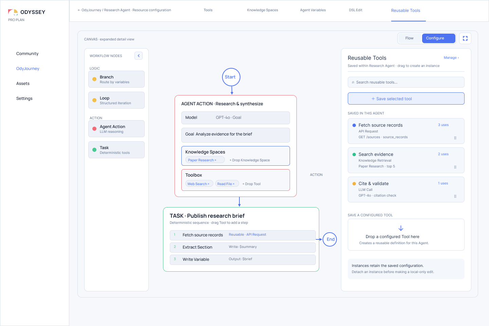
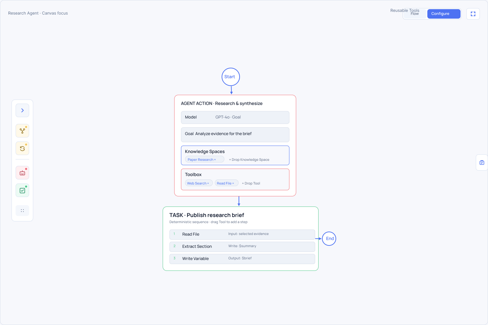
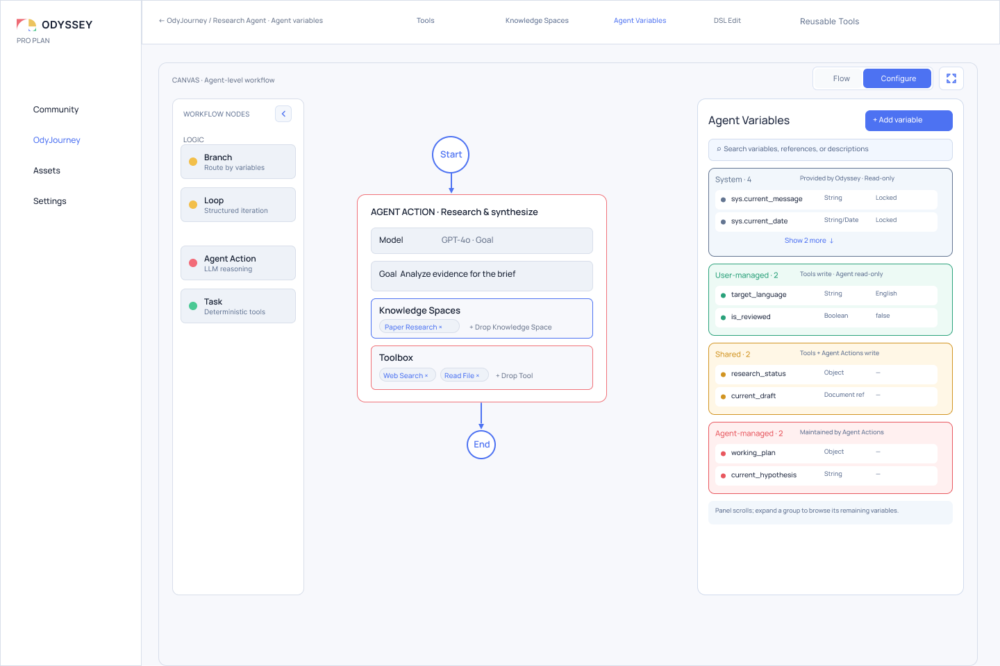
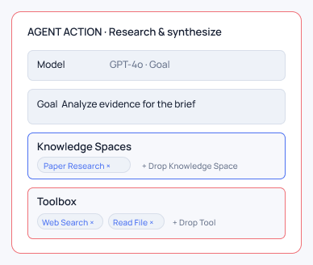
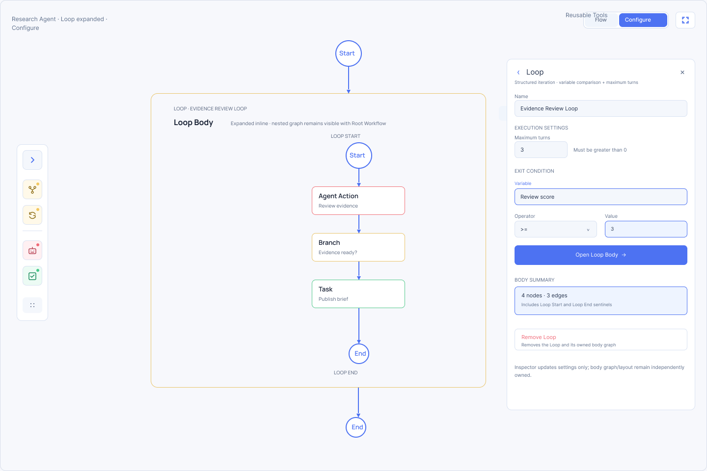
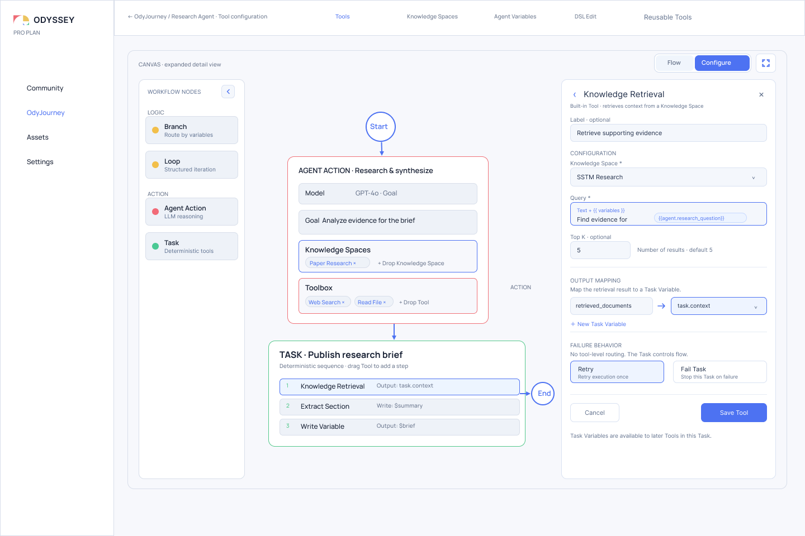

# 有边界的自主性：为什么 Odyssey 不把所有决定都交给 Agent

> 人定义结构、状态与资源边界；Agent 在明确的位置内承担开放式判断。

设计 AI Agent 系统时，我们很容易被推向两个极端。

一个极端是传统 Workflow：每一步、每个条件和每次 Tool 调用都由设计者预先确定。系统容易检查，却很难应对无法提前枚举的情况。

另一个极端是全自主 Agent：给出一个 Goal 和一组 Tool，让模型自行规划、行动和判断何时完成。系统更灵活，但关键决定也更容易被藏进一个笼统的“Agent 会处理”之中。

Odyssey 不把两者看成只能二选一的产品形态。

它试图回答的是：**哪些决定应该由人预先确定，哪些决定值得交给 Agent，二者又如何通过显式结构和状态连接起来？**

Odyssey 将这个问题称为 Thinking Ownership，并把由此形成的设计原则称为**有边界的自主性（Bounded Autonomy）**。

## 自主性不是一个全局开关

一个系统被称为“Agentic”，并不意味着其中所有决定都应该由 Agent 作出。

即使在同一个 Agent Workflow 中，也可能同时存在几种完全不同的责任：某些 Tool 必须按固定顺序执行；某个路由必须服从可检查的条件；一段工作需要反复迭代，但迭代边界必须清楚；只有面对无法提前枚举的信息时，才需要 Agent 进行开放式判断。

如果只提供一个从 `Deterministic` 到 `Autonomous` 的全局滑块，这些差异会被压缩成一个模糊的强度选择。用户很难回答：究竟是哪一步更自主？Agent 可以修改哪些状态？哪些 Tool 可以自由选择？哪些控制边界不能越过？

Odyssey 因此把自主性分配到具体对象上，而不是赋予整个 Workflow 一个笼统标签。



*图 1：Configure 状态将 Workflow 节点、Agent Action、Task 与 Reusable Tools 放在同一设计表面中。Branch、Loop、Agent Action 与 Task 不是四种外观，而是四种不同的决策责任；Tool 则作为可配置能力进入这些责任边界。Figma 节点 `194:33`，导出于 2026-10-08。*

## 颜色回答“谁负责决定”

Odyssey 使用三种颜色贯穿 Workflow 节点、Variable 分组和资源边界：

- 绿色表示 **User-managed**：决定由用户预先配置；
- 黄色表示 **Shared**：用户定义可检查的结构，实际路径或状态变化还会结合运行状态；
- 红色或粉色表示 **Agent-managed**：Agent 在明确边界内承担开放式判断。

Odyssey 自身提供并维护的 System 状态使用中性灰。它不属于三类可分配的 Thinking Ownership。

颜色不表示执行顺序，也不是简单的节点类型分类。绿色节点不一定最先执行，红色节点也不意味着权限最高。颜色的作用是让读者在 Canvas、Variable 和 Tool 配置之间移动时，仍然能够追踪：**这个决定主要由谁维护？**



*图 2a：Focus Mode 延续同一套 Thinking Ownership 颜色。红色或粉色的 Agent Action 承担开放式判断，绿色 Task 表达预先配置的确定性步骤，黄色 Branch / Loop 表达显式控制边界。Figma 节点 `166:2`，导出于 2026-10-07。*



*图 2b：相同的颜色语义进入 Agent Variables。System 使用中性灰；User-managed、Shared 与 Agent-managed 延续绿色、黄色和红/粉色，把“谁负责决定”进一步落实为状态分组。Figma 节点 `119:2`，导出于 2026-10-07。*

节点与 Variable 使用同一套颜色，并不表示二者是同一种对象。它们共享的是责任语言：节点说明行动或控制决定位于哪里，Variable 则说明状态可以由谁维护。

## 四类节点不是功能菜单，而是责任边界

Odyssey 刻意限制 Agent Workflow 的核心节点种类：

```text
Action
├── Agent Action
└── Task

Logic
├── Branch
└── Loop
```

这套分类首先关心的不是“这个节点能接入哪种 API”，而是它承担什么决定。

### Task：用户拥有步骤与顺序

Task 表达确定性执行。用户选择需要使用的 Tool，配置参数，并预先排列步骤顺序。

```text
Task
├── Read File
├── Extract Section
└── Write Variable
```

运行时可以自动执行这些步骤，但自动执行并不等于 Agent 拥有决定。Tool 的选择、顺序和绑定已经由用户设计，因此这里的 Thinking Ownership 属于 User-managed。

Task 适合那些必须可预测、可复查或严格复现的操作。它不会在运行时临时增加 Tool，也不会自行改变步骤顺序。如果工作需要开放式规划，把它伪装成一个越来越复杂的 Task，只会把不确定性藏进配置细节。

### Agent Action：Agent 拥有路径，但不拥有世界

Agent Action 处理无法提前完整枚举的工作。用户为它给出 Goal，并直接在节点上定义两个彼此互补的资源空间：把 Knowledge Spaces 拖入 Agent Action，就是在定义它的**认知空间**——Agent 理解问题时可以依赖哪些信息与语义环境；把 Tool 拖入 Toolbox，就是在定义它的**行动空间**——Agent 可以使用哪些能力作用于问题和外部世界。可访问的 Variable 则进一步构成状态边界。

在这些边界内，Agent 决定如何推进 Goal、参考哪些知识、何时使用可用 Tool，以及如何更新被允许写入的 Variable。

这并不意味着 Agent 获得无限权限。

Agent 可以在所提供的 Knowledge Spaces 中理解和推理，也可以从 Toolbox 中选择 Tool，但不能越出这些认知空间与行动空间；可以更新 Shared 或 Agent-managed Variable，但不能直接改写 User-managed 或 System 状态；可以在节点内部进行开放式判断，但 Workflow 的 Branch、Loop 与出口仍然由显式结构约束。

因此，Agent Action 的自主性不是“想做什么就做什么”，而是：**在用户定义的认知、行动、状态和控制边界内选择行动路径。**

Agent Action 也不是一个完整 Agent。Agent 是 OdyJourney 中占据 Agent Slot、拥有完整 Agent Workflow 的协作单元；Agent Action 只是这个 Workflow 中的一步。区分二者，才能避免把系统层的 Agent 关系与节点层的模型行动混成同一个概念。



*图 3：Agent Action 的当前节点设计。Model 提供推理载体，Goal 说明需要达成什么，Knowledge Spaces 提供可引用的信息与思考环境，Toolbox 则限定可以采取的行动。素材裁自 Figma `Agent Workflow Canvas — Create Variable`（`132:2`），导出并裁切于 2026-10-08。*

这四个部分形成了一组很紧凑的概念关系：

| 配置 | 回答的问题 | 边界作用 |
| --- | --- | --- |
| **Model** | 由什么推理能力承担这次行动？ | 选择推理载体，但不替代 Goal 与权限 |
| **Goal** | 需要完成什么？ | 定义目的，而不是预先编写完整步骤 |
| **Knowledge Spaces** | 可以在哪些信息与语义环境中理解问题？ | 提供可引用的上下文，不等于复制或拥有知识资产 |
| **Toolbox** | 可以用什么方式作用于外部世界？ | 限定可选择的行动能力 |

Goal 给 Agent 一个方向，Knowledge Space 提供理解问题的信息环境，Toolbox 提供采取行动的能力。Agent 的开放式判断发生在三者交叉形成的空间中，而 Model 是承载这次判断的推理配置。

这套概念在结构上很漂亮，因为它没有把 Agent Action 缩减成一个 Prompt 输入框；但它是否真的容易配置、不同用户能否稳定理解四者的边界，仍然需要通过实际使用来验证。

### Branch：把路由判断留在可检查的结构里

Branch 根据显式条件，从多个后续路径中选择一条。

用户定义 Case、条件和 Default 出口；运行时状态决定哪一个 Case 匹配。它因此处在 User-managed 结构与运行状态相遇的位置，但不会像 Agent Action 那样自行发明目标或规划一条新路径。

Branch 的 Route 直接显示在 Canvas 上，而不是藏在属性面板的 `routeTo` 字段里。这让读者能够检查：有哪些可能路径、每条路径由什么条件触发、没有条件命中时会去哪里。

黄色在这里不是“让 LLM 随意决定”的颜色，而是在提醒读者：控制结构由用户设计，实际选择依赖运行时状态。

### Loop：允许迭代，但不允许图失去边界

Loop 把迭代封装成一个有边界的复合节点。它拥有内部子 Workflow、退出条件和最大轮次，而不是让用户在主图上任意画回边。

当前设计允许 Loop 内部包含 Agent Action、Task 与 Branch；禁止嵌套 Loop，并要求 Loop 内部的子 Workflow 保持无环。重复来自 Loop 本身，而不是来自任意图循环。



*图 4：Loop 展开后显示内部子 Workflow 与配置区域。开放式 Agent Action 可以参与一轮迭代，但 Loop 仍通过显式边界组织重复，而不是把整个 Canvas 变成任意有环图。Figma 节点 `477:157`，导出于 2026-10-07。*

这种设计允许“过程本身需要反复”成为一等结构，同时保留可检查性：哪里进入循环、什么构成一轮、何时退出、最多执行多少轮，都应在 Loop 边界中表达。

Loop 与 OdyJourney 层的 Circular Loop 不是同一个对象。Circular Loop 描述多个 Agent Slot 之间的协作拓扑；Loop 描述一个 Agent Workflow 内部的结构化迭代。它们可能都呈现循环，但处于不同设计尺度。

## Tool 是能力，不是第五种决策节点

许多 Workflow Builder 会把 Search、Database、Code、Retrieval 或 Write Variable 都铺成独立节点。这样做很直观，却容易把“能够做什么”和“谁决定何时去做”混成同一个问题。

Odyssey 将 Tool 视为能力资源。Tool 本身描述一种可配置能力；承载它的上下文决定 Thinking Ownership：

| Tool 所在位置 | 谁决定使用 | 顺序如何形成 |
| --- | --- | --- |
| Agent Action 的 Toolbox | Agent 在 Goal 与权限边界内选择 | Agent 根据当前情况决定 |
| Task 的 Tool steps | 用户预先选择 | 用户显式排列，按固定顺序执行 |

同一个 `Write Variable` Tool，放入 Task 时可以是一条确定步骤；提供给 Agent Action 时，则表示 Agent 可以在允许的时机调用它。Tool 的能力没有因此改变，改变的是谁拥有使用决定。



*图 5：Tool Configuration 负责配置能力、输入、输出和绑定，而不是定义 Workflow 路由。Tool 可以被放入 Agent Action 的 Toolbox 或 Task 的确定性步骤中，其 Thinking Ownership 由使用上下文决定。Figma 节点 `177:33`，导出于 2026-10-07。*

这种分离让 Canvas 不必为每一种外部能力发明新的节点类型，也让 Tool 能在不同责任边界中复用。但它同时要求界面持续告诉用户：这个 Tool 当前由谁触发、可以读写什么，以及结果被绑定到哪里。

## Variable 把责任落实为权限

如果 Thinking Ownership 只停留在节点颜色，它仍然很容易成为视觉隐喻。Variable 把责任进一步落实为可检查的状态权限。

Odyssey 将 Agent Variable 分成四组：

| Variable 分组 | Tool 写入 | Agent Action 写入 | Thinking Ownership |
| --- | ---: | ---: | --- |
| **System** | 否 | 否 | Odyssey 提供并维护 |
| **User-managed** | 是 | 否 | 用户通过配置好的 Tool 维护 |
| **Shared** | 是 | 是 | 用户结构与 Agent 都可维护 |
| **Agent-managed** | 否 | 是 | Agent Action 维护 |

这里有两个容易误解的地方。

第一，Tool 在运行时自动写入 User-managed Variable，并不会让这次变化变成 Agent-owned。写入规则、目标 Variable 与调用位置都由用户预先配置，因此决定仍属于用户。

第二，Agent-managed 不表示 Agent 可以随意创建顶层状态。非 System Variable 的 Schema 仍由用户定义；Agent 只是在预先声明的状态空间中决定何时更新、写入什么值。这样既保留了 Agent 的工作状态，又不放弃验证与检查边界。

## 可见的是决策位置，不是完整内部推理

有边界的自主性让很多重要信息变得可见：

- 哪些步骤由用户预先确定；
- 哪些位置允许 Agent 进行开放式判断；
- 哪些路径和迭代边界必须显式配置；
- Agent 能够使用哪些 Tool；
- Tool 与 Agent Action 分别可以写入哪些 Variable。

这些结构可以被查看、讨论和修改，但它们不等于模型运行时完整的私有 Chain of Thought。

Agent Action 可以显示 Goal、资源范围、输入输出、状态变化和可记录的行动结果；它不承诺展示模型形成答案时的全部内部推理过程。Odyssey 追求的是系统设计的可检查性，而不是把“可见结构”夸大成“所有思考都可见”。

## 这个设计带来的不是更多控制，而是更明确的控制

Thinking Ownership 的价值不在于把每个决定都重新交还给用户。那只会退回传统 Workflow。

它也不在于给 Agent 更多 Tool 后宣称系统已经自主。Tool 数量并不能说明自主性的边界是否清楚。

真正的变化是，设计者可以逐项回答：

- 哪些操作必须稳定复现？
- 哪些判断无法提前枚举？
- 哪些状态可以由 Agent 修改？
- 哪些控制路径必须始终可检查？
- 哪些能力可以自由选择，哪些必须按固定顺序使用？
- 哪一种失败应该被限制在一个节点或一次 Loop 内？

这些问题把“Agent 到底有多自主”转化成一组具体的结构选择。自主性因此不再是产品宣传中的形容词，而成为可以被设计和审查的系统属性。

## 代价与仍未解决的问题

这套设计并不会自动让复杂系统变简单。

首先，Thinking Ownership 引入了一套需要学习的语言。用户必须理解为什么同一个 Tool 在 Task 与 Agent Action 中承担不同责任，以及为什么“自动执行”不等于“Agent 决定”。如果颜色、标签和配置反馈不一致，边界会迅速失去可信度。

其次，Agent Action 的边界需要足够具体。Goal 太宽、Toolbox 太大或 Variable 权限太松，都会让一个看似受控的红色节点重新变成黑盒。界面必须帮助设计者看到 Agent 实际获得了哪些能力，而不只是看到一个漂亮的节点卡片。

再次，Branch 与 Loop 的黄色语义需要持续验证。它们表达的是用户定义的控制结构与运行状态之间的结合，并不意味着每次路由都由 LLM 参与。如果 Shared 被理解成模糊的“人机共同决定”，反而会削弱精确性。

最后，未来的错误处理、重试、Human Input 与并行结构仍需回答自己的 Thinking Ownership。新增节点不能只扩展功能列表；它们必须说明谁定义规则、谁作出运行时决定，以及状态如何被记录。

## 本文术语

| 术语 | 本文中的含义 |
| --- | --- |
| **Bounded Autonomy** | 人定义结构、状态和资源边界，Agent 在明确位置内承担开放式判断的设计原则。 |
| **Thinking Ownership** | 用来说明一个决定主要由用户、Agent，还是二者通过显式结构共同维护的责任语言。 |
| **Agent** | OdyJourney 中占据 Agent Slot、拥有完整 Agent Workflow 的协作单元。 |
| **Agent Action** | Agent Workflow 中承担开放式 LLM 判断与动态资源使用的一类节点。 |
| **Task** | 按用户预先配置的顺序执行 Tool steps 的确定性节点。 |
| **Branch** | 根据显式条件选择一个后续路径的控制节点。 |
| **Loop** | 显式封装子 Workflow、迭代边界与退出条件的复合控制节点。 |
| **Tool** | Agent Action 或 Task 用来与外部能力、数据或确定性操作交互的可配置资源。 |

## 设计来源

- 当前 Workflow 结构：[Figma `Research Agent — Workflow Canvas`（`62:2`）](https://www.figma.com/design/P3EF9io2DhyhwkNYBVqB5Z/Odyssey-Design?node-id=62-2)；
- 当前 Variable 设计：[Figma `Agent Workflow Canvas — Agent Variables`（`119:2`）](https://www.figma.com/design/P3EF9io2DhyhwkNYBVqB5Z/Odyssey-Design?node-id=119-2)；
- 当前 Focus Mode：[Figma `Agent Workflow Canvas — Focus Mode`（`166:2`）](https://www.figma.com/design/P3EF9io2DhyhwkNYBVqB5Z/Odyssey-Design?node-id=166-2)；
- 当前 Reusable Tools：[Figma `Agent Workflow Canvas — Reusable Tools`（`194:33`）](https://www.figma.com/design/P3EF9io2DhyhwkNYBVqB5Z/Odyssey-Design?node-id=194-33)；
- 当前 Agent Action 节点：Figma `Agent Workflow Canvas — Create Variable`（`132:2`），裁切区域以 `132:56` 及其相邻字段为依据；
- 当前 Tool 配置：[Figma `Agent Workflow Canvas — Tool Configuration (Knowledge Retrieval)`（`177:33`）](https://www.figma.com/design/P3EF9io2DhyhwkNYBVqB5Z/Odyssey-Design?node-id=177-33)；
- 当前 Loop 展开设计：[Figma `Focus Mode / Loop Expanded Inline + Configuration`（`477:157`）](https://www.figma.com/design/P3EF9io2DhyhwkNYBVqB5Z/Odyssey-Design?node-id=477-157)；
- 节点执行语义：`odyssey/doc/architecture/execution/Canvas Execution Model.md`；
- Loop 与 Tool 领域边界：`odyssey/doc/architecture/domain/odyssey-v1-design-constraints.md`；
- Variable 权限：`odyssey/doc/product/feature-specifications/variables/odyssey-agent-variable-ui-spec.md`；
- 术语与可见性边界：`doc/foundations/first-release-terminology.md`、`doc/foundations/visibility-language-guidelines.md`。
