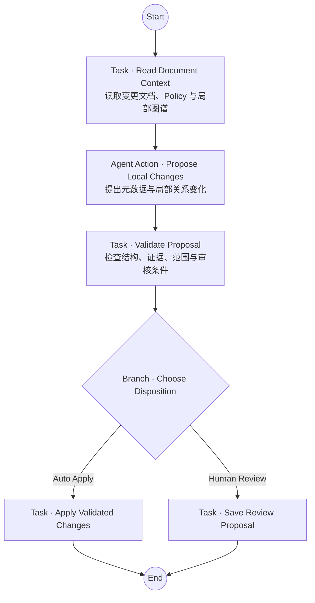

# Document Curator：让 Agent 提议改变，而不是直接修改知识

> 作为 Odyssey 文档中的第一篇完整案例文章，Document Curator 把 Knowledge Space、Thinking Ownership、Agent Action、Task、Branch、Toolbox、Variable 与 Ody DSL 放进同一个具体问题中：当一份文档发生变化时，Agent 可以帮助维护知识，但谁有权决定哪些变化真正生效？

::: tip 在 Odyssey 中查看这个案例
你可以在 [Odyssey Live Demo](https://shiny-dawn-ff43.houliang008.workers.dev/) 中找到 Document Curator，查看它的 Agent Workflow Canvas 与 Ody 配置。公开 Demo 仅供浏览，不提供修改能力；由于 Odyssey 目前没有执行 kernel，它也不运行这条知识维护 Workflow。
:::

## 知识不会因为进入 Knowledge Space 就永远正确

Knowledge Space 不只保存等待检索的文本。它同时保留面向人的文件结构，以及文档之间面向语义的关系。这样的知识环境可以跨越一次模型调用持续存在，但“持续存在”也意味着它会逐渐变化。

新的文档会被加入，旧文档会被修改，原有摘要可能不再准确，引用可能失效，两份资料也可能开始互相矛盾。如果系统只在上传时完成一次索引，那么 Knowledge Space 最终仍会变成一张逐渐过期的快照。

Document Curator 面向其中最局部的一类变化：**一份文档新增或更新以后，如何为它生成初始元数据，检查它影响到的邻近资料，并维护有证据支持的局部关系？**

这听上去像一个很适合交给 Agent 的任务。Agent 可以阅读文档、理解语义、寻找相关材料，并提出比固定规则更灵活的关系建议。

真正困难的部分却不是生成摘要或寻找相似文档，而是**改变知识的权力**。

如果 Agent 既负责提出修改，又负责判断自己的修改是否安全，最后还可以直接写入 Knowledge Space，那么“自动维护”就会把几种完全不同的责任压缩进一次不可分辨的模型判断：

- Agent 是否读到了完整、最新的源文档？
- 它找到的关系是否有明确证据，而不只是关键词相似？
- 它是否覆盖了人已经修改过的 Summary、Guide 或标签？
- 它是否把一次局部更新扩大成了对整个 Knowledge Space 的重构？
- 遇到冲突时，它是否在没有权限的情况下替人选定了“正确版本”？

Document Curator 因此不是“让 Agent 自动整理一切”。它首先是一项关于 **Bounded Autonomy** 的设计：让 Agent 负责开放式判断，同时把验证、授权和实际写入留在明确的系统边界中。

## 为什么只需要一个 Agent

这个案例采用 **Solo Pattern**。Document Curator 的目标不是模拟一个由 Planner、Researcher、Reviewer 组成的团队，而是维护一项边界清楚的局部能力。

一份文档变化只需要一个 Curator Agent 理解上下文并提出候选修改。为了体现“审核”，再增加一个 Reviewer Agent 看起来很自然，但它会模糊这里真正重要的责任差异：候选内容可以来自模型判断，是否符合范围、权限和 Policy 却不应该依赖另一次同类模型判断。

因此，Odyssey 没有用两个 Agent 分别扮演“提议者”和“批准者”。开放式提议属于 Agent Action；确定性检查属于 Task 中受约束的 Tool；需要人判断的候选则进入显式 Review 路径。这里的边界来自不同设计对象，而不是来自更多角色名称。

## 一条刻意保持简短的 Workflow

Document Curator 的 Agent Workflow 只保留一个真正的业务分支：这组变化可以自动应用，还是必须等待人工审核？



这条 Workflow 没有为 `no change`、重复事件、过期版本或工具失败分别添加 Branch。它们不是新的业务选择：无变化可以沿自动路径产生一份不写入任何内容的结果；重复与过期输入应由未来的调用和校验合同拒绝或短路；读取失败与工具失败属于执行错误，而不是让 Agent 继续猜测的另一条正常路线。

保持 Canvas 简短不是为了隐藏复杂性，而是把不同复杂性放回各自应在的位置。用户需要在 Workflow 中看见的是维护责任与业务决定，而不是把所有运行时错误码都画成节点。

<!-- Visual TODO：使用当前 Document Curator Agent Workflow Canvas 截图替换或补充上图。不要使用 cases 目录中的旧版 mermaid-diagram.png；它属于已经被 V0.2 简化方案取代的双 Branch 设计。 -->

## Task 先建立可信上下文

Workflow 从 `Read Document Context` 开始，而不是直接把一条“文档更新了”的消息交给 Agent。

这一步需要准备当前源文档、已有元数据及其所有者、现存标签、与该文档相连的关系、相关文档证据，以及完整的维护 Policy 与版本。它还需要保留目标 Workspace、Knowledge Space、文档身份和源版本等可信运行时信息。

这里有一个重要区别：**上下文中的文本是证据，不自动构成权限。**

在当前设计中，Agent Action 可以同时看到两个 Knowledge Space：

- 固定配置的 **Document Curator Playbook**，保存 Metadata、Relationship 与 Review Policy；
- 由 `$sys.target_knowledge_space$` 在运行时绑定的目标 Knowledge Space，保存本次需要维护的文档与局部关系。

前者是受信任的维护规则，后者是被维护的知识。把两者都叫作“可检索文本”会掩盖它们完全不同的权威来源。

## Agent Action 负责提出，而不负责批准

`Propose Local Changes` 是整条 Workflow 中唯一承担开放式语义判断的节点。

它需要阅读已准备的上下文，为发生变化的文档提出 Summary、Guide、已有标签和局部关系建议；必要时还可以通过 `Find Related Game Documents` 检索 Tool 寻找更多邻近证据。每个候选操作都应包含来源身份、版本、文本位置、支持段落、原值与修改理由。

这里同时出现了 Agent Action 的两类资源边界：

- **Knowledge Spaces 是认知空间**：它们规定 Agent 可以依据哪些知识和规则进行判断；
- **Toolbox 是行动空间**：它规定 Agent 可以主动调用哪些能力来补充证据。

Agent 可以决定是否以及如何使用检索 Tool，却不能凭空获得未被放入 Toolbox 的写入能力。更重要的是，它只把候选对象写入 `proposal` Variable：它不能设置可信的 `requiresReview`，不能批准自己的候选，也不能直接改变知识图谱。

“Agent 拥有路径”在这里有非常具体的含义：它可以决定如何理解文档、寻找哪些局部证据，以及提出什么变化；但它不拥有整个 Knowledge Space，也不拥有变化最终生效的决定权。

## 确定性校验拥有 Branch 的输入

Agent 完成提议以后，`Validate Proposal` Task 接管控制权。

它先检查候选是否具有正确结构，再根据当前上下文验证操作范围、证据、对象身份、版本、所有权与 Review Policy。只有技术上有效的候选才会产生一个明确的 `requiresReview` Boolean，并进入 `Choose Disposition` Branch。

这个 Boolean 由 Validator 产生，而不是由 Agent 在输出中自报。缺失、格式错误或无法验证的值都不能默认解释为“无需审核”。

当前 Policy 只允许一组很窄的变化自动应用，例如：

- 在所有权明确时，为变更文档创建或刷新 Curator 自己维护的 Summary 与 Guide；
- 把变更文档加入已经存在且唯一确定的标签；
- 当源文档存在明确引用、目标唯一且位于同一 Knowledge Space 时，增加与变更文档相连的 `references` 关系。

创建新标签、删除关系、修改人维护的内容、提出非 `references` 关系、遇到目标歧义或发现资料冲突，都必须进入人工审核。

如果候选中任何一项需要审核，当前设计会把**整组候选**送入 Review，而不是先悄悄应用“看起来安全”的部分。这样，用户看到的 Proposal 与最终可能应用的 Change Set 保持一致，也避免一次运行同时留下部分已应用、部分待审核的难以解释状态。

## 同一设计同时存在于 Canvas 与 Ody 中

Document Curator 也把 Odyssey 的另一项设计主张放进了具体配置：Canvas 与 Ody DSL 应该表达同一份 Agent Workflow，而不是两套逐渐分叉的配置。

在 Canvas 中，用户通过节点颜色、连线和 Branch 看见开放式判断与确定性控制的边界；在 Ody 中，同样的边界通过 `agent_action`、`task`、`branch`、Variable binding、Knowledge 与 Toolbox 声明被精确表达。

其中，运行时目标 Knowledge Space 不是硬编码的资源名称：

```ody
agent_action "Propose Local Changes" {
  knowledge ["Document Curator Playbook", $sys.target_knowledge_space$];
  toolbox [tool_1_Find_Related_Game_Documents];
}
```

在语言和配置层面，同一份 Workflow 因而不必为每个目标 Knowledge Space 复制一份配置。`$sys.target_knowledge_space$` 是一个需要接受类型检查、并在未来执行时由可信上下文提供的系统输入；Agent 不能把任意字符串变成新的知识来源。当前编辑器能够表达和检查这种绑定，但尚未通过 kernel 把真实事件注入并执行。

<!-- Visual TODO：制作当前 Canvas 与 DSL Edit 并排截图。重点标注 Agent Action 中固定 Playbook、动态 target KS、Toolbox，以及 Validate Proposal → Branch 的边界。 -->

## 这个案例目前能说明什么

Document Curator 不是用来证明 Odyssey 已经拥有生产级知识维护执行器。

当前案例已经形成可以在 Canvas 与 Ody 中表达和检查的 Workflow 配置，并定义了维护 Policy、Variable、资源绑定和静态 API contracts。它能够说明：Odyssey 的核心概念至少可以共同描述一个具体而非抽象的问题；开放式语义判断、确定性验证、知识边界与人工审核可以在同一套设计语言中获得不同位置。

它没有验证真实事件订阅、API 服务、原子图谱写入、并发冲突恢复、持久化 Review lifecycle 或端到端运行可靠性。示例中的 API 地址是非运行占位合同；编译成功表示 Workflow 配置满足当前语言与领域检查，不表示外部维护服务已经存在，更不表示这条 Workflow 已经成功运行。

这一区分对案例本身很重要。Odyssey 当前是一套可操作、可检查的 Human-AI Collaboration System Prototype；Document Curator 展示的是这套 Prototype 如何组织一项真实能力，而不是把尚未实现的执行基础设施写成产品承诺。

## 从一个案例回到 Odyssey 的设计命题

Document Curator 最终没有依赖一个更长的 Prompt，也没有用更多 Agent 角色掩盖权力边界。

它选择把问题拆到不同设计对象中：Solo Pattern 定义能力的系统形态；Task 表达可信上下文与确定性能力应当如何建立；Agent Action 在 Knowledge Space 与 Toolbox 的边界内表达开放式判断；Variable 让中间状态及其所有权可以被引用；Branch 只接受 Validator 产生的决定；Review 路径保留人真正需要承担的判断；Ody 则让同一份设计可以被精确编辑、检查，并与 Canvas 双向同步。

这个案例并没有消除知识维护中的不确定性。它做的是让不确定性出现在正确的位置，让 Agent 能够贡献判断，却不能因为能够提出变化，就自动获得批准变化的权力。

## 相关设计

- [为什么 Knowledge Space 不只是 RAG](/zh/core-concepts/knowledge-space-more-than-rag)
- [为什么需要有边界的自主性](/zh/core-concepts/bounded-autonomy)
- [为什么 Odyssey 需要一门语言](/zh/core-concepts/workflow-language)
- [Ody 如何表达一个 Agent Workflow](/zh/language/syntax-and-semantic-model)

## 设计来源

- Odyssey repository：`doc/product/cases/second-case-document-curator/README.md`；
- 当前简化 Workflow：`workflow-design.md`，V0.2；
- 当前 Ody 配置：`document-curator.ody`，Ody 0.2；
- 维护边界：`maintenance-rules/review-and-change-policy.md`；
- 静态接口合同：`api-contracts.md`。
