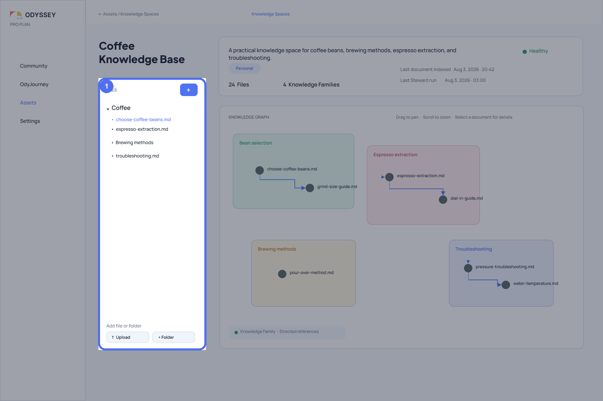
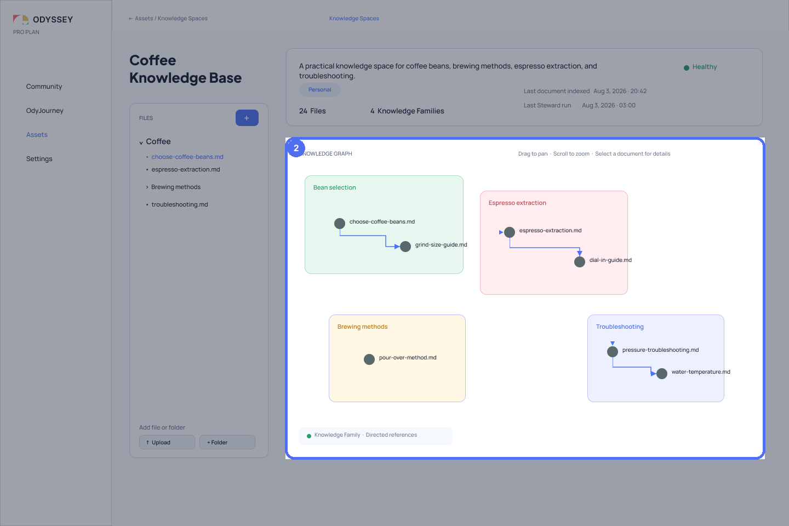
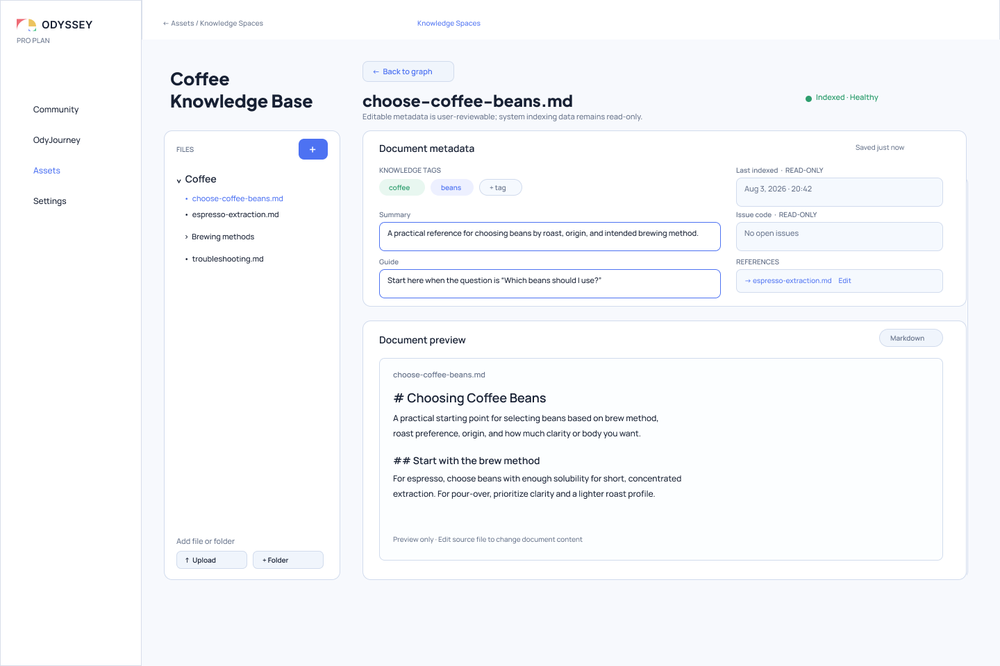

# Why Knowledge Space Is More Than RAG

> RAG helps an Agent find information for one task. Knowledge Space also defines how knowledge is organized, understood, maintained, and carried across multiple rounds of work.

When designing an Agent, “connecting it to a knowledge base” usually implies a familiar pipeline: upload files, split the text, build an index, and retrieve a set of relevant fragments for the current question.

That pipeline matters. Without retrieval, a model has difficulty bringing external material into its current judgment. Odyssey, however, is concerned with another layer of the problem: **when an AI Agent does more than answer one question and instead works repeatedly around the same body of knowledge, what structure should that material have? How can people understand it? How should existing relationships change when new documents arrive? How can different Agents share the same knowledge environment?**

Improving the relevance of a single retrieval result does not fully answer these questions.

Odyssey therefore does not treat Knowledge Space as one retrieval parameter inside Agent Action. It is an independent asset: it preserves a file organization familiar to people, represents knowledge relationships that machines can use, and has a maintenance lifecycle of its own.

## RAG Solves What Enters the Context

RAG most directly answers: which content should enter the model context for the current question?

```text
Current question
→ Retrieve relevant content
→ Add it to context
→ Produce an answer or action
```

This is a task-centered process. It concerns the relevance between a query and some content, and what should fit within a limited context window.

But being retrieved together does not mean two fragments have the same relationship within a body of knowledge. They may support one another, conflict, or represent different versions; they may also merely use similar words. A retrieval result alone rarely explains where a document belongs in the larger topic, where a reader should enter, or which relationship to follow next.

Odyssey therefore treats retrieval as one way to enter knowledge, not as the final form of knowledge itself.

This does not mean RAG disappears from Odyssey. Retrieval remains an important capability and exists as a Knowledge Retrieval Tool. Knowledge Space defines how knowledge exists and is maintained; the Knowledge Retrieval Tool finds material from that environment that is suitable for the context of a particular action.

Like other Tools, it can be placed in an Agent Action’s Toolbox, allowing the Agent to decide when to use it. It can also be placed in a Task as a deterministic step arranged in advance by the user. Odyssey does not replace retrieval with a knowledge graph. It separates “what the knowledge is” from “how knowledge is retrieved this time” so that each can be designed explicitly.

## Knowledge Space Defines an Agent’s Cognitive Space

Knowledge Spaces and the Toolbox are configured together in Agent Action, but they establish two different kinds of boundary:

| Resource | Question it answers | Meaning for Agent Action |
| --- | --- | --- |
| **Knowledge Spaces** | Which information and semantic environments may the Agent rely on to understand the problem? | Defines the cognitive space |
| **Toolbox** | Which capabilities may the Agent use to act on the problem or the outside world? | Defines the action space |

A Toolbox is not a record of actions the Agent has already taken. It is a set of capabilities the Agent is allowed to use. Likewise, a Knowledge Space is not a Prompt assembled for one request. It is a knowledge environment the Agent is allowed to enter and navigate.

This distinction matters to bounded autonomy. Restricting Tools answers what an Agent may do, but not what knowledge it may rely on when making a judgment. Providing retrieval results alone can reduce a knowledge boundary to a temporary injection of context.

Open-ended judgment in an Agent Action therefore occurs where several boundaries meet: Goal defines the purpose, Knowledge Space defines the cognitive scope, Toolbox defines the available actions, and Variables define the state the Agent may read and maintain.

## The Same Material Has Two Structures

People usually maintain material through directories and filenames. A file tree is useful for storage location, working habits, and deliberate categorization. But placing two files in the same folder does not mean that they play the same semantic role, and moving a file should not automatically change its knowledge relationships.

Odyssey therefore preserves two structures side by side:

```text
Knowledge Space
├── A user-maintained file tree
│   └── Where files live and how people manage them
└── An Odyssey-maintained knowledge graph
    └── How documents relate and form Knowledge Families
```

The file tree answers “where is the material?” The knowledge graph answers “how does the material form a body of knowledge?” They describe the same documents without pretending to be the same structure.



*Figure 1a: The highlighted area is the user-maintained file tree. It preserves the familiar folder-and-file structure and answers where material lives and how people manage it. It does not define semantic relationships between documents. [View the complete interface in Figma](https://www.figma.com/design/P3EF9io2DhyhwkNYBVqB5Z/Odyssey-Design?node-id=147-44).*



*Figure 1b: The highlighted area is the Odyssey-maintained knowledge graph. The same documents can form directed relationships across folders. Four colors identify four independent Knowledge Families; Brewing methods shows that one document can also form a Family of its own. [View the complete design in Figma](https://www.figma.com/design/P3EF9io2DhyhwkNYBVqB5Z/Odyssey-Design?node-id=147-44). Figma node `147:44`, corrected, exported, and annotated on October 14, 2026.*

In the graph, each document becomes a Document Node. Documents can form directed semantic relationships such as references, supports, explains, contradicts, or supersedes. One Knowledge Space may contain several Knowledge Families; a document that currently has no relationship to any other document appears as a singleton Family.

A Knowledge Family is one complete connected graph inside a Knowledge Space: if edge direction is ignored, a path exists between every pair of documents in that Family. Different Knowledge Families have no edges between them. If a document relationship connects two regions, they become one connected component rather than two Families. One document with no relationships may still form a singleton Family.

A Knowledge Family is therefore not another presentation of a folder. It is a connected region formed by document relationships and may be regrouped as the knowledge changes, rather than a physical path chosen in advance by the user.

## Relationships Give Knowledge Context

If an Agent receives only a set of similar fragments, it still has to infer their relationships in the moment. Knowledge Space turns some of those relationships into visible, maintainable design objects.

For example, a research note may provide evidence for a design decision, that decision may be adopted by a later specification, and a newer decision may partially replace it. All of these documents may be “relevant” to a keyword search, but they do not play the same role in a real judgment.

```text
Research note ──supports──> Design decision
Design decision ──explains──> Product specification
New decision ──supersedes──> Old decision
```

Relationships do not reason on behalf of the model or guarantee that an answer is correct. They provide an explicit layer of context. People and Agents can see why a document was brought into a judgment and follow its relationships to inspect the evidence, downstream effects, or source of a conflict.

This is the most important difference between Knowledge Space and simply putting more text into context. The former attempts to preserve the structure of knowledge; the latter primarily supplies content to the current context window.

## Knowledge Space Is an Independent Asset, Not an Agent Attachment

A Knowledge Space does not belong to one Agent and does not disappear when that Agent is deleted. Agents and Agent Templates store references to a Knowledge Space rather than copying its documents and graph.

The same Knowledge Space can therefore become a shared cognitive environment for several Agents. They may have different Goals, Workflows, and Toolboxes while still referring to the same continuously maintained body of knowledge.

```text
Knowledge Space
├── Referenced by Agent A
├── Referenced by Agent B
└── Maintains its documents and knowledge relationships independently
```

This ownership boundary avoids two problems. First, creating an Agent Template does not silently copy a knowledge asset that will quickly diverge. Second, changing or deleting an Agent does not damage the knowledge environment used by other Agents.

“Shared” does not mean that every Agent automatically receives all knowledge in the Workspace. Only the Knowledge Spaces explicitly provided to an Agent Action form the cognitive space for that step.

## Long-Lived Knowledge Needs Maintenance, Not Just Indexing

A collection of files does not remain still. New documents arrive, old documents change, references break, sources conflict, and previously isolated material may gradually form a new Knowledge Family.

If a Knowledge Space builds an index only when files are uploaded, it remains a snapshot that grows stale. Odyssey therefore distinguishes two scales of maintenance:

- **Document Curator OdyJourney** responds to local change. When a document is added or updated, it generates initial metadata and updates the affected local relationships.
- **Knowledge Steward OdyJourney** responds to global change. It periodically reviews the complete Knowledge Space, reconciles cross-document relationships, and finds broken links, conflicts, duplicates, or issues requiring human confirmation.

They are not special backend services that bypass Odyssey’s design language. In the current direction, Document Curator and Knowledge Steward are themselves two maintenance assistants built with Odyssey: the upper System Pattern Canvas defines the participating Agents and their relationships, while the lower Agent Workflow Canvas defines each Agent’s internal actions, control structure, Knowledge Spaces, Toolbox, and state boundaries. The maintainers of a Knowledge Space therefore follow the same conceptual grammar of two Canvas levels, bounded autonomy, and Agent Workflows.

The exact Pattern, Agent responsibilities, and Workflow of these two assistants will be designed separately. What is established here is that they should be expressed through Odyssey’s own composition language rather than exist as invisible system exceptions.

The two roles do more than give conventional indexing processes more Agent-like names. They express different responsibilities: a document change needs to enter the system promptly, while the knowledge as a whole needs a slower and more comprehensive review.

Maintenance results should not be hidden behind the claim that “the system understands everything.” Knowledge Space distinguishes lifecycle status from graph quality. The system may be syncing while retaining the previous valid graph; a graph may also be valid while containing issues that require human review.

## People Must Be Able to See and Revise the Knowledge

If a knowledge structure exists only in a retrieval backend, it remains close to a black box for people. Odyssey therefore designs Knowledge Space as a workspace that can be explored, not merely an ID inside an Agent configuration panel.

The current design uses progressive disclosure:

```text
Knowledge Space Overview
→ Select a Document Node
→ Document Inspector
→ Document Detail
```

The Overview presents the file tree, Knowledge Families, and document relationships together. The Inspector reveals summaries, tags, relationships, and status without losing the graph context. Document Detail supports closer reading and review of editable graph-facing metadata.



*Figure 2: Document Detail lets a person move from the graph into one document, read its content, and review its Knowledge Tags, Summary, Guide, and References. System state such as indexing time and Issue code remains read-only. The reader can return to the graph without treating document detail as a second knowledge structure. [View the complete design in Figma](https://www.figma.com/design/P3EF9io2DhyhwkNYBVqB5Z/Odyssey-Design?node-id=157-2). Figma node `157:2`, exported on October 14, 2026.*

This does not mean that people must maintain every edge manually. The point is that knowledge structures generated or changed by the system still need places where they can be observed, reviewed, and corrected. The cognitive space used by an Agent should also be a space that people can enter.

## How It Differs from a File Repository and RAG

| Concern | File repository | Typical RAG pipeline | Odyssey Knowledge Space |
| --- | --- | --- | --- |
| Primary question | Where are files stored? | What should be retrieved for the current question? | How is a body of knowledge organized, used, and maintained over time? |
| Core structure | Folders and files | Indexes, fragments, and relevance | File tree and knowledge graph together |
| Time scale | When people organize it | At query time | Across document changes, periodic maintenance, and multiple rounds of work |
| Relationship model | Mostly implicit | May be formed temporarily during retrieval | Visible and maintainable graph objects |
| Agent use | Read files | Receive retrieved context | Enter an explicitly authorized cognitive space |
| Human role | Manage files | Ask questions or configure retrieval | Explore, review, and correct knowledge structure |
| Ownership | Often bound to an application directory | Often bound to a retrieval chain | Independent asset referenced by multiple Agents |

This comparison does not argue that RAG is obsolete. Knowledge Space may still use retrieval to find an entry point, filter content, and control context size. The difference is that Odyssey does not treat the retrieval layer as the whole of knowledge design.

## What Knowledge Space Is Not

Several boundaries are necessary to keep the concept from expanding indefinitely.

Knowledge Space is not all of an Agent’s memory. It stores knowledge assets meant to be maintained over time, not the temporary state of one run. The latter belongs to Variables or to a more explicit future design for runtime memory.

Knowledge Space is not another name for Prompt, but it also does not isolate reusable text such as Prompts and Personas into separate asset types. They are still text. When that content needs to be retained, related, maintained, and reused by several Agents, Odyssey manages it as documents in a Knowledge Space rather than creating a fragmented resource library for every textual purpose.

This does not mean that every runtime instruction automatically becomes a Knowledge Space document. The Goal of a particular Agent Action, node configuration, and Workflow control structure retain their respective control responsibilities. The distinction is: **Knowledge Space manages reusable textual knowledge over time; Goal, Workflow, and Tools determine how one action uses that knowledge.**

Knowledge Space is not a guarantee of factual correctness. A graph can expose relationships and issues between sources, but it cannot automatically remove stale information, flawed judgments, or source bias. Conflicts, broken links, and unconfirmed relationships must therefore become visible states rather than be concealed by a successful indexing run.

Finally, Knowledge Space is not a perfect graph in which everything must be connected. Real knowledge may contain several Knowledge Families, isolated documents, and relationships that cannot yet be confirmed. The goal is not to force every item into a connection, but to make existing relationships and uncertainty visible.

## The Cost of This Design

Treating knowledge as a long-lived asset costs more than building an index once.

First, relationships require governance. Automatically generated relationships may be too numerous, too weak, or poorly explained. If every item that is “possibly related” becomes an edge, the graph quickly loses meaning.

Second, local updates and global maintenance require clear coordination. Document Curator favors timeliness, while Knowledge Steward favors global consistency. Their treatment of conflicts, versions, and human changes needs explainable rules.

Third, a graph can become visually crowded as the document set grows. Knowledge Families, filtering, focus, and the Inspector need to support progressive exploration instead of turning the “global view” into an unreadable mass of nodes.

Finally, the authorization boundary of a cognitive space needs further refinement. An Agent being able to reference a Knowledge Space does not necessarily mean that it should read every document in it. Sensitive content, inherited permissions, auditing, and different access scopes cannot be solved by one drag operation on the Canvas.

These costs show that Knowledge Space is not merely a more impressive knowledge-base interface. It requires Odyssey to design information structure, maintenance responsibility, asset ownership, and an Agent’s cognitive boundary together.

## Why Odyssey Still Chooses It

Odyssey is not trying to design Agents that appear intelligent in a single conversation. It is trying to design systems that can work repeatedly around a changing body of knowledge, be inspected by people, and collaborate with other Agents.

In such a system, retrieval remains necessary but is no longer sufficient. An Agent needs to know which knowledge it may rely on. People need to see how that knowledge is organized. The system needs to maintain relationships after documents change. Multiple Agents need to share the same cognitive environment without copying the asset.

The design proposition of Knowledge Space is therefore not “replace RAG with a graph.” It is:

> **Let retrieval take place inside a knowledge environment with structure, ownership, maintenance responsibility, and a place for human review.**

## Terms Used in This Article

| Term | Meaning in this article |
| --- | --- |
| **Knowledge Space** | An independent knowledge asset composed of documents beneath one root folder, a user-facing file tree, and a graph of semantic relationships. |
| **Knowledge Family** | One complete connected graph formed by document relationships inside a Knowledge Space; different Families have no edges between them, and a singleton document may form a Family. |
| **Document Node** | A node in the knowledge graph representing one managed document. |
| **Document Curator OdyJourney** | A design responsibility for initial metadata and local graph updates when documents are added or changed. |
| **Knowledge Steward OdyJourney** | A design responsibility for relationship reconciliation, issue detection, and global maintenance across a Knowledge Space. |
| **Cognitive space** | The information and semantic environment an Agent Action is explicitly allowed to reference and navigate. |
| **Action space** | The capabilities an Agent Action is explicitly allowed to use through its Toolbox. |

## Design Sources

- Current Knowledge Space product model: `odyssey/doc/product/feature-specifications/knowledge-space/knowledge-space-specification.md`;
- Current product hierarchy and asset boundaries: `odyssey/doc/product/information-architecture/odyssey-figma-information-architecture.md`;
- Independent-asset and reference rules for Knowledge Space: `odyssey/doc/architecture/domain/odyssey-v1-design-constraints.md`;
- Current graph design: [Figma `Knowledge Space — Graph Overview` (`147:44`)](https://www.figma.com/design/P3EF9io2DhyhwkNYBVqB5Z/Odyssey-Design?node-id=147-44);
- Current Document Detail design: [Figma `Knowledge Space — Document Detail` (`157:2`)](https://www.figma.com/design/P3EF9io2DhyhwkNYBVqB5Z/Odyssey-Design?node-id=157-2);
- Knowledge Spaces and Toolbox boundaries in Agent Action: `doc/samples/bounded-autonomy/why-bounded-autonomy.zh.md`;
- Historical Knowledge Space argument: `docs/core-concepts/knowledge-space.md`.
