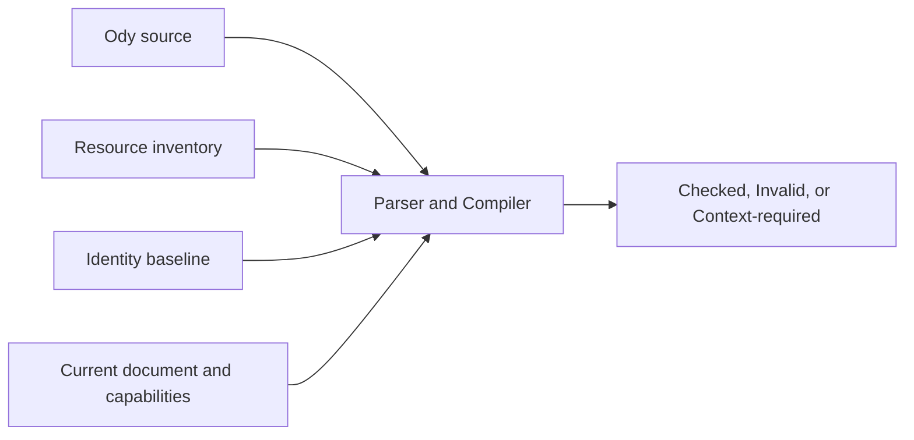
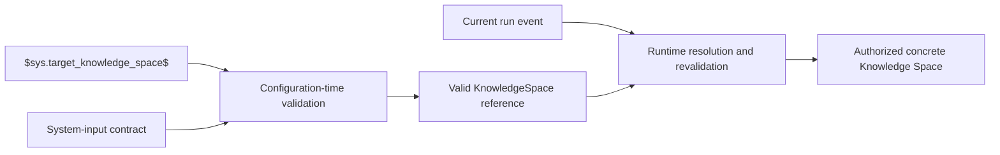
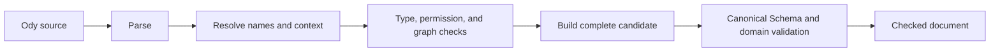
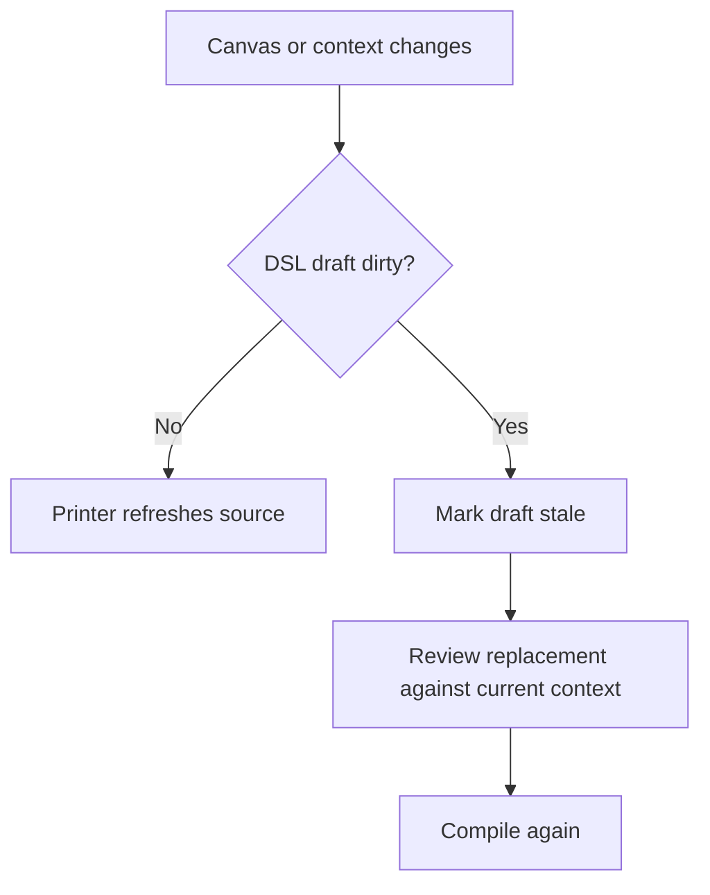

# How Ody Compiles and Validates a Workflow

> The Ody Compiler does more than turn text into JSON. It must establish that the source can become a complete, unambiguous, and authorized Agent Workflow in the current Odyssey context.

The previous article, [“How Ody Expresses an Agent Workflow”](./ody-syntax-and-semantic-model.en.md), introduced the language structure: how Variables, Agent Actions, Tasks, Branches, Loops, resources, and Edges map to Odyssey concepts.

Valid syntax, however, does not mean that a configuration can be applied.

The following source is easy to read as text:

```text
agent_action "Research" {
  model "gpt-5";
  goal "Research the topic.";
  knowledge ["Product Docs"];
  toolbox ["Product Lookup"];
}
```

Before it can become a real Workflow, Odyssey must still answer:

- Is `Product Docs` a uniquely referenceable Knowledge Space in the current Workspace?
- Is `Product Lookup` a fully configured Reusable Tool owned by the current Agent?
- Do the Variables and Knowledge Spaces required by that Tool still exist?
- Can the current Canvas structure be represented by this DSL version without loss?
- Has the Canvas changed since the source was checked?
- Even if the configuration is valid, does the page currently permit Apply and save?

Ody compilation is therefore a **chain of evidence from source text to a safely applicable candidate**, not a format conversion.

## Compilation Begins with Source and Context

The Compiler receives more than Ody source.



A complete check considers at least four kinds of input:

| Input | Responsibility |
| --- | --- |
| **Source** | The Ody text currently being edited |
| **Inventory** | Knowledge Spaces, Reusable Tools, System Tools, System Variables, and Pattern exits currently available for reference |
| **Identity baseline** | The session mapping among syntax objects, resource names, and existing internal UUIDs |
| **Current document and capabilities** | The current Canonical Workflow, Schema version, and target Canvas capabilities |

This is why the same Ody source may produce different results in different contexts.

`toolbox ["Product Lookup"]` may resolve successfully in the Agent that owns that Tool. It may be absent in another Agent. While the resource catalog is still loading, the Compiler cannot even know whether the Tool is missing or only temporarily unavailable.

The Compiler does not query a network or database itself. The Application layer loads and filters resources first, then passes an explicit inventory snapshot into the domain Compiler. This keeps domain validation deterministic and prevents compilation from silently expanding the permission boundary.

Ody 0.2 also reads an explicit **system-input contract**. `$sys.target_knowledge_space$`, for example, can be used in an Agent Action's `knowledge` or a retrieval Tool's `knowledgeSpaceId` only when that key is registered in the read-only System Input Catalog with the `KnowledgeSpace` type. The Compiler can validate the configuration even when no concrete run event exists yet, without inventing a Knowledge Space. An unknown key or incompatible type produces an error.

## Phase One: The Parser Recovers Structure without Pretending the Text Is Complete

The Parser first converts characters into tokens, then recovers the structure of Workflows, sections, declarations, and fields.

It recognizes:

- Keywords, identifiers, strings, numbers, and symbols.
- Braces, arrays, objects, and statement boundaries.
- Ordinary strings, raw strings, and comments.
- Variable references and ValueSource interpolation.
- Structural positions for Workflows, Nodes, Tools, Steps, and Edges.

Text inside an editor is often incomplete. When the user has just typed an opening brace or removed a semicolon, the Parser must not crash or stop providing useful feedback elsewhere.

The Ody Parser therefore recovers at deterministic synchronization points: semicolons in the current container, matching closing braces, and valid sibling declaration starters. It can report a zero-width diagnostic for a missing token and continue building a recoverable syntax structure.

For example:

```text
variables {
  string shared brief
  boolean user_managed approved = false;
}
```

The Parser can locate the missing semicolon after the `brief` declaration while continuing to recognize the following `approved` Variable.

A recoverable AST does not mean that a Workflow can be generated. As long as the source contains a blocking error, the Compiler returns no applicable document.

## Source Spans Return Errors to the Place Where the Design Happened

Every diagnostic carries a stable code, severity, and source span. A span identifies a `[start, end)` range in the original source and maps to lines and columns in the editor.

Different problems should point as closely as possible to the place that needs to change:

- An unknown Variable points to the reference itself.
- A duplicate declaration points to the second declaration and may relate it to the first.
- A missing field points to the end of its owning block.
- An illegal chained Edge points to the second arrow.
- A graph cycle points to a deterministically selected Edge in the cycle rather than vaguely marking the entire file.

This position contract is useful for more than red underlines. It gives the Problems list, click-to-navigate behavior, future Quick Fixes, and generated-source repair loops the same evidence model.

Diagnostics must also avoid copying sensitive content. A Goal, Script, Header, or other configuration can be displayed in place inside the editor, but it should not be copied wholesale into logs or telemetry.

## Phase Two: Resolve Names, Scopes, and Identity

After recovering basic syntax, the Compiler builds symbols and scopes.

It distinguishes among:

- `agent.topic`: a Variable on the current Agent.
- `task.cached`: a local Variable in the current Task.
- `sys.current_message`: an external System Variable inventory entry.
- `"Research"`: a node name in the current graph.
- `"Approved"`: a Case name inside a particular Branch.
- `lookup`: an alias in the current file's `tools` section.
- `"Product Lookup"`: the name of an existing Reusable Tool in the current Agent inventory.

Names use the same matching rule everywhere: trim surrounding whitespace, normalize to Unicode NFC, and remain case-sensitive. The Compiler does not select a duplicate object by array order or use fuzzy matching to guess the user's intention.

Names belong to user syntax; UUIDs belong to internal identity. While editing an existing Canvas, the identity baseline helps the Compiler and Printer decide whether a renamed declaration still represents the original node, Variable, or Tool. If a change combines additions, removals, and renames in a way that makes the mapping ambiguous, the result must require Review or become `context-required`. It cannot pair objects merely because they look similar.

## Phase Three: Validate Types, Configuration, and Thinking Ownership

The Compiler then checks whether every value is valid in its position.

A Variable default must match its declared type:

```text
number shared confidence = 0.8;     // Valid
number shared confidence = "high"; // Type error
```

Each System Tool Schema validates its Tool configuration. The Compiler checks:

- Whether required fields exist.
- Whether unknown fields appear.
- Whether enum values belong to the allowed set.
- Whether the Tool provides the named output sourceKey.
- Whether the output target is a writable Variable in the current scope.
- Whether operations such as `increment`, `toggle`, and `append` fit the target type.
- Whether API Headers, Form entries, and Script inputs contain duplicate or malformed records.

Thinking Ownership becomes an actual permission boundary here, not just a color system:

```text
A Task Tool cannot write an agent_managed Variable
An Agent Action cannot directly write a user_managed Variable
Neither may write System or read_only Variables
```

The Compiler can validate only writes explicitly represented by structured configuration. It does not read natural language in a Goal and guess which Variable the Agent intends to change. Runtime writes by an Agent Action still require the future runtime to enforce ownership.

Type checking also does not invent certainty. When the type of a dynamic Tool output cannot be proven at compile time, the Compiler preserves the need for runtime validation. It rejects only incompatibility that is already knowable.

## Phase Four: Separate Graph Validity from Readiness

Workflow graph validation has two layers.

The first is **structural validity**, including rules such as:

- Start cannot have incoming Edges.
- End cannot have outgoing Edges.
- An ordinary Edge cannot be a self-connection or semantic duplicate.
- A Branch Edge must reference a real Case or `.default`.
- One Branch exit cannot connect to multiple targets.
- The root graph and a Loop body cannot connect across their boundary.
- A Loop body cannot contain another Loop.
- The current Workflow cannot contain an arbitrary directed cycle.

Violating these constraints means that no valid Canonical Workflow can be formed, so the result is an error.

The second layer is **readiness**, including situations such as:

- A Branch Case is not connected yet.
- A node is not reachable from Start.
- A node cannot yet reach a valid End.
- An ordinary node has multiple outgoing Edges whose runtime fan-out semantics are not frozen.

These may mean only that the design is unfinished. If the graph remains structurally valid, they can stay as warnings and allow the user to Apply a Workflow that is saveable but not yet ready.

This distinction matters: the editor should not force the user to complete the whole system in one operation, but it must not present an incomplete configuration as runnable.

## Phase Five: Resource Resolution Must Carry Complete Configuration

Knowledge Spaces, Reusable Tools, System Variables, and Pattern exits come from external context.

The Compiler uses names for human readability, but it must resolve internal identity and complete dependencies before generating a Canonical Workflow.

Consider a Reusable Tool reference:

```text
toolbox ["Product Lookup"];
```

Valid compilation requires:

1. Exactly one `Product Lookup` exists in the current Agent inventory.
2. The object is a configured AgentReusableTool, not merely a System Tool definition name.
3. Its complete config, input and output bindings, and provenance are available.
4. Its dependent Knowledge Spaces and Variables still exist.
5. Target Variables satisfy type and ownership constraints.
6. The final Reusable Tool collection for the Agent contains no name conflict.

The Compiler then places a complete configuration snapshot in the candidate document instead of saving only a name or dangling ID.

While an inventory is still loading, the Compiler cannot interpret an empty list as “the resource does not exist.” It may continue lexical and syntax validation, but the overall result is `context-required` and contains no applicable document.

### Dynamic Resource Bindings Require Two Validation Stages

A fixed name can be resolved against the current inventory during configuration. A runtime binding separates “what type of input is required” from “which concrete resource is supplied for this run”:



Configuration-time validation checks binding syntax, namespace and key, whether the field accepts the referenced type, Variable scope, and read/write permissions. The absence of a concrete dynamic target at this point is not an error when the trigger-input contract is known.

Runtime validation checks that the actual input exists, its identity and type, Workspace ownership, the relationship between the document and Knowledge Space, access permission, and version conditions. A failure must reject that run rather than falling back to the previous binding, the resource selected in the current page, or an arbitrary default Knowledge Space.

This split also prevents the Compiler from acquiring hidden authority. It cannot substitute the Knowledge Space currently selected in the UI for `$sys.target_knowledge_space$`; a sample resource shown in an editor preview cannot be written back into persistent configuration. Canonical JSON stores the system-input reference itself, and Printer–Canvas round trips preserve the binding instead of emitting the UUID or name resolved for one run.

These bindings are part of Ody 0.2 across the Parser, Compiler, Printer, Canonical Schema, Canvas controls, and persistence path. `checked` means that the expression, system key, resource type, and field position passed configuration validation. It does not mean that the concrete resource supplied to an actual run has already been authorized; runtime still revalidates identity, Workspace ownership, permissions, and version conditions against that event.

## Phase Six: Canonical Emission Is the Final Boundary

Even if all local checks pass, the Compiler cannot hand a manually assembled, unchecked object to the Store.

It first builds a complete candidate and passes it through the shared Canonical Schema and domain validation:



Only a complete candidate that crosses this boundary can become `checked`.

If the shared Schema rejects a problem that earlier checks missed, the Compiler returns a canonical diagnostic and no document. This generally indicates a capability or implementation gap between the DSL Compiler and Canonical Schema. The user cannot work around it by changing unrelated text.

Likewise, if the current Canvas contains semantics that Ody V0.1 cannot represent without loss, the Printer or Compiler must fail closed. It preserves the original configuration and reports a diagnostic instead of deleting the unsupported part and continuing with Apply.

## Three Compilation Results, Not Just Success or Failure

The domain Compiler returns one of three result types:

| Result | Meaning | Returns a document |
| --- | --- | ---: |
| `checked` | All required checks completed with no error; warnings may remain | Yes, a complete candidate |
| `invalid` | The source, configuration, permissions, structure, or capability contract contains an error | No |
| `context-required` | Resources, identity, or parent-exit context is insufficient for a safe decision | No |

`context-required` is not a spelling mistake. It means that the text may be correct, but Odyssey currently lacks the external facts required to decide safely.

All three results may carry diagnostics and a recoverable syntax structure. The UI cannot use “the number of diagnostics is zero” as its Apply rule. A `checked` result may contain warnings, while a `context-required` result containing only informational diagnostics still has no applicable document.

## Error, Warning, and Info Carry Different Responsibilities

Severity answers how a finding affects the candidate configuration, not only which color to display.

| severity | Typical meaning | Apply |
| --- | --- | ---: |
| `error` | Known input violates the language, Schema, permission, or structural contract | Blocked |
| `warning` | Structure is valid, but the Workflow is not ready or runtime semantics require attention | Allowed with an explicit notice |
| `info` | External context or Review is required, or the result was truncated | Normally blocked until resolved |

Current diagnostic codes are grouped by problem family:

| Range | Problem family |
| --- | --- |
| `ODSL0xx` | Lexical problems, such as invalid escapes or unterminated strings |
| `ODSL1xx` | Structural syntax, such as missing semicolons, duplicate fields, or out-of-scope expressions |
| `ODSL2xx` | Names, symbols, scopes, and references |
| `ODSL3xx` | Types, Tool config, bindings, and write permissions |
| `ODSL4xx` | Graph, Branch, Loop, and readiness |
| `ODSL5xx` | External resources, inventory, and identity context |
| `ODSL6xx` | DSL capability and Canonical emission |

The precise code registry continues to evolve with the V0.1 validation contract. Public documentation can rely on these stable problem families and behavioral boundaries, but should not present every number in an internal Draft as a permanently frozen standard.

## Editor State Is Richer Than Compiler Results

DSL Edit must also represent active typing, asynchronous checks, and page-level concurrency. Its UI state therefore includes more than the three Compiler result types.

The current editor distinguishes:

```text
unavailable
synced
editing
checking
invalid
ready
stale
context-required
applying
apply-failed
```

Several states are easy to confuse:

- `ready`: the current dirty source compiled into a `checked` candidate and may attempt Apply.
- `synced`: the DSL and Canvas refer to the same semantic configuration and have no unapplied change.
- `invalid`: the current source cannot form a candidate document.
- `context-required`: resource, identity, or exit context is missing.
- `stale`: the Canvas or inventory used by the check has changed, so the old result cannot be used.
- `apply-failed`: the source may remain valid, but page state, concurrency, or Store mutation blocked this Apply attempt.

`stale` and `apply-failed` must not be disguised as syntax errors. They describe the relationship between the editing session and external state, not the Ody source itself.

## Asynchronous Checks Must Not Overwrite Newer Input

DSL Edit checks automatically after the user pauses typing briefly, while resources may load and the Canvas may update at the same time.

Every check is therefore bound to:

- A source revision.
- An inventory revision.
- A document mutation sequence.
- The current Agent and page session.

When a result returns, the editor discards it if any of those identifiers is stale. A result that arrives after component destruction, route navigation, or switching Agents cannot update the new session.

This prevents a dangerous race in which a slower, older check returns last and overwrites a newer correct result with `ready`.

## Stale: Two Authoring Surfaces Must Not Silently Overwrite Each Other

The Canvas and DSL can both modify the same Canonical Workflow, so the editor must handle concurrent authoring.

When there is no dirty DSL draft, a semantic Canvas change can update the source automatically through the Printer. A layout-only change is outside Ody semantics and does not make the draft stale.

When the DSL already has unapplied changes and the Canvas, resource inventory, or identity baseline changes, the editor enters `stale`:



The system neither overwrites the draft with the Canvas nor lets the draft overwrite the newer Canvas. The user first reviews a replacement produced against the current context, then checks it again and explicitly applies it.

## Apply Is a Second Gate Separate from Compilation

A `checked` candidate proves only that it was valid for a particular input snapshot. It does not mean the page necessarily permits a commit at this moment.

Before Apply, Odyssey recompiles the latest source and confirms again that:

- Source and context are not stale.
- The document mutation sequence still matches.
- The page is in Configure mode.
- No save is in progress and no save conflict exists.
- The DSL has not altered the Pattern-owned End set.
- The complete candidate still passes Schema and domain validation.

Only then does the Application layer perform one atomic Store mutation: either the complete Workflow is replaced or the original Canvas remains unchanged. It does not update Variables first and leave half a configuration behind when an Edge later fails.

A successful Apply updates editor state; persistence continues through the existing autosave and optimistic concurrency / CAS path. A save failure preserves the draft and candidate and reports a save problem. It does not invent a false Ody syntax error.

## The Compiler Must Be a Side-effect-free Domain Module

The Parser, Compiler, and Printer do not depend on Vue, Pinia, Vue Flow, the DOM, a Store, or a network.

The Compiler may read explicitly supplied context, but it cannot:

- Modify the Canvas.
- Create or rename resources.
- Execute a Tool, Script, model, or network request.
- Read the system clock to guess export metadata.
- Query another Workspace when inventory is missing.
- Expand permissions or invent Variables in an attempt to “help” the user.

This pure domain boundary allows the same logic to support editor feedback, pre-Apply revalidation, test fixtures, and a future LLM generation path.

## Error Recovery Should Avoid Cascading Noise

One root cause may otherwise produce many superficial errors.

If a Variable was never declared, the Compiler should not continue deriving its type through every operator and report ten additional incompatibilities. If an Edge references an unknown node, it should not participate in cycle and reachability analysis.

Ody validation follows several suppression principles:

- Report the problem closest to the root cause first.
- Do not continue type inference through an invalid symbol.
- Pause readiness checks for a graph that already has a structural error.
- An error in one Task does not prevent validation of an unrelated Task.
- Sort and deduplicate diagnostics deterministically by source span and code.
- When the diagnostic budget is reached, mark the result as incomplete and block Apply.

The goal is not to display the largest possible number of red marks. It is to help the user repair the real problems from top to bottom.

## For LLM Generation, the Validator Is the Capability Boundary

A future LLM may generate or modify Ody source, but it uses the same validation path as a person.

A model can propose:

- Which Variables to add.
- Which existing Knowledge Spaces and Tools to use.
- Which steps should be Tasks and which positions need Agent Actions.
- How Branches, Loops, and Edges should be organized.

Being system-generated does not allow it to bypass:

- Resource authorization.
- Complete Tool configuration.
- Variable ownership.
- Graph invariants.
- Pattern-owned exits.
- The Canonical Schema.
- Stale state and save conflicts.

This is one advantage of Ody over asking an LLM to emit internal JSON directly: the output is not only readable, but must also satisfy exactly the same domain contract as human-authored source.

The validator can prove only that a configuration is legal under the current contract. It cannot prove that the Workflow is well designed, much less that execution will achieve its Goal. Structural correctness, design quality, and runtime effectiveness are three different questions.

## Current Implementation and an Evolving Contract

DSL Edit implements the first complete main path:

- Canvas Canonical Workflow → Printer → Ody source.
- Ody source → Parser / Compiler → Canonical candidate.
- Source spans, line numbers, error underlines, Problems, and navigation.
- Automatic checking, Format, Apply, and Revert.
- Inventory context, stale state, and Review replacement.
- Atomic Apply through the existing autosave / CAS path.
- Zero Canvas mutation for invalid, stale, read-only, or context-incomplete input.

The main DSL Apply, autosave, reload, and revision-conflict paths have also been verified against a real backend environment. This does not mean every detail, every diagnostic code, and every network-failure sequence in the validation Draft has been delivered completely.

Areas still requiring work include:

- A more complete System Variable inventory.
- Resource creation, renaming, and backend uniqueness contracts.
- More precise type-comparison and dynamic-output boundaries.
- More error-recovery cases, related spans, and golden cases.
- A standalone `.ody` file adapter and draft recovery across refreshes.
- Final runtime enforcement of execution types and permissions.

This page therefore describes the current **compilation safety model**, not a claim that the validator and runtime are finished.

## From Source to Canvas, Failure Must Also Be an Explicit Result

Ody compilation ultimately follows one principle: **when the system is uncertain, it does not modify the Canvas.**

```text
Valid source with complete context → Return a complete candidate
Source or domain-contract error     → Invalid, zero mutation
Missing context or unclear identity → Context-required, zero mutation
Stale validation result             → Stale, require Review
Apply or save conflict              → Preserve the draft; do not invent a syntax error
```

This makes DSL Edit more than a convenient text input panel. It becomes a controlled boundary: a person or future LLM may propose an Agent Workflow, while Odyssey accepts only a configuration that the current language, resource permissions, domain rules, and Canonical Schema can jointly establish as valid.

## Terms Used in This Article

| Term | Meaning in this article |
| --- | --- |
| **Parser** | Recovers Ody characters into a syntax structure with source spans; it can represent temporarily incomplete editor text. |
| **Compiler** | A pure domain module that resolves symbols and resources, validates types and domain rules, and attempts to produce a complete Canonical candidate. |
| **Diagnostic** | A validation result with a stable code, severity, and source span. |
| **Inventory** | A snapshot of referenceable resources and capabilities explicitly supplied by the Application layer. |
| **Checked candidate** | A complete Canonical Workflow candidate that completed required checks and may proceed to the Apply gate. |
| **Context-required** | The text may not be wrong, but the external facts required for safe resolution are unavailable. |
| **Stale** | The Canvas, inventory, or identity baseline on which the source or validation result depended has changed. |
| **Apply** | A single atomic Workflow update performed on the Store after revalidating the latest source and context. |

## Design and Implementation Sources

- Syntax and semantic validation design: `odyssey/doc/planning/implementation/DSL/odyssey-workflow-dsl-v0.1-validation-spec.md`;
- Language specification: `odyssey/doc/planning/implementation/DSL/odyssey-workflow-dsl-v0.1-spec.md`;
- Bidirectional synchronization plan: `odyssey/doc/planning/implementation/DSL/dsl-edit-bidirectional-sync-implementation-plan.md`;
- First integration and validation boundaries: `odyssey/doc/planning/implementation/DSL/dsl-edit-first-integration-report.md`;
- Current Parser and Compiler: `odyssey/apps/web/src/domain/workflow-dsl/`;
- Current editor state machine: `odyssey/apps/web/src/features/workflow-editor/useWorkflowDsl.ts`;
- Current Store Apply path: `odyssey/apps/web/src/stores/agentWorkflow.ts`;
- Runtime variable-binding design: `odyssey/doc/planning/implementation/DSL/runtime-variable-binding-design.md`;
- Previous article: [“How Ody Expresses an Agent Workflow”](./ody-syntax-and-semantic-model.en.md).
