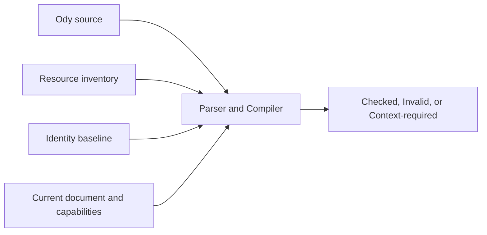
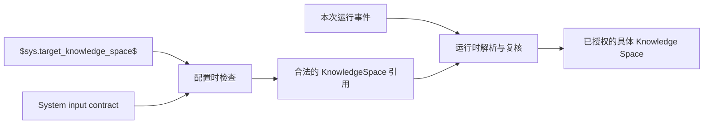
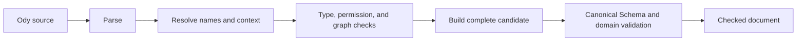
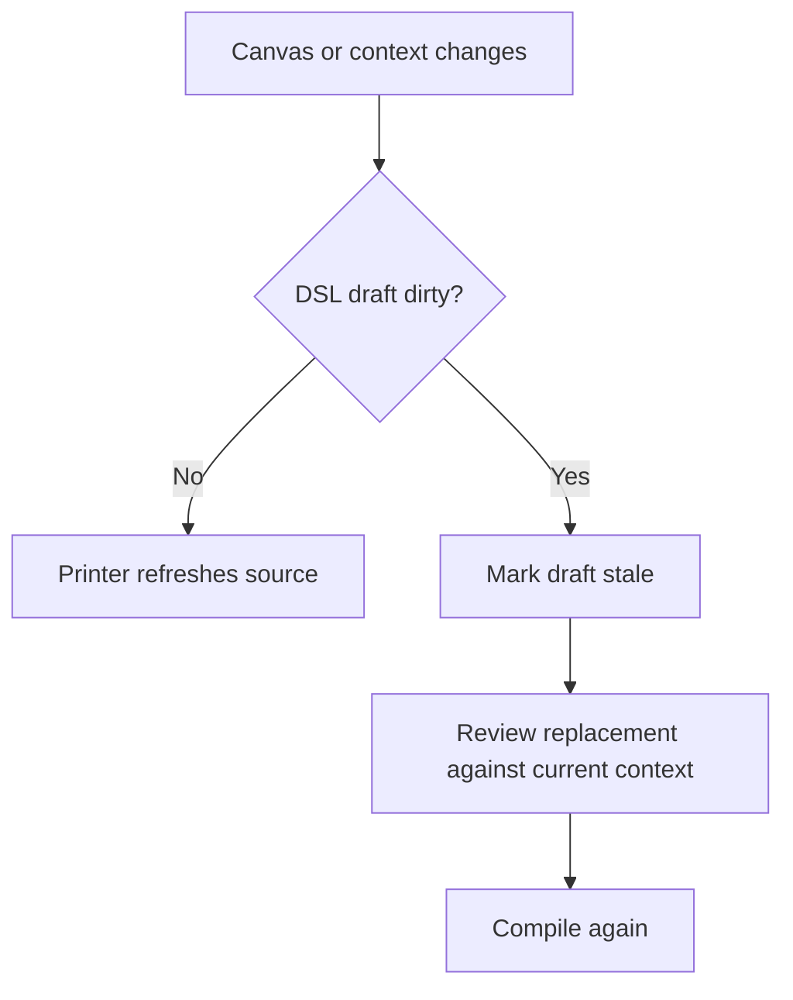

# Ody 如何编译并检查一个 Workflow

> Ody 的 Compiler 不只是把文本换成 JSON。它必须证明：这份文本能够在当前 Odyssey 上下文中，完整、明确并且无越权地成为一个 Agent Workflow。

上一篇[《Ody 如何表达一个 Agent Workflow》](./ody-syntax-and-semantic-model.zh.md)介绍了语言的结构：Variable、Agent Action、Task、Branch、Loop、资源与 Edge 如何映射到 Odyssey 概念。

但语法合法并不等于配置可以应用。

下面这段文本在形式上很容易阅读：

```text
agent_action "Research" {
  model "gpt-5";
  goal "Research the topic.";
  knowledge ["Product Docs"];
  toolbox ["Product Lookup"];
}
```

要把它变成真实 Workflow，Odyssey 还必须回答：

- `Product Docs` 是否是当前 Workspace 中唯一可引用的 Knowledge Space？
- `Product Lookup` 是否是当前 Agent 已经拥有且配置完整的 Reusable Tool？
- Tool 依赖的 Variable 与 Knowledge Space 是否仍然存在？
- 当前 Canvas 的结构能否由这个 DSL 版本无损表达？
- 源文本检查完成后，Canvas 是否已经被其他编辑修改？
- 即使配置合法，当前页面是否允许 Apply 和保存？

因此，Ody 的编译过程是一条**从文本到可安全应用候选配置的证明链路**，而不是一次格式转换。

## 编译从 Source 与 Context 同时开始

Compiler 的输入不只有 Ody source。



一次完整检查至少关心四类输入：

| 输入 | 作用 |
| --- | --- |
| **Source** | 用户当前编辑的 Ody 文本 |
| **Inventory** | 当前可引用的 Knowledge Spaces、Reusable Tools、System Tools、System Variables 与 Pattern exits |
| **Identity baseline** | 语法对象、资源名称与现有内部 UUID 的会话对应关系 |
| **Current document and capabilities** | 当前 Canonical Workflow、Schema 版本与目标 Canvas 能力 |

这解释了为什么同一段 Ody 文本在不同上下文中可能得到不同结果。

`toolbox ["Product Lookup"]` 在拥有该 Tool 的 Agent 中可以合法解析；在另一个 Agent 中可能不存在；当资源目录尚未加载时，Compiler 甚至不能确定它是不存在，还是暂时不可见。

Compiler 不会自行查询网络或数据库。Application 层先加载并筛选资源，再把一个明确的 inventory snapshot 交给领域 Compiler。这样，领域检查保持确定性，也不会在编译过程中偷偷扩大权限范围。

Ody 0.2 还会读取一个明确的**系统输入合同**。例如，`$sys.target_knowledge_space$` 只有在只读 System Input Catalog 中登记了这个 key、并且它的类型是 `KnowledgeSpace` 时，才能用于 Agent Action 的 `knowledge` 或检索 Tool 的 `knowledgeSpaceId`。即使此时还没有发生具体运行事件，Compiler 仍然可以确认配置结构合法，而不需要虚构一个具体 Knowledge Space；未知 key 或类型不兼容则直接产生 error。

## 第一阶段：Parser 恢复结构，而不是假装文本已经完整

Parser 首先把字符转换为 token，再恢复 Workflow、section、声明与字段的结构。

它负责识别：

- 关键字、标识符、字符串、数字与符号；
- 花括号、数组、对象与分号边界；
- 普通字符串、raw string 与注释；
- Variable 引用和 ValueSource 插值；
- Workflow、Node、Tool、Step 与 Edge 的结构位置。

编辑器中的文本经常是不完整的。用户刚输入一个左花括号或删掉分号时，Parser 不能崩溃，也不能停止提供其他有用提示。

因此，Ody Parser 会在确定的同步点恢复：当前容器的分号、匹配的右花括号，以及合法的同级声明起始词。它可以为缺失 token 生成零宽诊断，并继续构建一份可恢复的语法结构。

例如：

```text
variables {
  string shared brief
  boolean user_managed approved = false;
}
```

Parser 可以把缺失分号定位在 `brief` 声明之后，同时继续识别下一条 `approved` Variable。

但“可以恢复 AST”不等于“可以生成 Workflow”。只要源文本仍有阻断错误，Compiler 就不会返回可应用 document。

## Source Span 让错误回到设计发生的位置

每条诊断都携带稳定 code、severity 与 source span。span 指向原始文本中的 `[start, end)` 区间，并能映射到编辑器中的行与列。

不同错误应尽量指向真正需要修改的位置：

- 未知 Variable 指向引用本身；
- 重复声明指向第二次声明，并可关联第一次声明；
- 缺失字段指向所属 block 的末尾；
- 非法链式 Edge 指向第二个箭头；
- 图中有环时，主诊断指向确定选出的环上 Edge，而不是泛泛指向整个文件。

这种位置合同不只是为了红色波浪线。它使 Problems 列表、点击跳转、未来 Quick Fix 和自动生成后的修复循环共享同一套证据。

诊断中也要避免复制敏感正文。Goal、Script、Header 或其他配置可以在编辑器中就地显示，但不应被完整写入日志或 telemetry。

## 第二阶段：名称、作用域与 identity 解析

通过基本语法恢复后，Compiler 开始建立符号与作用域。

它需要区分：

- `agent.topic`：当前 Agent Variable；
- `task.cached`：当前 Task 的局部 Variable；
- `sys.current_message`：外部 System Variable inventory；
- `"Research"`：当前图中的节点名称；
- `"Approved"`：特定 Branch 中的 Case 名称；
- `lookup`：当前文件 `tools` section 中的 alias；
- `"Product Lookup"`：当前 Agent inventory 中已有 Reusable Tool 的名称。

名称经过相同的规范化规则后匹配：移除首尾空白、使用 Unicode NFC、区分大小写。Compiler 不按数组顺序选择重名对象，也不使用模糊匹配猜测用户意图。

名称是用户语法，UUID 是内部身份。编辑现有 Canvas 时，identity baseline 帮助 Compiler 和 Printer 判断一个改名后的声明是否仍代表原来的节点、Variable 或 Tool。若一次修改同时涉及增删和改名，导致映射不唯一，结果必须进入 Review 或 `context-required`，不能按“看起来最像”自动配对。

## 第三阶段：类型、配置与 Thinking Ownership

接下来，Compiler 检查每个值是否适合它所在的位置。

Variable 默认值必须符合声明类型：

```text
number shared confidence = 0.8;     // 合法
number shared confidence = "high"; // 类型错误
```

Tool configuration 由对应 System Tool Schema 检查。Compiler 会识别：

- 必填字段是否存在；
- 是否出现未知字段；
- enum 是否属于允许集合；
- output sourceKey 是否由该 Tool 提供；
- output target 是否为当前作用域中可写的 Variable；
- `increment`、`toggle`、`append` 等 operation 是否适合目标类型；
- API Header、Form entry 与 Script input 是否存在重复或非法结构。

Thinking Ownership 在这里成为真实权限，而不只是颜色：

```text
Task Tool 不能写入 agent_managed Variable
Agent Action 不能直接写入 user_managed Variable
任何一方都不能写入 System 或 read_only Variable
```

Compiler 只能检查结构化配置明确表达的写入。它不会阅读 Goal 中的自然语言，再猜测 Agent 是否打算修改某个 Variable。Agent Action 的运行时写入仍需要未来 runtime 按 ownership 执行约束。

类型检查也不会虚构确定性。若 Tool 的动态输出类型无法在编译期证明，Compiler 保留 runtime 校验责任；它只能拒绝已经可以确定的不兼容配置。

## 第四阶段：图结构与 readiness 是两种问题

Workflow graph 检查分为两层。

第一层是**结构合法性**，例如：

- Start 不能有入边；
- End 不能有出边；
- 普通 Edge 不能自连接或语义重复；
- Branch Edge 必须引用真实 Case 或 `.default`；
- 一个 Branch 出口不能同时连接多个目标；
- Root graph 与 Loop body 不能跨边界连接；
- Loop body 不能包含另一个 Loop；
- 当前 Workflow 不允许任意有向环。

违反这些约束意味着无法形成合法 Canonical Workflow，因此属于 error。

第二层是**readiness**，例如：

- Branch Case 暂时没有连接；
- 某个节点还无法从 Start 到达；
- 某个节点还不能走到合法 End；
- 普通节点存在尚未冻结运行语义的多个出边。

这些情况可能只是设计尚未完成。只要 graph 结构本身合法，它们可以作为 warning 保留，让用户继续 Apply 一份“可保存但尚未就绪”的 Workflow。

这项区分很重要：编辑器不应强迫用户一次性完成整个系统，但也不能把未完成配置展示成已经可以运行。

## 第五阶段：资源解析必须携带完整配置

Knowledge Space、Reusable Tool、System Variable 和 Pattern exit 都来自外部上下文。

Compiler 使用名称帮助人阅读，但真正生成 Canonical Workflow 时必须解析到内部身份和完整依赖。

以 Reusable Tool 为例：

```text
toolbox ["Product Lookup"];
```

合法编译需要：

1. 当前 Agent inventory 中存在唯一的 `Product Lookup`；
2. 该对象确实是已配置的 AgentReusableTool，而不是只有类型名称的 System Tool definition；
3. Tool 的完整 config、input/output binding 与 provenance 可以读取；
4. 它依赖的 Knowledge Space 和 Variable 仍然存在；
5. 目标 Variable 满足类型与 ownership 约束；
6. 最终 Agent 的 Reusable Tool 集合不存在名称冲突。

Compiler 随后把完整配置快照纳入候选 document，而不是只保存名称或一个悬空 ID。

当 inventory 仍在加载时，Compiler 不能把空列表解释成“资源不存在”。此时文本可以继续进行词法和语法检查，但整体结果是 `context-required`，不提供可应用 document。

### 动态资源绑定需要两阶段检查

固定名称可以在配置时解析到当前 inventory 中的资源；运行时绑定则把“这是什么类型的输入”和“这一次具体是哪一个资源”分开处理：



配置时检查绑定语法、namespace 与 key、字段是否接受该类型、Variable scope，以及读写权限。动态目标此时没有具体实例并不是错误，只要触发输入合同已经明确。

运行时则检查实际输入是否存在、资源身份与类型、Workspace 归属、文档和 Knowledge Space 的关系、访问权限以及版本条件。失败时必须拒绝本次运行，不能退回上一次绑定、当前页面选中的资源或任意默认 Knowledge Space。

这个分工也防止 Compiler 越权。它不能自行读取当前页面选择来替代 `$sys.target_knowledge_space$`；编辑器为预览显示的样例资源也不能写回持久化配置。Canonical JSON 必须保存“系统输入引用”本身，Printer 与 Canvas 往返后仍应输出同一个绑定，而不是本次运行解析出的 UUID 或名称。

这套绑定已经纳入 Ody 0.2 的 Parser、Compiler、Printer、Canonical Schema、Canvas 控件与保存链路。`checked` 表示绑定表达式、系统 key、资源类型和使用位置已经通过配置检查；它不等于某次实际执行中的具体资源已经通过授权。实际运行仍须根据本次事件输入重新完成身份、Workspace 归属、权限与版本检查。

## 第六阶段：Canonical emission 是最后一道边界

即使前面的局部检查都通过，Compiler 仍不能手工拼出一个未经验证的对象交给 Store。

它先构建完整候选配置，再通过共享 Canonical Schema 与领域验证：



只有完整 candidate 通过这一边界，结果才可能是 `checked`。

如果共享 Schema 拒绝了一个前置检查没有发现的问题，Compiler 返回 canonical diagnostic，并且不提供 document。这通常意味着 DSL Compiler 与 Canonical Schema 之间出现能力或实现差距，不能让用户通过修改无关文本绕过。

同样，如果当前 Canvas 包含 Ody V0.1 无法无损表达的语义，Printer 或 Compiler 必须 fail closed：保留原配置、给出诊断，而不是删除无法表达的部分后继续 Apply。

## 三种编译结果，不只是“成功或失败”

Compiler 的领域结果分成三类：

| 结果 | 含义 | 是否返回 document |
| --- | --- | ---: |
| `checked` | 必要检查完成且没有 error，可以包含 warning | 是，返回完整候选 |
| `invalid` | 源码、配置、权限、结构或 capability 存在错误 | 否 |
| `context-required` | 资源、identity 或父级出口上下文不足，当前无法安全判断 | 否 |

`context-required` 不是一种拼写错误。它表达的是：文本可能没有问题，但 Odyssey 目前缺少作出安全决定所需的外部事实。

三类结果都可以携带 diagnostics，也可以保留可恢复语法结构。UI 不能简单使用“diagnostics 数量是否为零”判断 Apply；一个 `checked` 结果可能带有 warning，而一个只有 info 的 `context-required` 结果仍然没有可应用 document。

## Error、Warning 与 Info 承担不同责任

Severity 回答“这条信息如何影响候选配置”，而不是只决定文字颜色。

| severity | 典型含义 | Apply |
| --- | --- | ---: |
| `error` | 已知输入违反语言、Schema、权限或结构合同 | 禁止 |
| `warning` | 结构合法，但 Workflow 尚未就绪或运行语义仍需注意 | 可以，但必须明确提示 |
| `info` | 需要外部上下文、结果被截断，或会话需要 Review | 通常禁止，直到状态解决 |

当前诊断 code 按问题族组织：

| 范围 | 问题族 |
| --- | --- |
| `ODSL0xx` | 词法，如非法转义、未闭合字符串 |
| `ODSL1xx` | 结构语法，如缺少分号、重复字段、越界表达式 |
| `ODSL2xx` | 名称、符号、作用域与引用 |
| `ODSL3xx` | 类型、Tool config、binding 与写入权限 |
| `ODSL4xx` | graph、Branch、Loop 与 readiness |
| `ODSL5xx` | 外部资源、inventory 与 identity context |
| `ODSL6xx` | DSL capability 与 Canonical emission |

具体 code registry 仍会随 V0.1 检查合同继续评审和补齐。公开文档可以依赖这些稳定问题族与行为边界，不应把内部 Draft 中的每个编号描述成永久冻结的标准。

## 编辑器状态比编译结果更丰富

DSL Edit 还要处理用户正在输入、异步检查和页面并发，因此 UI state 不止三种 Compiler result。

当前编辑器区分：

```text
unavailable
synced
editing
checking
invalid
ready
stale
context-required
applying
apply-failed
```

其中几个状态容易混淆：

- `ready`：当前 dirty source 已编译为 `checked` candidate，可以尝试 Apply；
- `synced`：当前 DSL 与 Canvas 指向同一语义配置，没有待应用修改；
- `invalid`：当前 source 无法形成候选 document；
- `context-required`：缺少资源、identity 或出口上下文；
- `stale`：检查所基于的 Canvas 或 inventory 已经变化，旧结果不能继续使用；
- `apply-failed`：source 可能仍然合法，但页面状态、并发或 Store mutation 阻止了本次 Apply。

`stale` 和 `apply-failed` 尤其不能伪装成语法错误。它们描述的是编辑会话与外部状态之间的关系，而不是 Ody 文本本身。

## 异步检查不能覆盖更新的输入

DSL Edit 会在用户停止输入一小段时间后自动检查，而资源加载和 Canvas 更新也可能同时发生。

因此，每次检查都绑定：

- source revision；
- inventory revision；
- document mutation sequence；
- 当前 Agent 与页面 session。

结果返回时，如果其中任一项已经过期，编辑器必须丢弃该结果。组件销毁、路由切换或切换 Agent 后返回的旧检查，也不能更新新的 session。

这条规则避免一种危险情况：较慢的旧请求最后返回，却把较新的正确结果覆盖成 ready。

## Stale：两种编辑表面相遇时不能静默覆盖

Canvas 与 DSL 都可以修改同一个 Canonical Workflow，因此必须处理并发编辑。

当 DSL 没有 dirty draft 时，Canvas 的语义变化可以通过 Printer 自动更新文本。单纯 layout 变化不属于 Ody 语义，因此不会触发 stale。

当 DSL 已经有未应用修改，而 Canvas、资源 inventory 或 identity baseline 又发生变化时，编辑器进入 `stale`：



系统不会自动用 Canvas 覆盖草稿，也不会让草稿覆盖新的 Canvas。用户先 Review 基于当前上下文生成的 replacement，再重新检查并主动 Apply。

## Apply 是独立于编译的第二道门槛

一个 `checked` candidate 只说明它在某个明确输入快照下合法，不代表页面此刻一定允许提交。

Apply 前会重新编译最新 source，并再次确认：

- source 与 context 没有过期；
- document mutation sequence 仍然匹配；
- 页面处于 Configure mode；
- 当前没有保存冲突或正在进行的保存；
- Pattern-owned End 集合没有被 DSL 擅自改变；
- 完整 Candidate 仍然通过 Schema 与领域校验。

全部通过后，Application 层才执行一次原子 Store mutation：要么整个 Workflow 被替换，要么原 Canvas 完全不变。不会先修改 Variable，再因为 Edge 失败留下半份配置。

成功 Apply 只更新编辑状态；持久化继续沿用现有 autosave 与 optimistic concurrency / CAS 流程。保存失败保留草稿和候选，并呈现保存问题，不能把它翻译成假的 Ody 语法错误。

## Compiler 必须是无副作用的领域模块

Parser、Compiler 与 Printer 不依赖 Vue、Pinia、Vue Flow、DOM、Store 或网络。

Compiler 可以读取调用方显式传入的 context，但不能：

- 修改 Canvas；
- 创建或重命名资源；
- 执行 Tool、Script、模型或网络请求；
- 读取系统时钟猜测导出信息；
- 在缺少 inventory 时自行查询其他 Workspace；
- 为了“帮助用户”自动扩大权限或补造 Variable。

这种纯领域边界使同一套逻辑可以被编辑器实时检查、Apply 前重检、测试 fixture 和未来 LLM 生成链路共同使用。

## 错误恢复需要避免级联噪声

一个根因可能产生许多表面错误。

如果 Variable 本身没有声明，Compiler 不应该继续推导它与每个操作符的类型，再连续报告十条“类型不兼容”。如果一条 Edge 引用未知节点，它也不应该参与后续环检测和可达性分析。

Ody 检查采用几条抑制原则：

- 先报告最接近根因的问题；
- 不用无效符号继续推导类型；
- graph 已有结构错误时，暂停该图的 readiness 检查；
- 一个 Task 出错，不阻止检查另一个无关 Task；
- 诊断按 source span 与 code 稳定排序并去重；
- 达到诊断预算时明确标记结果不完整，并禁止 Apply。

目标不是尽可能多地显示红线，而是让用户能够从上到下修复真正的问题。

## 对 LLM 生成而言，检查器就是能力边界

未来 LLM 可以生成或修改 Ody source，但它与人工编辑使用同一条检查链路。

模型可以提出：

- 新增哪些 Variable；
- 使用哪些已有 Knowledge Spaces 与 Tools；
- 哪些步骤是 Task，哪些位置使用 Agent Action；
- 如何组织 Branch、Loop 与 Edge。

它不能因为“是系统生成的”就绕过：

- 资源授权；
- Tool 完整配置；
- Variable ownership；
- graph invariants；
- Pattern-owned exits；
- Canonical Schema；
- stale 与保存冲突。

这也是 Ody 相比让 LLM 直接输出内部 JSON 的价值之一：生成结果不仅可读，还必须通过与人类编辑完全相同的领域合同。

不过，检查器只能证明“配置在当前合同下合法”，不能证明“这个 Workflow 的设计质量足够高”，更不能证明它运行后一定达成 Goal。结构正确性、设计质量与运行效果是三种不同问题。

## 当前实现与仍在演进的合同

当前 DSL Edit 已经实现首版主链路：

- Canvas Canonical Workflow → Printer → Ody source；
- Ody source → Parser / Compiler → Canonical candidate；
- source span、行号、错误下划线、Problems 与跳转；
- 自动检查、Format、Apply、Revert；
- inventory context、stale 与 Review replacement；
- Apply 原子更新并沿用现有 autosave / CAS；
- 无效、stale、只读或上下文不足时零 Canvas mutation。

真实后端环境已经验证 DSL Apply、autosave、reload 与 revision conflict 的主路径。但这不表示 validation Draft 中的每条细则、每个错误码和所有网络失败时序都已经完整交付。

仍需继续完善的部分包括：

- 更完整的 System Variable inventory；
- 资源创建、重命名与后端唯一性合同；
- 细化的类型比较和动态输出边界；
- 更多错误恢复、related span 与 golden case；
- 独立 `.ody` 文件 adapter 与跨刷新草稿恢复；
- 未来 runtime 对执行类型和权限的最终落实。

因此，这一页描述的是当前已经成立的**编译安全模型**，而不是宣布检查器及运行时已经全部完成。

## 从文本到 Canvas，失败也必须是明确结果

Ody 的编译设计最终坚持一个原则：**不确定时不修改 Canvas。**

```text
合法且上下文完整     → 返回完整 candidate
文本或领域合同错误   → invalid，零 mutation
上下文不足或身份不明 → context-required，零 mutation
检查结果过期         → stale，要求 Review
Apply 或保存冲突     → 保留草稿，不伪造语法错误
```

这使 DSL Edit 不只是一个方便输入文本的侧栏。它成为一条受控边界：人或未来的 LLM 可以提出 Agent Workflow，而 Odyssey 只接受能够被当前语言、资源权限、领域规则与 Canonical Schema 共同证明的配置。

## 本文术语

| 术语 | 本文中的含义 |
| --- | --- |
| **Parser** | 将 Ody 字符恢复为带 source span 的语法结构；可以容纳暂时不完整的编辑文本。 |
| **Compiler** | 解析符号与资源、检查类型和领域规则，并尝试生成完整 Canonical candidate 的纯领域模块。 |
| **Diagnostic** | 带稳定 code、severity 与 source span 的检查结果。 |
| **Inventory** | 由 Application 层显式提供的可引用资源与能力快照。 |
| **Checked candidate** | 完成必要检查、可进入 Apply 门槛的完整 Canonical Workflow 候选。 |
| **Context-required** | 文本未必错误，但当前缺少安全解析所需的外部事实。 |
| **Stale** | source 或检查结果所依赖的 Canvas、inventory 或 identity baseline 已经变化。 |
| **Apply** | 在最新 source 与 context 上重检后，对 Store 执行一次原子 Workflow 更新。 |

## 设计与实现来源

- 语法与语义检查设计：`odyssey/doc/planning/implementation/DSL/odyssey-workflow-dsl-v0.1-validation-spec.md`；
- 语言规范：`odyssey/doc/planning/implementation/DSL/odyssey-workflow-dsl-v0.1-spec.md`；
- 双向同步计划：`odyssey/doc/planning/implementation/DSL/dsl-edit-bidirectional-sync-implementation-plan.md`；
- 首版集成与验证边界：`odyssey/doc/planning/implementation/DSL/dsl-edit-first-integration-report.md`；
- 当前 Parser 与 Compiler：`odyssey/apps/web/src/domain/workflow-dsl/`；
- 当前编辑器状态机：`odyssey/apps/web/src/features/workflow-editor/useWorkflowDsl.ts`；
- 当前 Store Apply：`odyssey/apps/web/src/stores/agentWorkflow.ts`；
- 运行时变量绑定设计：`odyssey/doc/planning/implementation/DSL/runtime-variable-binding-design.md`；
- 上一篇：[样章《Ody 如何表达一个 Agent Workflow》](./ody-syntax-and-semantic-model.zh.md)。
