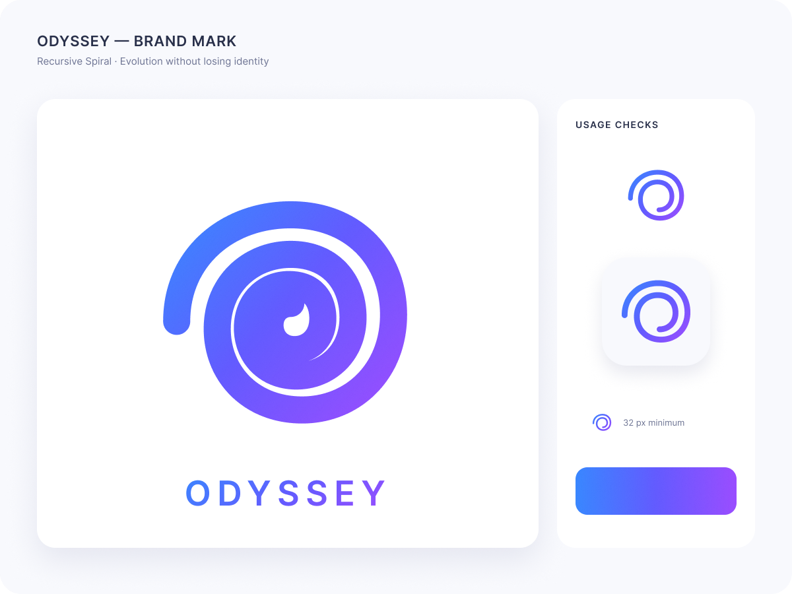
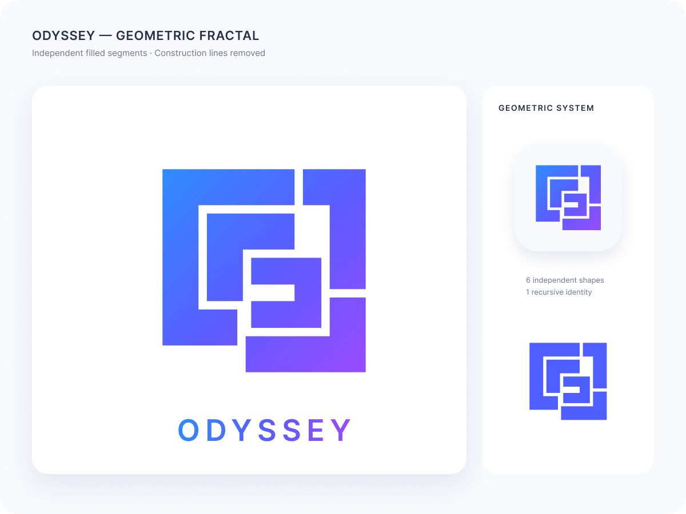
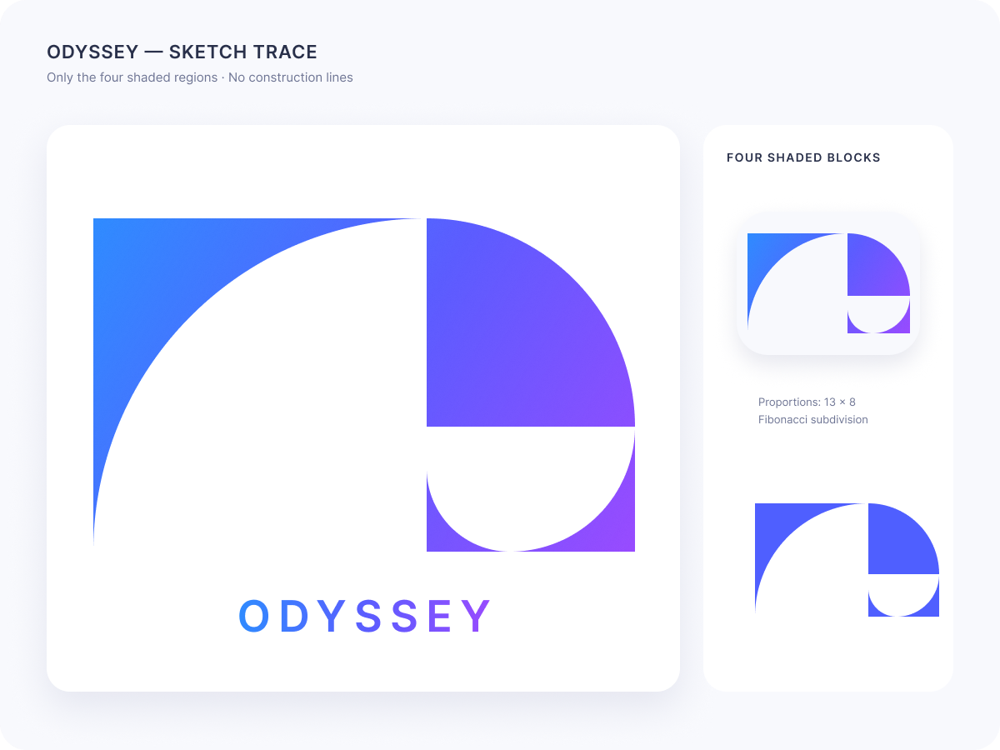
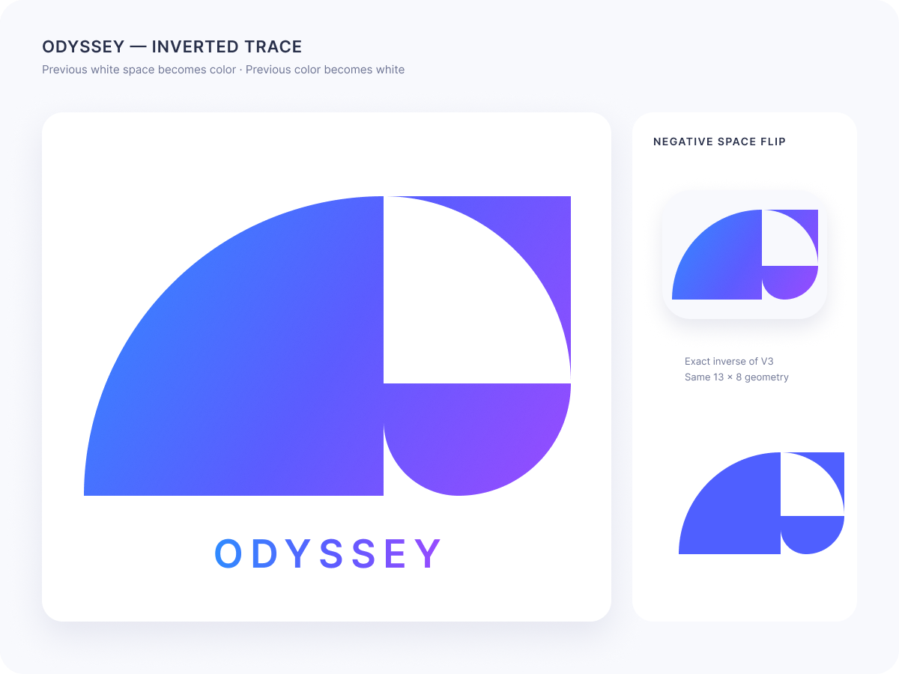
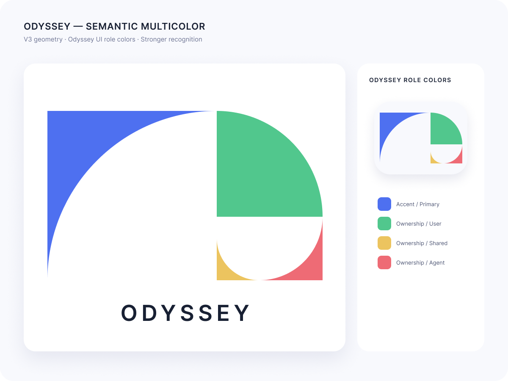
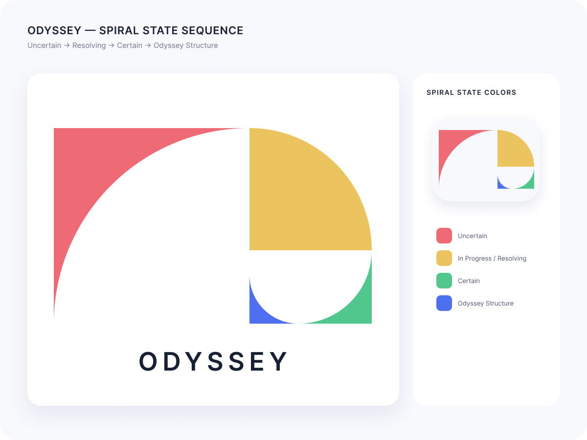

# Odyssey 图标是如何形成的

> Odyssey 的图标试图把一件抽象的事画出来：一个 Human-AI Collaboration System 如何在长期演进中不断改变，同时不失去自己的结构与身份。

Odyssey 关注的不是一次 Prompt 能否得到漂亮答案，而是一项 AI Agent 能力能否经过多轮配置、协作、修订与知识积累，逐渐成为可以继续理解和维护的系统。

因此，图标也不应该只是首字母、机器人或一颗抽象的“AI 星星”。它需要表达一种持续发生的运动：从不确定性出发，在人与 Agent 的共同作用下逐渐收束，最终形成清晰、统一而和谐的结构。

## 从递归螺旋开始

图标最初的造型灵感来自分形与递归螺旋。

分形吸引我们的地方，不只是它看起来复杂，而是相似的关系可以在不同尺度上继续出现。局部会发生变化，整体却仍保持可辨认的秩序。这与 Odyssey 对长期演进的理解相近：系统可以不断加入新的 Agent、Workflow、Tool 与 Knowledge，但这些变化不应该让它失去原有的责任边界和协作结构。

Figma 中最初的概念说明是：**Evolution without losing identity**。递归螺旋首先确定的不是最终轮廓，而是图标需要承载的核心思想。

| Recursive Spiral | Geometric Fractal V2 |
| --- | --- |
|  |  |

*左：理念从递归螺旋开始。右：V2 将构造关系收束为更明确的几何系统。*

## 从几何构造到 Sketch Trace

`Geometric Fractal V2` 将递归关系收束为更明确的几何分区，并开始移除构造线，让每个区域能够独立成立。

但一套完整的几何构造不等于一个有效的图标。图标需要在更小的尺寸下仍然清楚，也需要依靠填充与留白形成稳定的识别轮廓。

`Sketch Trace V3` 因此只保留四个被填充的区域。它沿用了 `13 × 8` 的 Fibonacci subdivision 比例，却不再展示全部构造过程。分形从显性的几何图解，变成了隐藏在形状背后的秩序。

V3 确定了后来版本最重要的基础：四个区域、递进的曲线，以及由留白维持的螺旋运动。

*V3 隐去构造线，只留下四个填充区域与负空间形成的递归螺旋。*

## 为什么选择 V3，而不是 V4

`Inverted Sketch Trace V4` 没有重新设计几何，而是进行了一次更直接的试验：把 V3 的颜色与留白完全反转。

这次对照让取舍变得清楚。V4 强化了外部色块，却削弱了四个区域沿螺旋连续推进的感觉；V3 的填充方向更容易让视线沿曲线向内部移动，也为不同区域承载独立语义留下了空间。

所以最终被保留的不是“V3 这张图”本身，而是 V3 确立的**几何骨架、正负形关系与填充方向**。V4 的价值在于证明了这项选择，而不是成为一次需要隐藏的失败尝试。

*V4 与上方的 V3 使用相同的 `13 × 8` 几何。变化的只有正负形关系，因此两张图可以直接说明最终为什么选择 V3 的填充方向。*

## 当 Thinking Ownership 进入图标

到 `Semantic Multicolor V5`，图标开始使用 Odyssey 的 Thinking Ownership 颜色。颜色不再只是为了区分四个区域，而是把系统中的责任与状态带入标志：

- **红色**代表 Agent-managed 的开放判断，以及由 Agent 承担的不确定性；
- **黄色**代表 Shared，人与 Agent 共同参与、共同修订的协作区域；
- **绿色**代表 User-managed，由人决定并维持的确定边界；
- **蓝色**代表经过工作逐渐沉淀下来的结构与成果，同时连接 Odyssey UI 的整体视觉基调。

*V5 保留 V3 的几何与正负形，只将单一渐变替换为 Odyssey 的责任颜色。*

这里的颜色不是四种角色，也不是一套可以覆盖所有运行状态的分类法。它们是一种视觉语言：提醒人们，一项能力由不同主体以不同方式参与，并最终需要形成可被继续使用的结构。

V5 由此完成了一次关键转变：图标不再只是受分形启发的造型，而开始承载 Odyssey 自己的系统观。

## 从 V5 到 V6：让颜色形成演进

`Spiral State Sequence V6` 没有推翻 V3 的几何，也没有放弃 V5 的颜色。它解决的是最后一个问题：这些区域应该被怎样阅读？

V6 将四个区域组织为一条持续向内推进的螺旋。外层仍然保留开放性与不确定性，随着路径向内收束，人与 Agent 的协作、人的决定以及已经形成的结构不再是彼此孤立的色块，而成为同一次演进中的不同状态。

Figma 将这一方向概括为：**Uncertain → Resolving → Certain → Odyssey Structure**。

这并不意味着每一次真实工作都必须严格按照四种颜色线性发生。它表达的是一个更宽松的方向：不确定性不会因为 Agent 开始工作就自动消失；它需要经过协作、约束、修订与沉淀，才可能成为可以理解和维护的成果。

V6 因而成为最终版本。它保留了递归螺旋的连续性、V3 的正负形关系和 V5 的 Thinking Ownership，同时让这些元素共同指向 Odyssey 最重要的理念：**以清晰、统一而和谐的方式长期演进。**

*相较于上方的 V5，V6 进一步明确了四色的状态语义：红色 Uncertain、黄色 Resolving、绿色 Certain、蓝色 Odyssey Structure。*

## 一个图标能够说明什么

图标不能代替产品设计，也不能证明 Odyssey 已经解决了长期 Human-AI collaboration 的所有问题。

它更像一个压缩后的设计声明：系统可以变化，但变化需要留下结构；Agent 可以承担不确定性，但自主性需要边界；人与 Agent 可以共同工作，但共同工作需要最终沉淀为仍可被人理解、修改和延续的成果。

从 Recursive Spiral 到 V6，变化的不是 Odyssey 想表达什么，而是这个想法如何逐渐获得更清楚的几何、颜色与阅读顺序。

## 设计来源

- Figma：`Odyssey LOGO`，node `144:2`；
- `Recursive Spiral · Evolution without losing identity`；
- `Sketch Trace V3 · 13 × 8 Fibonacci subdivision`；
- `Inverted Sketch Trace V4 · Negative Space Flip`；
- `Semantic Multicolor V5 · Odyssey Role Colors`；
- `Spiral State Sequence V6 · Uncertain → Resolving → Certain → Odyssey Structure`。
