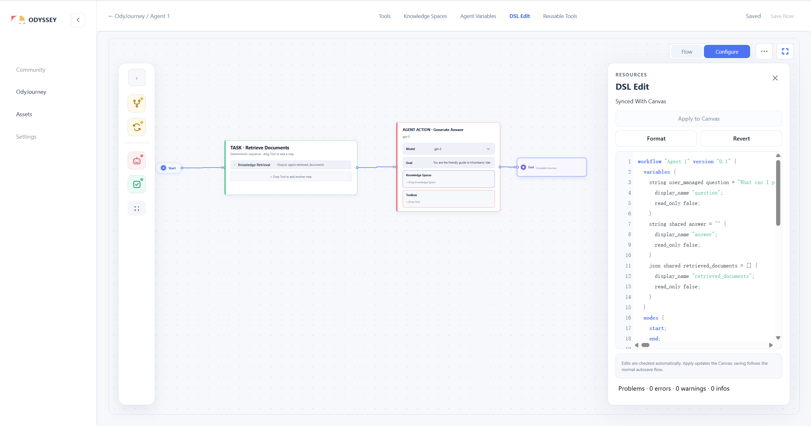
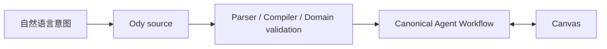
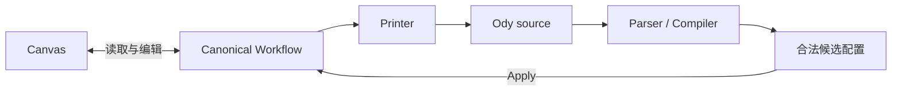

# 为什么 Odyssey 需要一门语言

> Canvas 让 Agent 系统的结构变得可见；一门面向 Agent 设计的语言，则让同一套结构可以被精确编辑、检查、生成和传播。

Odyssey 最初从 Canvas 开始。但从一开始，我们想服务的就不只有手动搭建 Workflow 的人。Odyssey 也希望 LLM 能够根据人的目标，生成一份可以继续查看、检查和修改的 Agent Workflow。

这是一个自然的选择。Agent Workflow 不只是一组参数：它包含行动节点、控制结构、Variable、Knowledge Space、Tool，以及它们之间的连接。把这些对象放在 Canvas 上，设计者可以直接看见工作从哪里开始、经过哪些节点、在哪里分支或迭代，又在哪些位置允许 Agent 进行开放式判断。

但随着设计逐渐完整，一个新的问题出现了：**如果 Canvas 是唯一的表达方式，人和 LLM 如何在不直接操作界面的情况下准确描述一个 Agent Workflow？**

人可能希望像编辑配置一样批量修改它；团队可能希望比较两个版本；LLM 则需要把自然语言意图转换成一个结构明确、能够通过 Odyssey 检查的 Workflow。Canvas 擅长空间化理解，却不是这些任务最自然的接口。

现有编程语言当然能够“写出”一个 Workflow，但它们同时允许任意函数、对象、控制流和副作用。为了创建几个 Agent 节点，LLM 还需要理解 SDK、构造过程和运行环境；Odyssey 也很难把任意代码无损地转换回 Canvas。我们需要的不是另一门通用编程语言，而是一种只表达 Odyssey Agent 设计概念的受限语言。

因此，Odyssey 在 Canvas 之外设计了一门领域语言。本文暂时称它为 **Ody——Odyssey Workflow DSL**。

Ody 不是另一套 Agent 模型。它是 Odyssey 已有概念的文本表达：同一个 Agent Workflow，既可以在 Canvas 中被看见和操纵，也可以在 DSL 中被阅读和编辑。



*图 1：Canvas 与 DSL Edit 并排展示同一个 Agent Workflow。左侧以节点和连线表达结构，右侧以 Ody 源文本表达 Variable、节点与关系；`Synced With Canvas` 表示两种设计表面当前指向同一份语义配置。截图来自 Odyssey 当前 DSL Edit 实现，2026-10-25。*

## Canvas 很重要，但不应该成为唯一入口

Canvas 的优势来自空间。

设计者不必顺着一份长配置逐行阅读，就能先看到 Workflow 的整体形状；Agent Action、Task、Branch 与 Loop 通过不同节点承担不同决策责任；Thinking Ownership 的颜色继续说明哪些决定属于用户、Agent 或二者之间的显式结构。

然而，同一种空间表达也会带来限制。

第一，Canvas 很适合观察关系，却不总适合编辑大量细节。批量增加 Variable、复用一段节点配置，或者准确比较两个版本时，文本通常更直接。

第二，Canvas 中包含两类性质不同的信息：

- **语义信息**：有哪些 Variable、节点和边；Agent Action 拥有什么 Goal、Knowledge Spaces 与 Toolbox；Task 以什么顺序调用 Tool；
- **视图信息**：节点放在哪里、尺寸多大、Viewport 停留在哪一片区域。

这些信息在界面中共同构成一次编辑体验，却不应该都成为 Agent 设计本身。一个 Task 从 Canvas 左侧移动到右侧，不应被理解为 Agent 的行为发生了变化。

第三，Canvas 并不是 LLM 易于稳定生成的目标。让模型“画出”一组节点位置和连线控制点，会把大量注意力消耗在视觉布局，而不是 Agent 的目标、能力和控制边界上。

Ody 因此不是为了替代 Canvas，而是为了给同一套设计增加一个不同性质的入口。

## 为什么不用通用编程语言或直接生成 JSON

用 Python、TypeScript 等语言调用 SDK，是构建 Agent 系统的一种常见方式。它们具有成熟的工具链，也能表达几乎任何逻辑。但“几乎什么都能表达”并不完全适合 Odyssey 的目标。

通用代码会把 Agent 设计与对象构造、库版本、运行环境和任意控制逻辑混在一起。LLM 不仅要决定 Workflow 中应该有什么，还要正确选择 API、组织初始化顺序并处理语言细节。更重要的是，一段任意代码很难被可靠地反向解释成 Canvas：其中哪些语句代表节点，哪些循环代表 Odyssey Loop，哪些副作用只是构建脚本自己的行为，并不存在稳定答案。

Ody 选择一个更窄的表达范围。它只允许 Odyssey 已经定义的 Variable、Agent Action、Task、Branch、Loop、Tool 与连接关系。这个限制牺牲了通用编程能力，却换来了静态检查、确定性转换以及与 Canvas 双向同步的可能。

Odyssey 已经拥有结构化的 Workflow JSON。它适合被 Schema 校验、由前后端传输，并作为持久化配置的一部分保存。既然如此，为什么还要设计一门 DSL？

因为**适合机器保存的数据结构，不一定适合人和 LLM 进行设计**。

Canonical JSON 必须照顾内部身份、Schema 版本、嵌套结构以及应用所需的完整字段。对系统而言，这些信息是明确的；对设计者而言，它们会让一个简单意图被大量结构噪声包围。LLM 也需要同时维持括号层级、内部 ID、默认字段和实现细节，生成结果虽然可能满足 JSON 语法，却未必满足 Odyssey 的领域规则。

Ody 在自然语言与 Canonical JSON 之间增加了一层受约束的表达：



自然语言足够灵活，却容易留下歧义；通用编程语言足够强大，却引入了任意执行语义；JSON 足够精确，却暴露了过多存储和实现细节。Ody 选择三者之间一个更窄的位置：它使用有限语法明确对象与关系，同时让文本仍然接近设计者和 LLM 理解 Agent Workflow 的方式。

这也意味着，Ody 并不与 JSON 竞争“唯一真相”的位置。Canonical Workflow 仍是 Odyssey 校验和持久化的正式数据；Ody 是面向人和生成系统的 authoring surface。

## 一门只表达 Agent 设计的语言

Ody 有意忽略 layout。

节点坐标、尺寸、Viewport 和连线控制点不属于 DSL。它们仍由 Canvas 负责，并在应用 DSL 修改时尽可能保留。只有新创建、尚无位置的对象才需要由 Canvas 安排布局。

这项取舍让语言集中回答更重要的问题：

- Agent 拥有哪些 Variable，它们由谁维护；
- Workflow 中有哪些 Agent Action、Task、Branch 与 Loop；
- Agent Action 的 Goal 是什么；
- 哪些 Knowledge Spaces 构成它的认知空间；
- 哪些 Tools 构成它的行动空间；
- Task 如何确定性地调用 Tool；
- 节点之间如何连接；
- Workflow 可以从哪些 End 返回上层 OdyJourney。

例如，一个经过简化的 Workflow 可以写成：

```text
workflow "Research Agent" version "0.1" {
  variables {
    string user_managed research_topic = "Odyssey";
    string shared research_brief;
  }

  nodes {
    start;
    end;

    agent_action "Research & Synthesize" {
      model "gpt-5";
      goal "Research ${agent.research_topic} and update the brief.";
      knowledge ["Product Docs"];
      toolbox [WebSearch];
    }
  }

  edges {
    start -> "Research & Synthesize";
    "Research & Synthesize" -> end;
  }
}
```

这段文本没有说明节点应该出现在 Canvas 的哪个位置，却完整表达了这个 Agent Action 的目的、认知边界、行动边界、状态以及控制关系。

这里的 `knowledge` 与 `toolbox` 不是两组普通依赖。

Knowledge Spaces 定义 Agent Action 可以依赖哪些信息和语义环境，是它的**认知空间**；Toolbox 定义 Agent 可以选择哪些能力作用于问题与外部世界，是它的**行动空间**。DSL 将二者和 Goal 放在同一节点声明中，使 Agent 的开放式判断仍然处于用户给定的边界内。

## 两种编辑方式，但只有一份语义

增加 DSL 最危险的做法，是在系统中制造两份配置：Canvas 保存一份，文本编辑器再保存一份，然后试图判断哪一份更新。

Odyssey 不采用这种结构。

Canvas 和 DSL 都指向同一个 Canonical Agent Workflow：



从 Canvas 打开 DSL Edit 时，Printer 根据当前 Canonical Workflow 生成 Ody 文本。用户修改文本后，Parser 与 Compiler 先构建一份完整候选配置，执行语法、类型、资源和图结构检查；只有候选配置整体合法，`Apply to Canvas` 才会以一次原子修改更新 Workflow。

这带来几个重要结果：

- 错误文本不会对 Canvas 产生一半成功、一半失败的修改；
- 资源尚未加载、名称无法唯一解析或编辑基线已经过期时，Apply 会被阻止；
- 单纯移动节点不会让 DSL 失去同步，因为 layout 不属于 DSL 语义；
- 当用户正在修改 DSL 而 Canvas 的语义也发生变化时，系统不会静默覆盖任意一方，而是将草稿标记为 stale，要求用户检查新的替换内容；
- 成功 Apply 后仍沿用现有的保存与并发控制流程，而不是绕过 Store 另建一条保存通道。

因此，“双向同步”不是两个编辑器实时争夺同一份文本。它意味着两种设计表面都可以读写同一个领域模型，并在越过边界之前经过明确的转换与检查。

## DSL 让错误更接近设计发生的位置

Canvas 可以通过可选项、拖拽限制和连接规则避免一部分错误。文本编辑则必须允许用户暂时写出不完整内容，否则它就无法像真正的编辑器一样工作。

Ody 因此把诊断作为语言的一部分，而不是 Apply 失败后的附加消息。

检查范围包括：

- 字符串、括号和声明结构是否完整；
- Variable、节点与资源名称能否被解析；
- Tool 的输入输出与 Variable 类型是否匹配；
- Agent 是否试图写入不允许维护的状态；
- Branch 出口、Loop 边界与 Workflow 连线是否合法；
- 引用的 Knowledge Space、Reusable Tool 或 Pattern End 是否存在且唯一；
- 当前 Canvas 是否包含 DSL 尚无法无损表达的语义。

诊断会指向源码位置，并区分 error、warning 与需要外部资源的 context-required 状态。错误阻止 Apply；某些尚未连接的 Branch 出口或不可达节点可以作为 readiness warning 保留，让用户继续编辑一份结构合法但尚未完成的 Workflow。

这种设计很重要，因为 DSL 的价值不只是“少写一些 JSON”。它把 Odyssey 的领域约束变成一份可以被编辑器、人和生成系统共同检查的合同。

## 给 LLM 的不是画布控制权，而是一个生成接口

Ody 的第二个目标，是为 LLM 生成 Odyssey Workflow 提供接口。

如果模型直接操作 Canvas，它必须决定节点坐标、拖拽顺序和界面状态；如果直接生成 Canonical JSON，它又必须了解大量内部字段。两种方式都把产品实现细节混入 Agent 设计任务。

使用 Ody 时，LLM 可以把注意力放在较稳定的概念上：

- 需要哪些 Variable；
- 哪些步骤必须是确定性的 Task；
- 哪些工作需要 Agent Action；
- Agent 可以参考哪些知识、使用哪些能力；
- 哪里需要显式 Branch 或受约束的 Loop；
- 节点之间应该如何连接。

生成结果随后经过与人工编辑相同的编译和领域检查。LLM 不因为生成了文本就获得绕过权限、Schema 或控制边界的能力。

不过，这仍然是一项**接口设计与未来能力**。当前 Odyssey 已经建立 Ody 与 Canvas 之间的编辑、检查和 Apply 主链路，但还没有用系统性评估证明 LLM 能够在不同复杂度的任务中稳定生成高质量 Workflow。公开文档应该说明这一方向，而不把尚未验证的生成质量写成既成事实。

## 它不是运行时编程语言

Ody 的外观接近一门小型编程语言，但它并不承担通用编程语言的职责。

它目前不提供任意函数、宏、导入、自由表达式或不受约束的图循环，也不直接执行 Agent。它描述一个 Agent Workflow，并将其编译为 Odyssey 已有的领域对象；真正的执行语义仍由 Odyssey 的运行模型、Tool 合同和权限边界决定。

这一区分也解释了为什么本文使用“Workflow DSL”，而不是把它称为脚本语言。它的主要价值是**声明与检查设计**，而不是在平台之外执行一段程序。

当前范围也刻意停留在单个 Agent Workflow。OdyJourney 的 System Pattern、Agent Slot 关系与 Journey 级执行行为仍由上层设计表面负责。未来是否让语言覆盖这些对象，需要重新讨论作用域、拓扑和迁移合同，不能只在现有 grammar 中增加几个关键字。

## 这种设计付出的代价

一门新语言会增加学习成本。

用户需要理解它的 section、名称引用、Variable namespace 和受限表达式；Odyssey 也必须长期维护 Parser、Compiler、Printer、诊断以及 Canonical Schema 之间的一致性。每当 Canvas 引入一种新的领域能力，团队都必须回答：DSL 能否无损表达它？如果不能，是阻止转换、扩展语言，还是明确将它留在 Canvas？

双向编辑还带来格式损失。Canvas 重新生成 DSL 时，可以保留语义和身份，却不一定保留用户原来的注释、空行和手工排版。当前设计通过“不覆盖 dirty draft”保护正在进行的文本编辑，但这并不等于源码已经成为需要长期保存的独立文件。

最后，为 LLM 设计语法并不意味着语法越接近自然语言越好。过度自由会让生成结果难以检查；过度接近内部 JSON，又会失去 DSL 的意义。Ody 需要在可生成性、明确性与领域约束之间持续寻找边界。

## 从一个界面，走向一种共享语言

Odyssey 仍然需要 Canvas。

Canvas 让结构、Thinking Ownership 和控制边界在空间中变得可见，是理解复杂 Agent 系统的重要方式。Ody 没有试图把这些优势压缩成一份只能顺序阅读的文本。

它补上的，是另一种能力：让同一套 Agent 设计脱离具体布局后，仍然能够被准确表达、修改、检查和生成。

```text
Canvas 负责让设计可见
Ody 负责让设计可表达
Canonical Workflow 保证二者仍是同一个系统
```

当人通过 Canvas 组织结构、通过文本精确修改，未来的 LLM 也通过同一份语言提出可检查的 Workflow 时，Odyssey 获得的不只是一个新编辑器。

它获得了一种可以在人、界面与生成系统之间共享的 Agent 设计语言。

## 本文术语

| 术语 | 本文中的含义 |
| --- | --- |
| **Ody** | 本文建议的产品短名称；正式指 Odyssey Workflow DSL。 |
| **DSL Edit** | Agent Workflow Canvas 中用于查看、检查和应用 Ody 源文本的编辑表面。 |
| **Canonical Workflow** | 经共享 Schema 与领域规则校验、用于应用状态与持久化的 Agent Workflow 正式结构。 |
| **Printer** | 将 Canonical Workflow 确定性地表达为 Ody 文本的领域模块。 |
| **Compiler** | 将 Ody 源文本解析、解析资源引用并检查后，生成完整 Canonical Workflow 候选的领域模块。 |
| **Authoring surface** | 面向用户或生成系统编辑同一领域模型的入口；Canvas 与 DSL Edit 都属于 authoring surface。 |
| **Layout** | 节点坐标、尺寸、Viewport 等视图状态；不属于 Ody 表达的 Agent 语义。 |

## 设计与实现来源

- 语言规范：`odyssey/doc/planning/implementation/DSL/odyssey-workflow-dsl-v0.1-spec.md`；
- 检查合同：`odyssey/doc/planning/implementation/DSL/odyssey-workflow-dsl-v0.1-validation-spec.md`；
- 双向同步设计：`odyssey/doc/planning/implementation/DSL/dsl-edit-bidirectional-sync-implementation-plan.md`；
- 当前集成状态：`odyssey/doc/planning/implementation/DSL/dsl-edit-first-integration-report.md`；
- 示例源文件：`odyssey/doc/planning/implementation/DSL/examples/*.ody`；
- 当前 Parser、Compiler 与 Printer：`odyssey/apps/web/src/domain/workflow-dsl/`；
- 当前 DSL Edit 集成：`odyssey/apps/web/src/features/workflow-editor/useWorkflowDsl.ts` 与 `WorkflowDslEditor.vue`。
