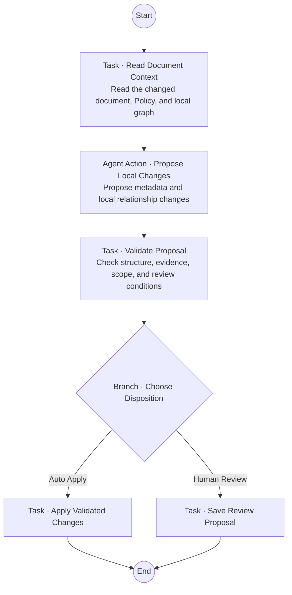

# Document Curator: Let the Agent Propose Changes, Not Modify Knowledge Directly

> As the first complete case study in the Odyssey documentation, Document Curator brings Knowledge Space, Thinking Ownership, Agent Action, Task, Branch, Toolbox, Variable, and the Ody DSL into one concrete problem: when a document changes, an Agent can help maintain the knowledge around it—but who has the authority to decide which changes actually take effect?

::: tip View This Case in Odyssey
You can find Document Curator in the [Odyssey Live Demo](https://shiny-dawn-ff43.houliang008.workers.dev/) and inspect its Agent Workflow Canvas and Ody configuration. The public Demo is view-only. Because Odyssey currently has no execution kernel, it does not run this knowledge-maintenance Workflow.
:::

## Knowledge Does Not Stay Correct Simply Because It Entered a Knowledge Space

A Knowledge Space does more than store text for retrieval. It preserves both a human-facing file structure and semantic relationships among documents. This knowledge environment can persist beyond one model call, but persistence also means that it will change over time.

New documents arrive. Existing documents are revised. Earlier summaries become inaccurate, references break, and two sources may begin to contradict one another. If a system builds an index only when content is uploaded, its Knowledge Space still becomes an increasingly outdated snapshot.

Document Curator focuses on the most local form of this change: **after one document is added or updated, how should the system generate its initial metadata, inspect the neighboring material it affects, and maintain local relationships supported by evidence?**

This sounds well suited to an Agent. An Agent can read a document, interpret its meaning, find related material, and propose relationships more flexibly than a fixed rule can.

The difficult part, however, is not generating a summary or finding similar documents. It is the **authority to change knowledge**.

If the same Agent proposes a change, judges whether its own proposal is safe, and writes directly into the Knowledge Space, “automatic maintenance” collapses several distinct responsibilities into one opaque model judgment:

- Did the Agent read the complete and current source document?
- Is a proposed relationship supported by explicit evidence, rather than keyword similarity alone?
- Would the proposal overwrite a Summary, Guide, or tag that a person has already changed?
- Has a local update expanded into an unintended reconstruction of the entire Knowledge Space?
- When sources conflict, has the Agent selected the “correct version” without having the authority to do so?

Document Curator is therefore not a design for “letting an Agent organize everything automatically.” It is first a design about **Bounded Autonomy**: the Agent owns open-ended judgment, while validation, authorization, and actual writes remain inside explicit system boundaries.

## Why One Agent Is Enough

This case uses the **Solo Pattern**. Document Curator is not intended to simulate a team of Planner, Researcher, and Reviewer Agents. It maintains one local capability with a clearly bounded responsibility.

One Curator Agent is enough to understand the context of a document change and propose a candidate update. Adding a Reviewer Agent may appear to make review visible, but it would obscure the distinction that matters here: a proposal may come from model judgment, while compliance with scope, permission, and Policy should not depend on another judgment of the same kind.

Odyssey therefore does not assign “proposer” and “approver” to two Agents. Open-ended proposals belong to an Agent Action. Deterministic checks belong to constrained Tools inside a Task. Candidates that require human judgment enter an explicit Review path. The boundary comes from different design objects, not from adding more role names.

## A Workflow Deliberately Kept Short

The Document Curator Agent Workflow retains only one genuine business decision: can this complete change set be applied automatically, or must it wait for human review?



The Workflow does not add a separate Branch for `no change`, duplicate events, stale versions, or Tool failures. These are not new business choices. A valid no-change result can follow the automatic path without writing anything. Future invocation and validation contracts should reject or short-circuit duplicate and stale inputs. Read failures and Tool failures are execution errors, not another normal route in which the Agent should continue guessing.

Keeping the Canvas short does not hide complexity. It returns different kinds of complexity to the places where they belong. What a user needs to see in the Workflow is the maintenance responsibility and the business decision—not every runtime error code rendered as a node.

<!-- Visual TODO: replace or supplement the diagram with a screenshot of the current Document Curator Agent Workflow Canvas. Do not use the old mermaid-diagram.png in the case directory; it shows the superseded two-Branch design that V0.2 simplified. -->

## The Task Establishes Trusted Context First

The Workflow begins with `Read Document Context`, rather than handing a “document changed” message directly to the Agent.

This step needs to prepare the current source document, existing metadata and its ownership, existing tags, relationships incident to the document, evidence from relevant documents, and the complete maintenance Policy and version. It must also preserve trusted runtime information such as the target Workspace, Knowledge Space, document identity, and source revision.

One distinction matters here: **text in the context is evidence; it does not automatically grant authority.**

In the current design, the Agent Action can see two Knowledge Spaces:

- the fixed **Document Curator Playbook**, which contains the Metadata, Relationship, and Review Policies;
- the target Knowledge Space bound at runtime through `$sys.target_knowledge_space$`, which contains the document and local relationships being maintained.

The former contains trusted maintenance rules. The latter contains the knowledge under maintenance. Describing both merely as “retrievable text” would conceal their fundamentally different sources of authority.

## The Agent Action Proposes; It Does Not Approve

`Propose Local Changes` is the only node in the Workflow responsible for open-ended semantic judgment.

It reads the prepared context and proposes a Summary, Guide, existing tags, and local relationships for the changed document. When necessary, it may also use the `Find Related Game Documents` retrieval Tool to find additional neighboring evidence. Each candidate operation should carry its source identity, revision, locator, supporting passage, prior value, and reason for change.

The two resource boundaries of an Agent Action appear together here:

- **Knowledge Spaces are its cognitive space**: they define which knowledge and rules the Agent may rely on;
- **the Toolbox is its action space**: it defines which capabilities the Agent may actively invoke to gather further evidence.

The Agent may decide whether and how to use the retrieval Tool, but it cannot invent a write capability that was never placed in its Toolbox. More importantly, it only writes a candidate object into the `proposal` Variable. It cannot set a trusted `requiresReview` value, approve its own candidate, or directly alter the knowledge graph.

“The Agent owns the path” has a concrete meaning here: it may decide how to interpret the document, which local evidence to seek, and what changes to propose. It does not own the entire Knowledge Space or the decision that makes a proposed change take effect.

## Deterministic Validation Owns the Branch Input

After the Agent completes its proposal, the `Validate Proposal` Task takes control.

It first checks that the candidate has the required structure, then validates operation scope, evidence, object identity, revisions, ownership, and the Review Policy against the current context. Only a technically valid candidate produces an explicit `requiresReview` Boolean for the `Choose Disposition` Branch.

The Validator produces this Boolean; the Agent does not report it as part of its own answer. A missing, malformed, or unverifiable value must never default to “no review required.”

The current Policy permits only a narrow set of changes to be applied automatically, including:

- creating or refreshing a Summary and Guide maintained by this Curator when ownership is known;
- adding the changed document to an existing, uniquely resolved tag;
- adding a `references` relationship incident to the changed document when the source contains an explicit reference and the target resolves uniquely within the same Knowledge Space.

Creating a new tag, removing a relationship, modifying human-maintained content, proposing a relationship other than `references`, encountering an ambiguous target, or discovering a source conflict all require human review.

If any operation in the candidate requires review, the current design sends the **entire candidate** to Review rather than quietly applying the parts that appear safe. This keeps the Proposal visible to the user aligned with the Change Set that could eventually be applied, and avoids a difficult state in which one run leaves some operations applied and others pending.

## The Same Design Exists in Both Canvas and Ody

Document Curator also places another Odyssey design claim into a concrete configuration: Canvas and the Ody DSL should express the same Agent Workflow, rather than becoming two configurations that gradually diverge.

In Canvas, node colors, connections, and the Branch make the boundary between open-ended judgment and deterministic control visible. In Ody, `agent_action`, `task`, `branch`, Variable bindings, Knowledge, and Toolbox declarations express the same boundary precisely.

The target Knowledge Space is not a hard-coded resource name:

```ody
agent_action "Propose Local Changes" {
  knowledge ["Document Curator Playbook", $sys.target_knowledge_space$];
  toolbox [tool_1_Find_Related_Game_Documents];
}
```

At the language and configuration level, the same Workflow therefore does not need to be copied for every target Knowledge Space. `$sys.target_knowledge_space$` is a system input that must pass type checking and, in future execution, be supplied by trusted context. The Agent cannot turn an arbitrary string into a new knowledge source. The current editor can express and check this binding, but no kernel has yet injected a real event and executed it.

<!-- Visual TODO: create a side-by-side screenshot of the current Canvas and DSL Edit views. Highlight the fixed Playbook, dynamic target KS, and Toolbox inside the Agent Action, as well as the boundary from Validate Proposal to Branch. -->

## What This Case Can Currently Show

Document Curator does not prove that Odyssey already has a production-grade knowledge-maintenance executor.

The case now has a Workflow configuration that Canvas and Ody can express and check, together with a maintenance Policy, Variables, resource bindings, and static API contracts. It can show that Odyssey's core concepts can at least describe one concrete problem together: open-ended semantic judgment, deterministic validation, knowledge boundaries, and human review can occupy distinct positions in one design language.

It does not validate real event subscriptions, API services, atomic graph writes, concurrency recovery, a persistent Review lifecycle, or end-to-end runtime reliability. The API addresses in the example are non-operational contract placeholders. Successful compilation means that the Workflow configuration satisfies current language and domain checks; it does not mean that external maintenance services exist or that this Workflow has run successfully.

This distinction is essential to the case. Odyssey is currently an operable and inspectable Human–AI Collaboration System Prototype. Document Curator shows how this Prototype can organize a real capability without presenting unimplemented execution infrastructure as a product promise.

## From One Case Back to the Odyssey Design Thesis

Document Curator does not ultimately rely on a longer Prompt, nor does it use more Agent roles to conceal authority boundaries.

It assigns different parts of the problem to different design objects. The Solo Pattern defines the system form of the capability. Tasks express how trusted context and deterministic capabilities should be established. The Agent Action expresses open-ended judgment within Knowledge Space and Toolbox boundaries. Variables make intermediate state and its ownership referenceable. The Branch accepts only the Validator's decision. The Review path preserves the judgment that people genuinely need to own. Ody makes the same design precisely editable and checkable while keeping it synchronized with Canvas.

The case does not remove uncertainty from knowledge maintenance. It puts uncertainty in the right place: an Agent can contribute judgment, but the ability to propose a change does not automatically grant the authority to approve it.

## Related Design

- [Why Knowledge Space Is More Than RAG](/core-concepts/knowledge-space-more-than-rag)
- [Why Bounded Autonomy?](/core-concepts/bounded-autonomy)
- [Why Odyssey Needs a Language](/core-concepts/workflow-language)
- [How Ody Expresses an Agent Workflow](/language/syntax-and-semantic-model)

## Design Sources

- Odyssey repository: `doc/product/cases/second-case-document-curator/README.md`;
- current simplified Workflow: `workflow-design.md`, V0.2;
- current Ody configuration: `document-curator.ody`, Ody 0.2;
- maintenance boundary: `maintenance-rules/review-and-change-policy.md`;
- static interface contracts: `api-contracts.md`.


