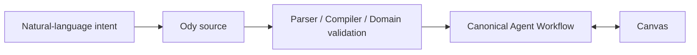
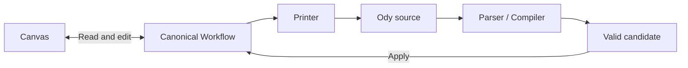

# Why Odyssey Needs a Language

> The Canvas makes the structure of an Agent system visible. A language for Agent design makes the same structure precise enough to edit, validate, generate, and share.

Odyssey began with a Canvas. But from the beginning, we wanted to support more than people manually assembling Workflows. Odyssey should also allow an LLM to turn a person's goal into an Agent Workflow that can still be inspected, validated, and revised.

Starting with a Canvas was a natural choice. An Agent Workflow is more than a collection of parameters: it contains action nodes, control structures, Variables, Knowledge Spaces, Tools, and the connections among them. By placing these objects on a Canvas, a designer can see where work begins, which nodes it passes through, where it branches or iterates, and where an Agent is allowed to make open-ended judgments.

As the design became more complete, however, a new question appeared: **if the Canvas is the only representation, how can people and LLMs describe an Agent Workflow accurately without directly operating the interface?**

A person may want to edit configuration in bulk. A team may want to compare two versions. An LLM needs to translate a natural-language intention into a structurally explicit Workflow that Odyssey can validate. The Canvas is well suited to spatial understanding, but it is not the most natural interface for these tasks.

Existing programming languages can, of course, be used to “write” a Workflow. But they also permit arbitrary functions, objects, control flow, and side effects. To create a few Agent nodes, an LLM would also need to understand an SDK, a construction process, and a runtime environment. Odyssey would then have to recover a Canvas from arbitrary code without losing meaning. What we needed was not another general-purpose programming language, but a constrained language that expresses only Odyssey's Agent design concepts.

Odyssey therefore introduces a domain-specific language alongside the Canvas. In this article, we call it **Ody—the Odyssey Workflow DSL**.

Ody is not a second Agent model. It is a textual representation of Odyssey's existing concepts: the same Agent Workflow can be seen and manipulated on the Canvas, or read and edited as DSL source.

For the concrete mapping between Ody syntax and Odyssey concepts, continue to [How Ody Expresses an Agent Workflow](/language/syntax-and-semantic-model).


*Figure 1: The Canvas and DSL Edit show the same Agent Workflow side by side. The Canvas expresses structure through nodes and edges; Ody source expresses Variables, nodes, and relationships as text. `Synced With Canvas` means that both authoring surfaces currently refer to the same semantic configuration. Screenshot from the current Odyssey DSL Edit implementation, 2026-10-25.*

## The Canvas Matters, but It Should Not Be the Only Entry Point

The Canvas derives its strength from space.

A designer can first see the overall shape of a Workflow instead of reading a long configuration from top to bottom. Agent Action, Task, Branch, and Loop nodes carry different decision responsibilities. Thinking Ownership colors continue to show whether a decision belongs to the user, the Agent, or an explicit structure between them.

The same spatial representation also introduces limitations.

First, the Canvas is effective for observing relationships, but it is not always the most efficient way to edit many details. Text is often more direct when adding Variables in bulk, reusing a node configuration, or comparing two versions precisely.

Second, a Canvas contains two fundamentally different kinds of information:

- **Semantic information:** which Variables, nodes, and edges exist; which Goal, Knowledge Spaces, and Toolbox an Agent Action has; and the order in which a Task uses Tools.
- **View information:** where nodes are placed, how large they are, and which region the Viewport currently shows.

Both contribute to the editing experience, but they should not both define the Agent design itself. Moving a Task from the left side of the Canvas to the right should not mean that the Agent's behavior has changed.

Third, a Canvas is not an easy target for an LLM to generate reliably. Asking a model to “draw” node positions and connection control points spends attention on visual layout instead of the Agent's goals, capabilities, and control boundaries.

Ody is therefore not intended to replace the Canvas. It provides another kind of entry point into the same design.

## Why Not Use a General-Purpose Language or Generate JSON Directly?

Calling an SDK from Python, TypeScript, or another programming language is a common way to build Agent systems. These languages have mature tooling and can express almost any logic. But the ability to express almost anything is not entirely aligned with Odyssey's goal.

General-purpose code mixes Agent design with object construction, library versions, runtime environments, and arbitrary control logic. An LLM must decide not only what belongs in the Workflow, but also which APIs to call, how to order initialization, and how to satisfy the host language. More importantly, arbitrary code cannot be translated reliably back into a Canvas. There is no stable answer to which statements represent nodes, which loops represent an Odyssey Loop, or which side effects belong only to the construction script.

Ody chooses a narrower expressive range. It permits only concepts Odyssey already defines: Variables, Agent Actions, Tasks, Branches, Loops, Tools, and their connections. This constraint sacrifices general-purpose programming power in exchange for static validation, deterministic conversion, and the possibility of bidirectional synchronization with the Canvas.

Odyssey already has structured Workflow JSON. It is suitable for Schema validation, frontend–backend transfer, and persistent configuration. Why introduce a DSL as well?

Because **a data structure that is appropriate for machine storage is not necessarily appropriate for people and LLMs designing a system**.

Canonical JSON must carry internal identity, Schema versions, nested structures, and the complete set of fields required by the application. This information is explicit for the system, but it can surround a simple design intention with structural noise. An LLM must also maintain bracket nesting, internal IDs, default fields, and implementation details. Its output may be valid JSON without satisfying Odyssey's domain rules.

Ody introduces a constrained representation between natural language and Canonical JSON:



Natural language is flexible but ambiguous. General-purpose programming languages are powerful but introduce arbitrary execution semantics. JSON is precise but exposes too many storage and implementation details. Ody occupies a narrower position among the three: it uses a limited syntax to make objects and relationships explicit while remaining close to the way designers and LLMs understand an Agent Workflow.

Ody therefore does not compete with JSON for the position of “single source of truth.” The Canonical Workflow remains Odyssey's formal validated and persisted representation. Ody is an authoring surface for people and generation systems.

## A Language That Expresses Only the Agent Design

Ody deliberately excludes layout.

Node coordinates, dimensions, Viewport state, and edge control points do not belong to the DSL. The Canvas remains responsible for them and preserves them when DSL changes are applied whenever possible. Only newly created objects without positions need to be laid out by the Canvas.

This choice allows the language to focus on more important questions:

- Which Variables does the Agent have, and who may maintain them?
- Which Agent Actions, Tasks, Branches, and Loops exist in the Workflow?
- What is the Goal of an Agent Action?
- Which Knowledge Spaces define its cognitive space?
- Which Tools define its action space?
- How does a Task invoke Tools deterministically?
- How are nodes connected?
- Through which Ends can the Workflow return to the parent OdyJourney?

For example, a simplified Workflow can be written as:

```text
workflow "Research Agent" version "0.1" {
  variables {
    string user_managed research_topic = "Odyssey";
    string shared research_brief;
  }

  nodes {
    start;
    end;

    agent_action "Research & Synthesize" {
      model "gpt-5";
      goal "Research ${agent.research_topic} and update the brief.";
      knowledge ["Product Docs"];
      toolbox [WebSearch];
    }
  }

  edges {
    start -> "Research & Synthesize";
    "Research & Synthesize" -> end;
  }
}
```

This source says nothing about where the node should appear on the Canvas. It still expresses the Agent Action's purpose, cognitive boundary, action boundary, state, and control relationships.

The complete public syntax walkthrough—including Variables, the four node types, resources, Edges, named Ends, and identity boundaries—is available in [Syntax and Semantic Model](/language/syntax-and-semantic-model).

Here, `knowledge` and `toolbox` are not simply two collections of dependencies.

Knowledge Spaces define the information and semantic environments an Agent Action may rely on: its **cognitive space**. The Toolbox defines the capabilities the Agent may choose when acting on a problem or the outside world: its **action space**. The DSL places both alongside the Goal in the same node declaration, keeping the Agent's open-ended judgment inside boundaries supplied by the user.

## Two Editing Methods, but Only One Semantic Model

The most dangerous way to add a DSL would be to create two configurations: one stored by the Canvas and another stored by the text editor, followed by a negotiation over which one is newer.

Odyssey does not use that structure.

The Canvas and DSL both refer to the same Canonical Agent Workflow:



When DSL Edit is opened from the Canvas, the Printer produces Ody source from the current Canonical Workflow. After the user edits that source, the Parser and Compiler first build a complete candidate configuration and run syntax, type, resource, and graph validation. Only when the entire candidate is valid does `Apply to Canvas` update the Workflow as one atomic change.

This produces several important consequences:

- Invalid source cannot leave the Canvas half updated.
- Apply is blocked when resources have not loaded, a name cannot be resolved uniquely, or the editing baseline has become stale.
- Moving a node does not make the DSL stale, because layout is outside DSL semantics.
- If the user is editing DSL while the Canvas semantics change, the system does not silently overwrite either side. It marks the draft as stale and asks the user to review the replacement.
- A successful Apply continues through the existing save and concurrency-control path instead of creating a second persistence channel around the Store.

“Bidirectional synchronization” therefore does not mean that two editors continuously compete over the same text. It means that two authoring surfaces can read and write the same domain model through explicit conversion and validation boundaries.

## Bringing Errors Closer to Where the Design Happens

The Canvas can prevent some errors through controlled options, drag constraints, and connection rules. A text editor must allow users to write temporarily incomplete source; otherwise, it cannot behave like an actual editor.

Ody therefore treats diagnostics as part of the language rather than an additional message shown only after Apply fails.

Validation covers questions such as:

- Are strings, braces, and declarations complete?
- Can Variable, node, and resource names be resolved?
- Are Tool inputs and outputs compatible with Variable types?
- Is the Agent attempting to write state it is not allowed to maintain?
- Are Branch exits, Loop boundaries, and Workflow edges valid?
- Do referenced Knowledge Spaces, Reusable Tools, and Pattern Ends exist uniquely?
- Does the current Canvas contain semantics that this DSL version cannot represent without loss?

Diagnostics point to source locations and distinguish errors, warnings, and context-required states that depend on external resources. Errors block Apply. Some unconnected Branch exits or unreachable nodes can remain as readiness warnings, allowing the user to continue editing a Workflow that is structurally valid but not yet complete.

This matters because the value of a DSL is not merely writing less JSON. It turns Odyssey's domain constraints into a contract that editors, people, and generation systems can all validate.

## Giving the LLM a Generation Interface, Not Control of the Canvas

Ody's second goal is to provide an interface for LLM-generated Odyssey Workflows.

If a model operates the Canvas directly, it must decide node coordinates, drag order, and interface state. If it generates Canonical JSON directly, it must understand many internal fields. Both approaches mix product implementation details into the Agent design task.

With Ody, an LLM can focus on more stable concepts:

- Which Variables are needed?
- Which steps must be deterministic Tasks?
- Which work requires an Agent Action?
- Which knowledge may the Agent reference, and which capabilities may it use?
- Where is an explicit Branch or bounded Loop required?
- How should the nodes connect?

The generated result then passes through the same compilation and domain validation as source written by a person. Generating text does not give an LLM permission to bypass capabilities, Schemas, or control boundaries.

This is still an **interface design and a future capability**. Odyssey has established the main editing, validation, and Apply path between Ody and the Canvas, but it has not yet demonstrated through systematic evaluation that LLMs can reliably generate high-quality Workflows across tasks of different complexity. Public documentation should explain the direction without presenting unvalidated generation quality as an accomplished product capability.

## It Is Not a Runtime Programming Language

Ody resembles a small programming language, but it does not assume the responsibilities of a general-purpose one.

It currently provides no arbitrary functions, macros, imports, unrestricted expressions, or unconstrained graph cycles, and it does not execute an Agent directly. It describes an Agent Workflow and compiles it into Odyssey's existing domain objects. Execution semantics remain the responsibility of Odyssey's runtime model, Tool contracts, and permission boundaries.

This distinction is also why this article calls Ody a Workflow DSL rather than a scripting language. Its primary purpose is to **declare and validate a design**, not to execute a program outside the platform.

Its current scope also deliberately stops at a single Agent Workflow. OdyJourney System Patterns, Agent Slot relationships, and Journey-level execution behavior remain the responsibility of higher-level design surfaces. Extending the language to those objects would require a new discussion about scope, topology, and migration contracts—not simply a few additional grammar keywords.

## The Cost of This Decision

A new language creates a learning cost.

Users must understand its sections, name references, Variable namespaces, and constrained expressions. Odyssey must also maintain consistency among the Parser, Compiler, Printer, diagnostics, and Canonical Schema. Whenever the Canvas gains a new domain capability, the team must ask whether the DSL can represent it without loss. If it cannot, Odyssey must block conversion, extend the language, or explicitly keep the capability on the Canvas.

Bidirectional editing also creates formatting loss. When the Canvas regenerates DSL, it can preserve semantics and identity without necessarily preserving the user's original comments, blank lines, or hand formatting. The current design protects work in progress by refusing to overwrite a dirty draft, but that does not mean the source has become an independently persisted file.

Finally, designing syntax for LLMs does not mean making it as close to natural language as possible. Excessive freedom makes generated results difficult to validate; excessive resemblance to internal JSON removes the reason for having a DSL. Ody must continue to find a boundary among generatability, precision, and domain constraints.

## From an Interface to a Shared Language

Odyssey still needs the Canvas.

The Canvas makes structure, Thinking Ownership, and control boundaries visible in space. It remains an important way to understand a complex Agent system. Ody does not attempt to compress those strengths into text that can only be read sequentially.

What Ody adds is another capability: after an Agent design is separated from its specific layout, it can still be expressed, edited, validated, and generated precisely.

```text
The Canvas makes the design visible
Ody makes the design expressible
The Canonical Workflow keeps them one system
```

When people can organize structure on the Canvas, make precise changes in source, and eventually ask an LLM to propose a validated Workflow through the same language, Odyssey gains more than a new editor.

It gains an Agent design language that people, interfaces, and generation systems can share.

## Terms Used in This Article

| Term | Meaning in this article |
| --- | --- |
| **Ody** | The proposed product-facing short name for the Odyssey Workflow DSL. |
| **DSL Edit** | The Agent Workflow Canvas surface used to view, validate, and apply Ody source. |
| **Canonical Workflow** | The formal Agent Workflow structure validated by shared Schemas and domain rules, used by application state and persistence. |
| **Printer** | The domain module that deterministically expresses a Canonical Workflow as Ody source. |
| **Compiler** | The domain module that parses Ody source, resolves resource references, validates the result, and produces a complete Canonical Workflow candidate. |
| **Authoring surface** | An interface through which a user or generation system edits the same domain model. Both the Canvas and DSL Edit are authoring surfaces. |
| **Layout** | View state such as node coordinates, dimensions, and Viewport; it is not part of the Agent semantics expressed by Ody. |

## Design and Implementation Sources

- Language specification: `odyssey/doc/planning/implementation/DSL/odyssey-workflow-dsl-v0.1-spec.md`;
- Validation contract: `odyssey/doc/planning/implementation/DSL/odyssey-workflow-dsl-v0.1-validation-spec.md`;
- Bidirectional synchronization design: `odyssey/doc/planning/implementation/DSL/dsl-edit-bidirectional-sync-implementation-plan.md`;
- Current integration status: `odyssey/doc/planning/implementation/DSL/dsl-edit-first-integration-report.md`;
- Example source files: `odyssey/doc/planning/implementation/DSL/examples/*.ody`;
- Current Parser, Compiler, and Printer: `odyssey/apps/web/src/domain/workflow-dsl/`;
- Current DSL Edit integration: `odyssey/apps/web/src/features/workflow-editor/useWorkflowDsl.ts` and `WorkflowDslEditor.vue`.
