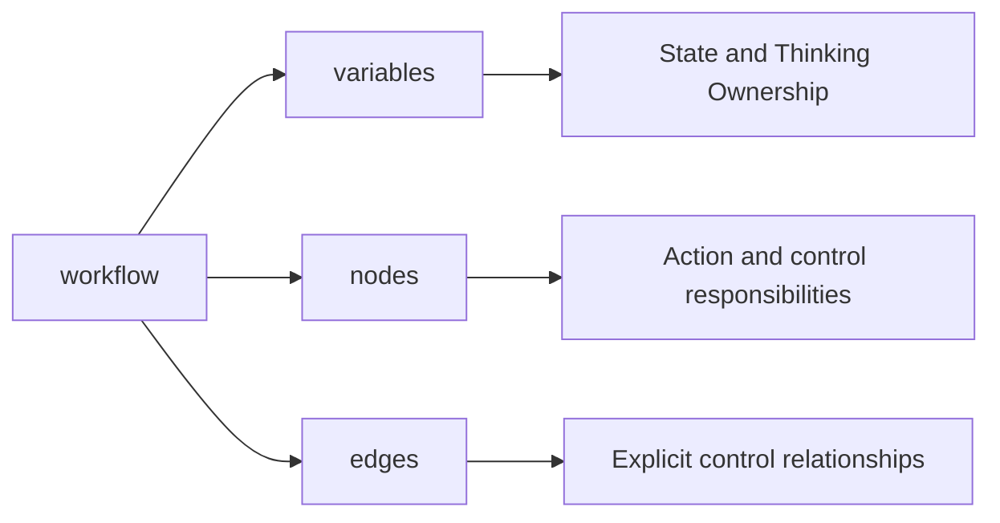
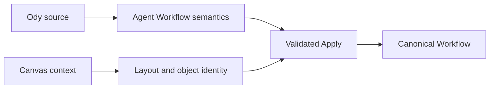

# How Ody Expresses an Agent Workflow

> Ody does not reinvent Odyssey's concepts. It organizes the Variables, nodes, resources, and connections already present on the Canvas into a textual structure that can be read and validated.

[“Why Odyssey Needs a Language”](/core-concepts/workflow-language) explains the motivation behind Ody: the Canvas makes the structure of an Agent system visible, while Ody makes the same structure precise enough to edit, validate, and generate.

This article answers the next, more concrete question: **how is an Agent Workflow written in Ody?**

Ody is formally the **Odyssey Workflow DSL**. It is a declarative domain-specific language, not a general-purpose programming language, and it does not execute an Agent directly. Ody source passes through a Parser, Compiler, and domain validation to produce Odyssey's Canonical Workflow. The Canvas and DSL Edit both work with this same domain model.

The current language version focuses on the **internal Workflow of one Agent**. It does not define an OdyJourney System Pattern, create Agent Slots, or describe node coordinates and Viewport state.

## Start with a Small Workflow

One `.ody` document declares exactly one Agent Workflow. The following example assumes that the current Agent's editing context already contains a Knowledge Space named `Product Docs` and a fully configured Reusable Tool named `Product Lookup`:

```text
workflow "Research Agent" version "0.1" {
  variables {
    string user_managed research_topic = "Odyssey";
    string shared research_brief;
  }

  nodes {
    start;
    end;

    agent_action "Research & Synthesize" {
      model "gpt-5";
      goal "Research ${agent.research_topic} and update the brief.";
      knowledge ["Product Docs"];
      toolbox ["Product Lookup"];
    }
  }

  edges {
    start -> "Research & Synthesize";
    "Research & Synthesize" -> end;
  }
}
```

This source expresses five things:

1. It describes a Workflow named `Research Agent` using Ody version `0.1`.
2. The Workflow has two Agent Variables.
3. It contains one Agent Action.
4. The Agent Action's cognitive space contains `Product Docs`, and its action space contains `Product Lookup`.
5. Control flows from Start into the Agent Action and then reaches End.

It does not say where the node appears on the Canvas, because position is not part of the behavioral semantics of an Agent Workflow.

`"Product Lookup"` does not mean a Tool with a name but no configuration. A quoted string is a reference to an **existing Reusable Tool owned by the current Agent**. The Compiler must uniquely resolve it through an explicitly supplied inventory, validate its complete configuration, input and output bindings, Variable dependencies, and Knowledge Space dependencies, and then include a complete configuration snapshot in the generated Canonical Workflow.

The source can therefore compile only when that resource context exists and is valid:

- If the inventory has not loaded, the result is `context-required` and cannot be applied.
- If the name is missing or resolves to multiple objects, the result is an error.
- If the Tool configuration is incomplete, a dependency is missing, or a binding exceeds its authority, the result is also an error.
- The Compiler never creates an empty Tool merely because it sees `"Product Lookup"`, and it never writes only the name into the Canonical Workflow.

To create a new Reusable Tool inside the Ody document, the source must provide its complete configuration in the `tools` section described later, then place its bare alias in the Toolbox.

## Document Structure Answers Three Design Questions

Ody uses braces to make structural boundaries explicit. A Workflow is primarily composed of `variables`, `nodes`, and `edges` sections:



- `variables` asks: which state must the system maintain, and who may update it?
- `nodes` asks: which action and control responsibilities exist in the Workflow?
- `edges` asks: through which explicit relationships are those responsibilities connected?

`nodes` and `edges` must be present, although they may temporarily be empty. `variables` may be omitted. The language also permits an optional `tools` section and an `identity` section used for internal compatibility. Input section order does not change meaning; the Printer emits them in a stable order.

This separation is not merely formatting. It keeps state, objects, and relationships distinct. A node declares its own configuration but does not hide its next step in a property. Routing appears in `edges`, where it can be read and validated as a whole.

## Lexical Rules: Code-like, but Deliberately Small

Ody uses C-like braces and semicolons to make boundaries clear while keeping the language surface deliberately limited:

| Rule | Current meaning |
| --- | --- |
| Case | Keywords, identifiers, and name matching are case-sensitive. |
| Identifiers | `[A-Za-z_][A-Za-z0-9_]*`, primarily for Variable keys, Tool aliases, and Step aliases. |
| Display names | Double-quoted strings; Unicode is allowed. |
| Comments | `//` line comments and non-nested `/* ... */` block comments. |
| Statement endings | Simple declarations end with `;`; structural blocks do not. |
| Basic values | JSON-style string, number, boolean, null, array, and object values. |
| Multiline text | Triple-quoted raw strings that preserve actual line breaks. |

Ordinary nodes are declared directly by display name:

```text
task "Publish report" {
  steps {}
}
```

Node names must be unique within the same graph. Matching trims surrounding whitespace, normalizes Unicode to NFC, and remains case-sensitive. Edges use the same quoted name, so users do not need to work with internal UUIDs.

Comments and manual formatting are not part of Workflow semantics. When the Canvas regenerates DSL, it preserves configuration meaning, but the current version does not promise to preserve original comments, blank lines, or formatting style.

## Variables: State and Maintenance Responsibility Together

The basic Agent Variable form is:

```text
variables {
  string user_managed topic = "Odyssey";
  number agent_managed confidence = 0;
  boolean shared approved = false;
  json shared findings = [];
}
```

Every declaration combines three pieces of information:

```text
type  ownership  key  = optional default value;
```

The current types map directly to Odyssey's Canonical Schema:

| DSL keyword | Value represented |
| --- | --- |
| `string` | Text |
| `number` | A finite number |
| `boolean` | `true` or `false` |
| `json` | Any JSON value, including objects and arrays |

`object`, `array`, `integer`, and custom record names are not additional types. Objects and arrays are values that a `json` Variable may contain.

Ownership carries Odyssey's Thinking Ownership into the language:

| ownership | Task Tool may write | Agent Action may write |
| --- | ---: | ---: |
| `user_managed` | Yes | No |
| `shared` | Yes | Yes |
| `agent_managed` | No | Yes |

“User-managed” does not mean that a person must type every value manually. A Tool explicitly configured by the user inside a Task may update a `user_managed` Variable automatically. The decision still belongs to the user because the Tool, target, and invocation position were designed in advance.

A Variable can use a metadata block when it needs more explanation:

```text
string shared research_brief {
  display_name "Research brief";
  description "A concise summary maintained during research.";
  read_only false;
}
```

`read_only true` further prevents writes, but it does not replace ownership. A default value must be a JSON literal compatible with the declared type and cannot reference another Variable.

## References and Values: Scope Must Be Explicit

Ody does not provide bare Variable names. A reference must identify its scope:

| Reference | Scope |
| --- | --- |
| `agent.topic` | A Variable owned by the current Agent |
| `task.cached` | A local Variable in the current Task |
| `sys.current_message` | A System Variable supplied by Odyssey |

Explicit namespaces prevent same-name Variables from being confused and let the Compiler validate read and write boundaries. A Task Variable cannot be accessed from another Task, an Agent Action, or a Branch. A System Variable must be supplied by the current context; the DSL does not invent System state from a name.

A ValueSource position may use a Variable directly or interpolate it into a string:

```text
goal "Research ${agent.topic} and produce a concise brief.";
```

Interpolation accepts only one complete namespace and key. It does not support object-member access, array indexing, arithmetic, or function calls. Complex dynamic JSON should be constructed through an explicitly configured Script Tool instead of expanding Ody into a general expression language.

When `${...}` must appear as ordinary text, `literal(...)` explicitly disables interpolation semantics:

```text
goal literal("Show ${agent.topic} verbatim.");
```

## Agent Action: Goal, Cognitive Space, and Action Space

Agent Action syntax maps directly to four core Canvas fields:

```text
agent_action "Research" {
  model "gpt-5";
  goal "Research ${agent.topic}; update the shared findings.";
  knowledge ["Product Docs"];
  toolbox ["Product Lookup"];
}
```

- `model` selects the reasoning configuration responsible for the action.
- `goal` defines what should be achieved rather than enumerating every step in advance.
- `knowledge` references existing Knowledge Spaces and defines the Agent Action's cognitive space.
- `toolbox` references existing Reusable Tools and defines the Agent Action's action space.

`model` and `goal` are required; omitted `knowledge` and `toolbox` lists are empty. Resource names are readable by people, while the Compiler resolves them through an explicit inventory to the internal identities used by the Canonical Workflow. For a Reusable Tool, resolution must retrieve and validate the complete configuration snapshot and all of its dependencies, not merely an ID. A missing or duplicate name, invalid configuration, or unavailable context prevents the configuration from being applied.

Loading an entire resource catalog for selection does not authorize the entire catalog. Only objects explicitly listed in `knowledge` and `toolbox` are bound to the Agent Action.

## Task: Declare Deterministic Tool Steps in Order

A Task expresses Tool selection, configuration, and order determined by the user in advance:

```text
task "Summarize" {
  variables {
    string cached;
  }

  steps {
    step draft using system_tool llm_call {
      config {
        model = "gpt-5";
        prompt = "Summarize ${agent.topic}.";
      }
      output "response.text" -> task.cached;
      on_failure retry 2;
    }

    step store using system_tool set_variable {
      config {
        targetVariableId = agent.brief;
        operation = assign;
        value = task.cached;
      }
      on_failure fail_task;
    }
  }
}
```

Declaration order inside `steps` is the Task's step order. Each Step selects a System Tool kind, supplies its complete `config`, and may declare an output binding and failure behavior.

The current language and product model support five System Tool kinds:

| Tool kind | Responsibility |
| --- | --- |
| `knowledge_retrieval` | Retrieve content from a specified Knowledge Space |
| `script_execution` | Execute constrained Python or JavaScript |
| `api_request` | Send a configured HTTP request |
| `set_variable` | Update a Variable through an allowed operation |
| `llm_call` | Invoke a model through a deterministic configuration |

Each Tool's Schema defines its fields. Unknown fields, missing required fields, invalid enums, and forbidden output bindings fail compilation. Ody only declares Tool configuration; the Compiler does not execute scripts, network requests, or model calls.

A Task may define local Variables that exist only inside it. Local Variables have no ownership field because the Task boundary already defines their lifetime and access scope.

## Branch: Keep Conditions Separate from Destination Paths

A Branch declares only Cases and conditions:

```text
branch "Review" {
  case "Approved" {
    when agent.approved == true;
    when agent.confidence >= 0.8;
  }
  default "Needs revision";
}
```

Multiple `when` clauses inside one Case use AND semantics, and Cases are evaluated in declaration order. Every Branch must have exactly one `default`.

Current conditions support:

- Comparison: `==`, `!=`, `>`, `>=`, `<`, `<=`.
- Containment: `contains`, `not_contains`.
- Emptiness: `is_empty`, `is_not_empty`.

Ody provides no OR, NOT, parenthesized logic, or arbitrary functions. A complex judgment should be separated into explicit state or produced as a validated result Variable by a deterministic Tool.

A Branch does not include destinations inside its condition block. Case routes remain centralized in `edges`:

```text
edges {
  "Review"."Approved" -> "Publish";
  "Review".default -> "Revise";
}
```

This keeps the judgment and the graph's control relationships independently inspectable. When a Case display name changes, the editing session maintains its stable internal identity instead of treating the name as a persistent ID.

## Loop: Iteration Owns a Constrained Subgraph

A Loop declares a repeating process as a bounded composite node:

```text
loop "Refine" {
  max_turns 3;
  exit_when agent.approved == true;

  nodes {
    loop_start;
    loop_end;

    agent_action "Revise" {
      model "gpt-5";
      goal "Improve the brief and update shared state.";
    }

    task "Validate" {
      steps {
        // Update agent.approved through configured Tools.
      }
    }
  }

  edges {
    loop_start -> "Revise";
    "Revise" -> "Validate";
    "Validate" -> loop_end;
  }
}
```

`max_turns` is a positive integer. `exit_when` currently accepts only a comparison between a Variable and a JSON literal. The Loop body owns its own `nodes`, `edges`, `loop_start`, and `loop_end`, while sharing Agent Variables and resources.

A Loop body may contain Agent Actions, Tasks, and Branches. It cannot contain another Loop or connect an internal node directly to an external one. Repetition comes from the Loop boundary itself, not from arbitrary back edges.

This configuration expresses Odyssey's design contract for iteration. Because the current product does not yet have a formal execution engine, successful compilation does not prove runtime results or termination behavior.

## Start, End, and Parent Exits

The simplest Workflow uses one Start and one End:

```text
nodes {
  start;
  end;
}
```

`start`, `end`, `loop_start`, and `loop_end` are boundary keywords and do not use quotes. References to ordinary nodes must use quoted names.

When the parent Pattern supplies multiple business exits for the current Agent Workflow, Ody can represent existing bindings through named Ends:

```text
nodes {
  end "Accepted result" {
    exit "Accepted";
  }

  end "Rejected result" {
    exit "Rejected";
  }
}
```

Here, `exit` references an exit already supplied by the parent Pattern. It does not create a new Route inside the Agent Workflow. Ody cannot use a named End to rewrite OdyJourney topology. If the parent exit is missing, duplicated, or cannot be resolved uniquely, the Compiler must wait for complete context or block Apply rather than guess a target.

## Edges: Declare Every Relationship Separately

All control relationships are centralized in the `edges` section:

```text
edges {
  start -> "Research";
  "Research" -> "Review";
  "Review"."Approved" -> "Publish";
  "Review".default -> "Refine";
  "Refine" -> "Publish";
  "Publish" -> end;
}
```

Ody requires every Edge to be declared separately. It does not allow:

```text
start -> "Research" -> "Review";
```

A single declaration gives every connection one explicit source and target and lets diagnostics point precisely to an invalid relationship. The Compiler rejects self-connections, duplicate Edges, invalid Branch handles, connections crossing a Loop boundary, and arbitrary directed cycles.

An unconnected Branch exit, a node unreachable from Start, or a node that cannot yet reach End is a readiness issue. It may remain as a warning so a designer can edit an incomplete but structurally valid Workflow. The interface must not claim that such a Workflow is ready to run.

## Reusable Tools: Reference Existing Capabilities or Declare Shared Configuration

An Agent Action normally references a fully configured Reusable Tool already owned by the current Agent:

```text
toolbox ["Product Lookup"];
```

This form requires the inventory to contain exactly one valid `Product Lookup`. It is a context-bound reference, not shorthand Tool configuration. Without the corresponding complete configuration, the source does not compile successfully.

When an Ody document needs to declare a new configuration shared by multiple Agent Actions, it can use the optional `tools` section:

```text
tools {
  reusable_tool lookup using system_tool knowledge_retrieval {
    name "Product lookup";
    config {
      knowledgeSpaceId = "Product Docs";
      topK = 5;
    }
    input_bindings [];
    output_binding none;
  }
}
```

The new Tool is then referenced by its bare alias:

```text
toolbox [lookup];
```

A quoted name resolves only an existing Tool from the inventory. A bare alias resolves only a declaration in the current file's `tools` section. Neither silently falls back to the other, preventing a name from being bound accidentally to a different kind of object.

When DSL is generated from the Canvas, the Printer may also use `tools` to express complete Reusable Tool configurations owned by the current document, including Tools that are not currently referenced by any node but still belong to the Agent. An independent `.ody` file does not carry original UUIDs or template provenance. Canonical JSON remains the exchange format for complete internal identity fidelity.

## Layout and Internal Identity Stay Out of User Syntax

Ody has no layout section.

Node coordinates, dimensions, Loop container size, and Viewport remain under Canvas control. When Ody changes are applied, existing objects preserve their positions where possible, deleted objects lose their placements, and the Canvas assigns initial positions to new objects. Moving a node alone does not change Ody or make an active DSL draft stale.

Likewise, the fact that users understand nodes and resources by name does not mean Odyssey uses names as internal identity. The Canvas and DSL Edit session maintains a baseline between names, syntax objects, and UUIDs, allowing a renamed node to remain the same domain object where the match is unambiguous. If matching is ambiguous, the system requires Review instead of guessing from array position or name similarity.

This creates an important boundary:



Ody independently expresses design semantics. Canvas context preserves the view and existing object identity. They are combined into a new Canonical Workflow only after complete validation.

## What the Language Deliberately Does Not Express

Current Ody does not provide:

- Creation or editing of OdyJourneys, System Patterns, or Agent Slots.
- Arbitrary functions, macros, imports, or a general module system.
- Arithmetic, object-member access, array indexing, or arbitrary expressions.
- Arbitrary directed cycles, unconstrained fan-out, or concurrency promises.
- Nested Loops.
- Canvas layout.
- Direct execution of models, scripts, network requests, or Tools.
- Complete persistence of internal UUIDs and provenance in standalone source.

These limits are not evidence that the syntax has failed to become enough like a programming language. They are part of the current domain boundary. Ody is not intended to replace Python or TypeScript; it is intended to express the Agent Workflow that Odyssey already defines.

## Current Status and How to Read This Page

DSL Edit is connected to the real Canvas. It can print Ody from a Canonical Workflow and apply a validated Ody candidate back to the Canvas. Variables, four node types, five System Tool kinds, Reusable Tools, Branches, Loops, named Ends, and layout preservation all have implementation or integration coverage.

This does not mean that every language rule and future runtime behavior is frozen:

- The current product has no formal execution engine, so this page makes no guarantee about runtime outcomes.
- System Variables depend on a real inventory and cannot be invented when context is missing.
- Standalone `.ody` import and export, and cross-session draft recovery, are not part of the first main path.
- Some comparison types, dynamic Tool outputs, and future capability boundaries must continue to tighten with the runtime contract.
- A syntax capable of expressing configuration does not prove that LLMs can reliably generate high-quality Workflows.

This page should therefore be read as **the current public mapping between Ody syntax and Odyssey concepts**, not as a permanently compatible general language standard.

The next article, “How Ody Compiles and Validates a Workflow,” will explain how the Parser, Compiler, resource inventory, and Canonical Schema decide whether source can be applied safely to the Canvas, and what error, warning, context-required, and stale mean.

## Terms Used in This Article

| Term | Meaning in this article |
| --- | --- |
| **Ody** | The product-facing short name for the Odyssey Workflow DSL. |
| **Workflow document** | One `.ody` document; it currently declares exactly one Agent Workflow. |
| **Section** | A top-level structure inside a Workflow, such as variables, tools, nodes, or edges. |
| **ValueSource** | A configuration value that can come from a literal, Variable reference, or string template. |
| **Inventory** | The set of Knowledge Spaces, Tools, System Variables, and Pattern exits explicitly supplied by the editing context for Compiler resolution. |
| **Canonical Workflow** | The formal structure validated by shared Schemas and domain rules and used by application state and persistence. |
| **Identity baseline** | The editing session's mapping among names, syntax objects, and internal UUIDs; it is not part of user syntax. |

## Design and Implementation Sources

- Current language specification: `odyssey/doc/planning/implementation/DSL/odyssey-workflow-dsl-v0.1-spec.md`;
- Current `.ody` examples: `odyssey/doc/planning/implementation/DSL/examples/`;
- First bidirectional editing integration: `odyssey/doc/planning/implementation/DSL/dsl-edit-first-integration-report.md`;
- Current Parser, Compiler, and Printer: `odyssey/apps/web/src/domain/workflow-dsl/`;
- Canonical Workflow Schemas: `odyssey/packages/schemas/src/workflow/`;
- Design motivation: the sample article “Why Odyssey Needs a Language.”
