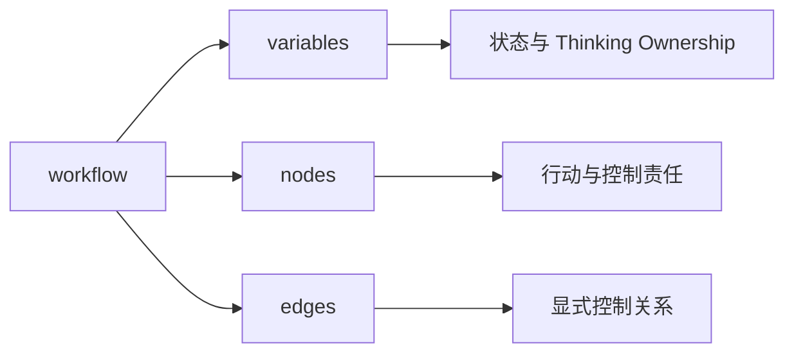
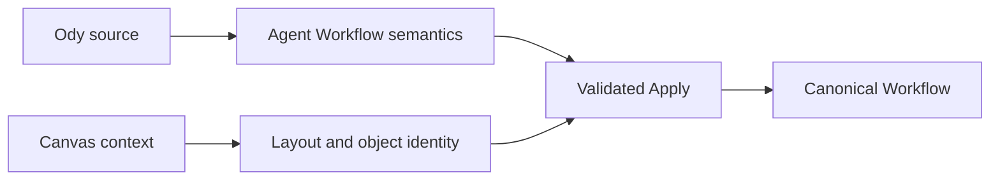

# Ody 如何表达一个 Agent Workflow

> Ody 不重新发明 Odyssey 的概念。它把 Canvas 中已经存在的 Variable、节点、资源与连接，组织成一种可阅读、可检查的文本结构。

[《为什么 Odyssey 需要一门语言》](/zh/core-concepts/workflow-language)解释了 Ody 的设计动机：Canvas 让 Agent 系统的结构变得可见，Ody 则让同一套结构可以被精确编辑、检查和生成。

这一篇继续回答更具体的问题：**一个 Agent Workflow 如何被写成 Ody？**

Ody 的正式定位是 **Odyssey Workflow DSL**。它是一门声明式领域语言，不是一门通用编程语言，也不直接执行 Agent。Ody 源文本经过 Parser、Compiler 与领域检查后，生成 Odyssey 的 Canonical Workflow；Canvas 与 DSL Edit 都围绕这同一份领域模型工作。

当前语言版本聚焦于**单个 Agent 的内部 Workflow**。它不负责定义 OdyJourney 的 System Pattern，不创建 Agent Slot，也不描述节点坐标和 Viewport。

## 从一份很小的 Workflow 开始

一个 `.ody` 文档只声明一个 Agent Workflow。下面的例子假设当前 Agent 的编辑上下文中，已经存在名为 `Product Docs` 的 Knowledge Space，以及完成配置的 Reusable Tool `Product Lookup`：

```text
workflow "Research Agent" version "0.1" {
  variables {
    string user_managed research_topic = "Odyssey";
    string shared research_brief;
  }

  nodes {
    start;
    end;

    agent_action "Research & Synthesize" {
      model "gpt-5";
      goal "Research ${agent.research_topic} and update the brief.";
      knowledge ["Product Docs"];
      toolbox ["Product Lookup"];
    }
  }

  edges {
    start -> "Research & Synthesize";
    "Research & Synthesize" -> end;
  }
}
```

这里的 `"Product Lookup"` 不是只有名称、没有配置的 Tool。双引号字符串表示对**当前 Agent 已有 Reusable Tool** 的引用。Compiler 必须从外部显式传入的 inventory 中将它唯一解析到一个真实 Tool，检查其完整配置、输入输出绑定、Variable 与 Knowledge Space 依赖，再把完整配置快照纳入生成的 Canonical Workflow。

因此，这段文本只有在上述资源上下文存在且合法时才能通过编译：

- inventory 尚未加载时，结果是 `context-required`，不能 Apply；
- 名称不存在或存在多个匹配对象时，结果是 error；
- Tool 配置不完整、依赖缺失或绑定越权时，结果也是 error；
- Compiler 不会因为看见 `"Product Lookup"` 就创建空 Tool，也不会只把名称写进 Canonical Workflow。

如果希望在这份 Ody 文档中创建一个新的 Reusable Tool，则必须使用后文的 `tools` section 写出完整配置，再通过裸 alias 放入 Toolbox。

这份文本表达了五件事：

1. 它描述名为 `Research Agent` 的 Workflow，并使用 Ody `0.1` 版本；
2. Workflow 拥有两个 Agent Variable；
3. 它包含一个 Agent Action；
4. 这个 Agent Action 的认知空间包含 `Product Docs`，行动空间包含 `Product Lookup`；
5. 控制流从 Start 进入 Agent Action，再到达 End。

它没有表达节点位于 Canvas 的什么位置，因为位置不是 Agent Workflow 的行为语义。

## 文档结构对应三类设计问题

Ody 使用花括号显式划分结构。一个 Workflow 主要由 `variables`、`nodes` 与 `edges` 三个 section 组成：



- `variables` 回答：系统需要维护哪些状态，谁可以更新它们？
- `nodes` 回答：Workflow 中存在哪些行动与控制责任？
- `edges` 回答：这些责任以什么显式关系连接？

`nodes` 与 `edges` 必须出现，但可以暂时为空；`variables` 可以省略。语言还允许可选的 `tools` 与内部兼容用途的 `identity` section。section 的输入顺序不改变含义，Printer 会使用稳定顺序重新输出。

这种分区不是单纯为了排版。它让状态、对象和关系保持分离：节点声明自身配置，但不会把下一步藏在节点属性中；路由统一出现在 `edges`，因此仍然可以被整体阅读和检查。

## 词法：接近代码，但保持很小

Ody 采用接近 C 风格的花括号与分号，使结构边界清楚，同时刻意限制语言表面：

| 规则 | 当前含义 |
| --- | --- |
| 大小写 | 关键字、标识符和名称匹配均区分大小写 |
| 标识符 | 使用 `[A-Za-z_][A-Za-z0-9_]*`，主要用于 Variable key、Tool alias 与 Step alias |
| 显示名称 | 使用双引号字符串，可以包含 Unicode |
| 注释 | 支持 `//` 行注释与非嵌套 `/* ... */` 块注释 |
| 声明结尾 | 简单声明使用 `;`，结构块后不加分号 |
| 基本值 | 使用 JSON 风格的 string、number、boolean、null、array 与 object |
| 多行文本 | 使用三双引号原始字符串；保留实际换行 |

普通节点直接以显示名称声明：

```text
task "Publish report" {
  steps {}
}
```

同一张图中的节点名称必须唯一。名称经过首尾空白移除和 Unicode NFC 规范化后匹配，仍然区分大小写。连线使用同一个双引号名称，不需要用户接触内部 UUID。

注释与手工排版不属于 Workflow 语义。Canvas 重新生成 DSL 时会保留配置含义，但当前版本不承诺保留原来的注释、空行与排版风格。

## Variable：把状态和维护责任写在一起

Agent Variable 的基本形式是：

```text
variables {
  string user_managed topic = "Odyssey";
  number agent_managed confidence = 0;
  boolean shared approved = false;
  json shared findings = [];
}
```

每个声明同时包含三项信息：

```text
类型  ownership  key  = 可选默认值;
```

当前类型严格对应 Odyssey Canonical Schema：

| DSL keyword | 表达的值 |
| --- | --- |
| `string` | 文本 |
| `number` | 有限数字 |
| `boolean` | `true` 或 `false` |
| `json` | 任意 JSON 值，包括 object 与 array |

`object`、`array`、`integer` 或自定义 record 名称不是额外类型。Object 和 array 是 `json` Variable 可以保存的值。

Ownership 延续 Odyssey 的 Thinking Ownership：

| ownership | Task Tool 写入 | Agent Action 写入 |
| --- | ---: | ---: |
| `user_managed` | 允许 | 禁止 |
| `shared` | 允许 | 允许 |
| `agent_managed` | 禁止 | 允许 |

这里的“用户维护”不意味着每次都要由人手动输入。Task 中由用户预先配置好的 Tool 可以自动更新 `user_managed` Variable；决定仍然属于用户，因为 Tool、目标和调用位置已经被显式设计。

需要更多说明时，Variable 可以使用 metadata block：

```text
string shared research_brief {
  display_name "Research brief";
  description "A concise summary maintained during research.";
  read_only false;
}
```

`read_only true` 会进一步禁止写入，但它不会取代 ownership。默认值必须是与声明类型兼容的 JSON literal，不能引用另一个 Variable。

## 引用和值：作用域必须显式

Ody 不提供裸 Variable 名称。引用必须说明作用域：

| 引用 | 作用域 |
| --- | --- |
| `agent.topic` | 当前 Agent 的 Variable |
| `task.cached` | 当前 Task 的局部 Variable |
| `sys.current_message` | 由 Odyssey 提供的 System Variable |

显式 namespace 避免同名 Variable 被误解，也使 Compiler 可以检查读取与写入边界。Task Variable 不能从其他 Task、Agent Action 或 Branch 中访问；System Variable 必须由当前运行上下文提供，DSL 不会凭名称虚构一个 System 状态。

ValueSource 位置可以直接使用 Variable，也可以在字符串中插值：

```text
goal "Research ${agent.topic} and produce a concise brief.";
```

插值只接受一个完整的 namespace 与 key，不支持对象成员访问、数组索引、算术或函数调用。需要动态构造复杂 JSON 时，应使用明确配置的 Script Tool，而不是把 Ody 扩展成通用表达式语言。

普通字符串中的 `${...}` 默认会被解释为 Variable 插值。如果整个 ValueSource 都是一段纯文字，可以使用 `literal(...)` 明确关闭插值语义：

```text
goal literal("Show ${agent.topic} verbatim.");
```

如果只需要在普通字符串的某个位置输出字面 `${`，也可以转义 `$`：

```text
goal "Show \${agent.topic} verbatim.";
```

两种写法生成的都是普通文本，而不是对 `agent.topic` 的读取。`literal(...)` 还可以包裹其他 JSON literal；它不是函数调用，也不会在运行时执行代码。

### 在使用位置直接绑定运行时输入

Ody 0.2 使用带有明确边界的 `$namespace.key$` 表达整值引用，同时保留 `${agent.topic}` 作为字符串内部的文本插值：

```text
query = $agent.question$;
goal "Question: ${agent.question}";
```

两种写法并不等价。`$agent.question$` 把一个带类型的完整值交给目标字段；`${agent.question}` 先把 Variable 放入字符串，结果仍然是文本。写在引号里的 `"$agent.question$"` 也只是普通字符串，不会被悄悄解释成绑定。

这套边界还允许 Workflow 接收由可信运行上下文提供的**类型化资源引用**。例如，同一个文档维护 Workflow 可以保留固定的规则 Knowledge Space，同时让系统根据本次文件事件提供目标 Knowledge Space：

```text
agent_action "Propose Changes" {
  model "gpt-5";
  knowledge ["Document Curator Playbook", $sys.target_knowledge_space$];
  toolbox [find_related];
  goal "Inspect the changed document using the assigned maintenance rules.";
}

config {
  knowledgeSpaceId = $sys.target_knowledge_space$;
}
```

这里的 `$sys.target_knowledge_space$` 不是一个恰好装着名称或 UUID 的 `string`。它是系统输入合同声明的只读 `KnowledgeSpace` 引用：配置时检查 key、类型和字段角色，运行时再解析真实资源并检查 Workspace 归属与授权。普通 `string` 或 `json` Variable 即使内容看起来像有效 ID，也不能冒充资源引用。

Ody 不为此增加一个全局 `bindings` section。绑定写在它真正被使用的位置，让读者直接看见某个 Agent Action 的认知空间、某个 Tool 的检索目标或某个输出的写入目标来自哪里。同一个系统 key 出现在 `knowledge` 和 `knowledgeSpaceId` 时，必须在同一次运行中指向同一个资源；Canvas、Canonical JSON 与 Printer 也必须保留“来自系统事件”的身份，而不能把它冻结成编辑器预览时碰巧显示的 Knowledge Space。

这项能力已经进入 Ody 0.2。Parser、Compiler、Printer、Canonical Schema 与 Canvas 都会识别并保留这种绑定；旧的 0.1 Workflow 可以在 DSL Edit 中显式升级为 0.2，经过检查后再 Apply，而不会在后台被静默改写。

## Agent Action：Goal、认知空间与行动空间

Agent Action 的语法直接对应 Canvas 中的四项核心配置：

```text
agent_action "Research" {
  model "gpt-5";
  goal "Research ${agent.topic}; update the shared findings.";
  knowledge ["Product Docs"];
  toolbox ["Product Lookup"];
}
```

- `model` 选择承担这次行动的推理配置；
- `goal` 定义需要达成什么，而不是预先枚举完整步骤；
- `knowledge` 引用已有 Knowledge Spaces，定义 Agent Action 的认知空间；
- `toolbox` 引用已有 Reusable Tools，定义 Agent Action 的行动空间。

`model` 与 `goal` 必填；`knowledge` 和 `toolbox` 省略时为空。资源通过名称供人阅读，但 Compiler 会根据显式 inventory 将名称解析为 Canonical Workflow 使用的内部身份。对于 Reusable Tool，解析不仅要得到 ID，还必须取得并校验完整配置快照及其依赖。名称缺失、重名、配置无效或上下文尚未加载时，配置不能被应用。

列出整个资源目录并不等于授权整个目录。只有写入 `knowledge` 和 `toolbox` 的对象会绑定到这个 Agent Action。

## Task：把确定性 Tool 步骤按顺序声明

Task 表达用户预先确定的 Tool 选择、配置与执行顺序：

```text
task "Summarize" {
  variables {
    string cached;
  }

  steps {
    step draft using system_tool llm_call {
      config {
        model = "gpt-5";
        prompt = "Summarize ${agent.topic}.";
      }
      output "response.text" -> task.cached;
      on_failure retry 2;
    }

    step store using system_tool set_variable {
      config {
        targetVariableId = agent.brief;
        operation = assign;
        value = task.cached;
      }
      on_failure fail_task;
    }
  }
}
```

`steps` 中的声明顺序就是 Task 的步骤顺序。每个 Step 选择一个 System Tool kind，提供完整 `config`，并可声明输出绑定和失败行为。

当前语言与产品模型支持五类 System Tool：

| Tool kind | 责任 |
| --- | --- |
| `knowledge_retrieval` | 从指定 Knowledge Space 检索内容 |
| `script_execution` | 执行受配置约束的 Python 或 JavaScript |
| `api_request` | 发送配置好的 HTTP 请求 |
| `set_variable` | 以允许的 operation 更新 Variable |
| `llm_call` | 以确定配置调用模型 |

具体字段由每种 Tool 的 Schema 决定。未知字段、缺失必填字段、非法 enum 和不允许的输出绑定都会在编译检查中被拒绝。Ody 只声明 Tool 配置；Compiler 不会执行脚本、网络请求或模型调用。

Task 可以定义仅在自身内部有效的局部 Variable。局部 Variable 不带 ownership，因为它的生命周期和访问范围已经被 Task 边界限定。

## Branch：条件与目标路径保持分离

Branch 只声明 Case 和条件：

```text
branch "Review" {
  case "Approved" {
    when agent.approved == true;
    when agent.confidence >= 0.8;
  }
  default "Needs revision";
}
```

同一 Case 中的多个 `when` 使用 AND 关系，并按 Case 声明顺序判断。每个 Branch 必须有且只有一个 `default`。

当前条件支持：

- 比较：`==`、`!=`、`>`、`>=`、`<`、`<=`；
- 包含：`contains`、`not_contains`；
- 判空：`is_empty`、`is_not_empty`。

Ody 不提供 OR、NOT、括号逻辑组合或任意函数。复杂判断应被拆成显式状态或通过确定性 Tool 产生一个可检查的结果 Variable。

Branch 不在条件块里写跳转目标。Case 对应的路由仍然统一写在 `edges`：

```text
edges {
  "Review"."Approved" -> "Publish";
  "Review".default -> "Revise";
}
```

这样，判断内容与图上的控制关系都可以独立检查。Case 显示名称改变时，内部稳定身份仍由编辑会话维护，而不是把名称本身当作持久化 ID。

## Loop：迭代拥有自己的受限子图

Loop 把重复过程声明为一个有边界的复合节点：

```text
loop "Refine" {
  max_turns 3;
  exit_when agent.approved == true;

  nodes {
    loop_start;
    loop_end;

    agent_action "Revise" {
      model "gpt-5";
      goal "Improve the brief and update shared state.";
    }

    task "Validate" {
      steps {
        // Update agent.approved through configured Tools.
      }
    }
  }

  edges {
    loop_start -> "Revise";
    "Revise" -> "Validate";
    "Validate" -> loop_end;
  }
}
```

`max_turns` 是正整数；`exit_when` 当前只接受 Variable 与 JSON literal 之间的比较。Loop body 拥有自己的 `nodes`、`edges`、`loop_start` 和 `loop_end`，但共享 Agent Variable 与资源。

Loop body 可以包含 Agent Action、Task 和 Branch，不能嵌套另一个 Loop，也不能把内部节点与外部节点直接相连。重复来自 Loop 自身的边界，而不是任意回边。

这段配置表达的是 Odyssey 对迭代的设计合同。由于当前产品还没有正式执行引擎，编译成功不等于已经验证了运行结果或终止行为。

## Start、End 与父级出口

最简单的 Workflow 使用唯一 Start 和 End：

```text
nodes {
  start;
  end;
}
```

`start`、`end`、`loop_start` 与 `loop_end` 是边界关键字，不需要双引号。普通节点引用必须使用双引号名称。

当父级 Pattern 为当前 Agent Workflow 提供多个业务出口时，Ody 可以用命名 End 表达现有绑定：

```text
nodes {
  end "Accepted result" {
    exit "Accepted";
  }

  end "Rejected result" {
    exit "Rejected";
  }
}
```

这里的 `exit` 引用父级 Pattern 已经提供的出口，而不是在 Agent Workflow 中创建一个新 Route。Ody 不能借由命名 End 改写 OdyJourney 拓扑。父级出口缺失、重名或无法唯一解析时，Compiler 必须等待完整上下文或阻止 Apply，不能猜测目标。

## Edge：每条关系都单独声明

所有控制关系集中在 `edges` section：

```text
edges {
  start -> "Research";
  "Research" -> "Review";
  "Review"."Approved" -> "Publish";
  "Review".default -> "Refine";
  "Refine" -> "Publish";
  "Publish" -> end;
}
```

Ody 要求每条 Edge 单独声明，不允许：

```text
start -> "Research" -> "Review";
```

单条声明让每个连接拥有明确的源和目标，也便于诊断准确指出非法关系。Compiler 会拒绝自连接、重复 Edge、错误的 Branch handle、跨 Loop 边界连接和任意有向环。

未连接的 Branch 出口、从 Start 不可达的节点，或暂时无法到达 End 的节点属于 readiness 问题。它们可以作为 warning 保留，使设计者能够编辑尚未完成但结构仍然合法的 Workflow；页面不能因此宣称它已经可以运行。

## Reusable Tool：引用已有能力，也可以声明共享配置

Agent Action 通常直接以名称引用当前 Agent 已有且已经完成配置的 Reusable Tool：

```text
toolbox ["Product Lookup"];
```

这种写法的前提是 inventory 中存在唯一、合法的 `Product Lookup`。它是 context-bound reference，不是 Tool 的简写配置；缺少对应配置时不会编译成功。

当一份 Ody 文档需要声明一个由多个 Agent Action 共享的新配置时，可以使用可选 `tools` section：

```text
tools {
  reusable_tool lookup using system_tool knowledge_retrieval {
    name "Product lookup";
    config {
      knowledgeSpaceId = "Product Docs";
      topK = 5;
    }
    input_bindings [];
    output_binding none;
  }
}
```

之后可以通过裸 alias 使用它：

```text
toolbox [lookup];
```

双引号名称只解析已有 inventory 中的 Tool；裸 alias 只解析当前文件 `tools` section 中的声明。二者不会互相回退，从而避免一个名称意外绑定到另一类对象。

页面内从 Canvas 生成 DSL 时，Printer 也可能使用 `tools` section 表达当前文档拥有的完整 Reusable Tool 配置，包括暂时没有被节点使用但仍属于该 Agent 的 Tool。独立 `.ody` 文件不携带原始 UUID 或模板来源；需要完整内部身份保真的交换格式仍然是 Canonical JSON。

## Layout 与内部 identity 不进入用户语法

Ody 没有 layout section。

节点坐标、尺寸、Loop 容器大小和 Viewport 仍由 Canvas 管理。应用 Ody 修改时，现有对象尽可能保留位置；被删除对象的位置随之移除；新增对象由 Canvas 分配初始位置。单纯移动节点不会修改 Ody，也不会让正在编辑的 DSL 草稿变成 stale。

同样，用户通过名称理解节点和资源，并不意味着 Odyssey 使用名称作为内部身份。Canvas 与 DSL Edit 的编辑会话会维护名称与 UUID 之间的 baseline，使节点改名时仍可能保留同一个领域对象。匹配存在歧义时，系统要求 Review，而不是按数组位置或相似名称猜测。

这形成一个重要边界：



Ody 独立表达设计语义；Canvas 上下文负责保留视图和既有对象身份；两者只有在完整检查后才合成为新的 Canonical Workflow。

## 这门语言刻意不表达什么

当前 Ody 不提供：

- OdyJourney、System Pattern 或 Agent Slot 的创建与编辑；
- 任意函数、宏、import 或通用模块系统；
- 算术、对象成员访问、数组索引和任意表达式；
- 任意有向环、自由 fan-out 或并发执行承诺；
- 嵌套 Loop；
- Canvas layout；
- 直接执行模型、脚本、网络请求或 Tool；
- 在独立文本中完整保存内部 UUID 与 provenance。

这些限制不是“语法还不够像编程语言”的缺陷，而是当前领域边界的一部分。Ody 的目标不是取代 Python 或 TypeScript，而是准确表达 Odyssey 已经定义的 Agent Workflow。

## 当前状态与阅读方式

当前 DSL Edit 已经接入真实 Canvas，支持从 Canonical Workflow 打印 Ody，也支持将通过检查的 Ody 候选配置应用回 Canvas。Variable、四类节点、五类 System Tool、Reusable Tool、Branch、Loop、命名 End，以及 layout 独立保留均已有实现或集成覆盖。

但这不表示所有语言规则和未来运行语义都已经冻结：

- 当前产品没有正式执行引擎，本文不对实际运行效果作保证；
- System Variable 依赖真实 inventory，缺少上下文时不能编造；
- 独立 `.ody` 文件的导入、导出与跨会话草稿恢复仍不是首版主链路；
- 一些比较类型、动态 Tool 输出和未来 capability 的边界仍需随运行合同继续收紧；
- 语法能够表达配置，不等于 LLM 已经被证明可以稳定生成高质量 Workflow。

因此，这一页应该被理解为**当前 Ody 语法与 Odyssey 概念之间的公开映射**，而不是一份承诺永久兼容的通用语言标准。

继续阅读[《Ody 如何编译并检查一个 Workflow》](/zh/language/compilation-and-validation)，了解 Parser、Compiler、资源 inventory 与 Canonical Schema 如何共同判断一份源文本能否安全应用到 Canvas，以及 error、warning、context-required 与 stale 分别意味着什么。

## 本文术语

| 术语 | 本文中的含义 |
| --- | --- |
| **Ody** | Odyssey Workflow DSL 的产品短名称。 |
| **Workflow document** | 一个 `.ody` 文档；当前恰好声明一个 Agent Workflow。 |
| **Section** | Workflow 内的顶层结构分区，如 variables、tools、nodes 与 edges。 |
| **ValueSource** | 可以来自 literal、Variable 引用或字符串模板的配置值。 |
| **Inventory** | 由编辑上下文显式提供、供 Compiler 解析的 Knowledge Space、Tool、System Variable 与 Pattern exit 集合。 |
| **Canonical Workflow** | 通过共享 Schema 与领域规则校验、由应用状态和持久化使用的正式结构。 |
| **Identity baseline** | 编辑会话维护的名称、语法对象与内部 UUID 对应关系，不属于用户语法。 |

## 设计与实现来源

- 当前语言规范：`odyssey/doc/planning/implementation/DSL/odyssey-workflow-dsl-v0.1-spec.md`；
- 运行时变量绑定设计：`odyssey/doc/planning/implementation/DSL/runtime-variable-binding-design.md`；
- 当前 `.ody` 示例：`odyssey/doc/planning/implementation/DSL/examples/`；
- 首版双向编辑集成：`odyssey/doc/planning/implementation/DSL/dsl-edit-first-integration-report.md`；
- 当前 Parser、Compiler 与 Printer：`odyssey/apps/web/src/domain/workflow-dsl/`；
- Canonical Workflow Schema：`odyssey/packages/schemas/src/workflow/`；
- 设计动机：样章《为什么 Odyssey 需要一门语言》。
